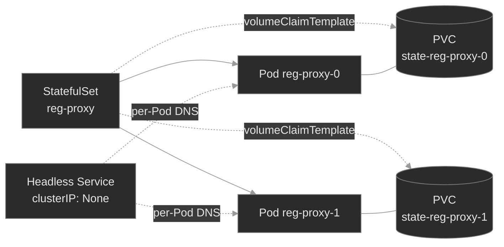

# M07 — Workloads II: StatefulSets & DaemonSets

> A Deployment treats its Pods as interchangeable. A StatefulSet gives each Pod an identity that survives restarts. A DaemonSet ties a Pod to a node instead of a replica count. Each guarantee fails quietly, and this module teaches the signature of each failure.

## What you'll learn

- State the three guarantees a **StatefulSet** adds to a Deployment: a stable ordinal name, a stable per-Pod DNS name, and stable per-Pod storage
- Trace the **headless Service** that serves the per-Pod DNS names, and recognize the failure when nobody creates it
- Read the **ordered lifecycle** (`OrderedReady`): why one un-Ready Pod stalls every ordinal behind it, and why a template fix does not repair that Pod
- Explain how the reverse-ordinal rollout and **`partition`** limit a bad update, and recover with a rollback plus a manual Pod delete
- Explain what a **DaemonSet** guarantees, and how `nodeSelector`, affinity and taints decide which nodes are eligible
- Read `DESIRED` on a DaemonSet as a coverage check, and tell a coverage gap from an unhealthy Pod

## Why it matters

A Deployment treats Pods as interchangeable. Any replica serves any request. A replacement Pod gets a random name and no memory of its predecessor. That model fits most services. It fails for two classes of workload, and a real-time platform runs both.

The first class is the replicated store. A registrar such as `reg-proxy` runs as a StatefulSet because a peer that reconnects to `reg-proxy-0` must reach the same member with the same disk. The second class is the node-local agent. A Session Border Controller such as `sbc-edge` must run on every node that terminates media, so it runs as a DaemonSet.

Both classes fail without a crash. The Pods run, no event fires, and the guarantee is absent: a name that does not resolve, a rollout that never starts the next ordinal, a node with no agent. You find these failures by checking that the guarantee held. Waiting for a red status finds nothing.

## Scope

**Covers:** the StatefulSet (ordinal identity, the governing headless Service and per-Pod DNS, `volumeClaimTemplates` and sticky PVCs, `OrderedReady` and `Parallel` pod management, `RollingUpdate` and `OnDelete` updates with `partition`, and the forced-rollback caveat); the DaemonSet (one Pod per eligible node, eligibility from selectors, affinity and tolerations, the automatic tolerations, `desiredNumberScheduled`, and the update strategies); and the signature each controller produces when its guarantee breaks.

**Doesn't cover:** Deployments, ReplicaSets and probes (M01); Jobs and CronJobs (M01b); PersistentVolumes, StorageClasses and access modes (M05); the scheduler's filters (M06); Services and cluster DNS internals (M04); leader election and quorum inside an application (M24); PodDisruptionBudgets and autoscaling (M09); StatefulSet `ordinals.start` and `maxUnavailable`; DaemonSet `maxSurge`.

**Assumes:** M01 (Pods, ReplicaSets, labels, readiness probes), M04 (a Service selects Pods; a headless Service has `clusterIP: None`), M05 (a PVC binds to a PV; `ReadWriteOnce` allows one node), and M06 (a taint repels Pods; a toleration permits them; the control-plane node carries `NoSchedule`).

## Vocabulary

| Term | Definition |
|------|------------|
| **StatefulSet** | The docs: "A StatefulSet runs a group of Pods, and maintains a sticky identity for each of those Pods." Each Pod gets an ordinal name, its own PersistentVolumeClaim (PVC, also called a claim) and a DNS name. |
| **ordinal** | The integer suffix on a StatefulSet Pod name, from 0 by default. `reg-proxy-0` has ordinal 0. A replacement Pod keeps the name, the claim and the DNS name. |
| **governing Service** | The Service named in `spec.serviceName`. It must be headless, and you create it. |
| **headless Service** | A Service with `clusterIP: None`. It has no virtual IP. Cluster DNS publishes a record for each Pod behind it. |
| **per-Pod DNS name** | `<pod>.<serviceName>.<ns>.svc.cluster.local`, with the default cluster domain. It resolves to the Pod that holds that ordinal now. |
| **`volumeClaimTemplate`** | A claim template inside the StatefulSet. The controller creates one claim per ordinal, named `<template>-<statefulset>-<ordinal>`. |
| **pod management policy** | `spec.podManagementPolicy`. `OrderedReady` (default) creates and deletes Pods in ordinal order. `Parallel` acts on all Pods at once. |
| **update strategy** | `spec.updateStrategy`. `RollingUpdate` (default) replaces Pods from the highest ordinal down. `OnDelete` replaces a Pod only when you delete it. |
| **`partition`** | A `RollingUpdate` field. Only ordinals greater than or equal to the partition receive a template change. |
| **DaemonSet** | The docs: "A DaemonSet ensures that all (or some) Nodes run a copy of a Pod." The node list sets the Pod count. |
| **eligible node** | A node whose labels match the DaemonSet's `nodeSelector` and affinity, and whose taints the Pod tolerates. |
| **`desiredNumberScheduled`** | The DaemonSet's count of eligible nodes. `kubectl get ds` prints it as `DESIRED`. |
| **automatic tolerations** | Tolerations the DaemonSet controller adds to every DaemonSet Pod. They keep the agent on unhealthy nodes. The control-plane taint is not among them. |

## Mental model

A Deployment guarantees a number of Pods somewhere. Each stronger controller guarantees something more specific, and each guarantee has its own way to fail.

Solid arrows show ownership. The StatefulSet creates each Pod, and it recreates a deleted Pod with the same name. Dotted arrows show attachments that follow the ordinal. The claim comes from the `volumeClaimTemplate`. The DNS record comes from the headless Service, which you create. The controller also enforces order: under `OrderedReady`, ordinal 1 does not exist until ordinal 0 is Ready.

A DaemonSet has no replicas to count. The node list is the replica count. The controller asks one question per node: is the node eligible?

| Controller | Guarantee | Pod names | Quiet failure |
|------------|-----------|-----------|---------------|
| Deployment | A number of Pods, anywhere | random suffix | none of these |
| StatefulSet | Named Pods, each with its own claim, created in order | `<name>-<ordinal>` | no DNS record; a stalled rollout |
| DaemonSet | One Pod per eligible node | `<name>-<random>` | a node with no Pod |

## Concept walkthrough

### The StatefulSet's three guarantees

A Deployment's ReplicaSet names its Pods with a random suffix, such as `session-broker-7d9f8-abc12`. The Pods share no identity. That suits a stateless service. It fails for a database, a broker or a registrar cache, where one member owns specific data and peers address that member by name.

The docs list what a StatefulSet adds<a href="https://kubernetes.io/docs/concepts/workloads/controllers/statefulset/">[1]</a>: "Stable, unique network identifiers", "Stable, persistent storage", "Ordered, graceful deployment and scaling", and "Ordered, automated rolling updates". The identity has three parts: "an ordinal, a stable network identity, and stable storage".

**Ordinal identity.** Pods are named `<name>-0` through `<name>-(N-1)`. Delete `reg-proxy-0` and the controller creates a new Pod with the same name. An application can rely on that. `reg-proxy-0` can be the seed that other members join.

**Stable network identity.** The StatefulSet names a governing Service in `spec.serviceName`. That Service must be headless, so it has no virtual IP. Cluster DNS publishes one record per Pod instead<a href="https://kubernetes.io/docs/concepts/services-networking/dns-pod-service/">[2]</a>. The record `reg-proxy-0.reg-proxy.signaling.svc.cluster.local` always resolves to the Pod that holds ordinal 0. Peers address one specific member this way, and no virtual IP balances the traffic.

The docs state the limit: "StatefulSets currently require a Headless Service to be responsible for the network identity of the Pods. You are responsible for creating this Service."<a href="https://kubernetes.io/docs/concepts/workloads/controllers/statefulset/#limitations">[1]</a> The controller never creates it. If the Service is missing, the Pods start, pass readiness and run, and no per-Pod record exists. Every peer lookup returns `NXDOMAIN`. A Service that has a ClusterIP, or a selector that matches no Pod, has the same effect. To diagnose it, compare `spec.serviceName` with `kubectl get svc`, then read `IP:` and the endpoints in `kubectl describe svc`.

**Stable storage.** Each entry in `volumeClaimTemplates` gives every Pod its own claim. The controller names the claims `<template>-<statefulset>-<ordinal>`, such as `state-reg-proxy-0`<a href="https://kubernetes.io/docs/concepts/workloads/controllers/statefulset/#stable-storage">[1]</a>. The claim follows the ordinal. Reschedule `reg-proxy-0` to another node and it mounts the same claim with the same data. The docs add a safety rule: "Deleting and/or scaling a StatefulSet down will _not_ delete the volumes associated with the StatefulSet."

📖 Going deeper: StatefulSet or Deployment with a PVC?<a href="https://kubernetes.io/docs/concepts/workloads/controllers/statefulset/">[1]</a>

A claim alone does not require a StatefulSet. A Deployment with one replica and one claim works, and `directory` in the fleet runs that way. Choose a StatefulSet when the workload needs at least one of three guarantees:

- **A stable name.** Members address each other by identity, or an external system pins to one replica.
- **Storage per replica that follows the replica.** Each member owns a distinct copy of the data. A Deployment with N replicas that share one `ReadWriteOnce` claim cannot schedule past the first node. `volumeClaimTemplates` gives each ordinal its own claim.
- **Ordered rollout.** The application must start or upgrade one member at a time.

Otherwise use a Deployment. It rolls out all replicas in parallel and has no ordering gate. Each StatefulSet adds a cost: slower rollouts, the forced-rollback caveat below, and storage you must track.

### Ordered lifecycle: creation, updates, and the stall that does not self-heal

The default `podManagementPolicy` is `OrderedReady`. The docs say it "enforces the sequential ordering guarantees"<a href="https://kubernetes.io/docs/concepts/workloads/controllers/statefulset/#deployment-and-scaling-guarantees">[1]</a>. The controller creates `<name>-0` and waits until it is Running and Ready. Only then does it create `<name>-1`. Scale-down runs in reverse: the highest ordinal terminates completely before the next. A clustered store often needs its seed healthy before the rest join. `Parallel` "launch[es] or terminate[s] all Pods in parallel" and keeps names and storage stable. It drops the order.

A Deployment never fails this way. It creates all replicas at once, and the healthy ones serve while a sick one waits. A StatefulSet with three replicas and an un-Ready ordinal 0 creates only ordinal 0. Ordinals 1 and 2 do not exist. `kubectl get statefulset` shows `READY 0/3`, and `kubectl get pods` shows one Pod that is `Running` and `0/1`. Look for one Pod and two absences, not for three crashing Pods. Fix the readiness of ordinal 0, and the controller creates the rest.

Updates follow the same discipline. The default `updateStrategy` is `RollingUpdate`. When the Pod template changes, the controller replaces Pods one at a time, from the highest ordinal down. It waits for each new Pod to be Ready before it touches the next<a href="https://kubernetes.io/docs/concepts/workloads/controllers/statefulset/#update-strategies">[1]</a>. The reverse order limits the damage of a bad update. The first Pod replaced is the highest ordinal. If that Pod never goes Ready, the rollout stops, and every lower ordinal keeps serving the old revision. Compare the Pods' `controller-revision-hash` label to see the split.

Two fields change this behavior:

- **`partition`** restricts the update. Ordinals greater than or equal to the partition update. Lower ordinals "will not be updated, and, even if they are deleted, they will be recreated at the previous version." Set `partition: 2` on three replicas and only ordinal 2 updates. You lower the partition to widen the canary.
- **`OnDelete`** turns automation off. The controller does not update Pods until you delete them.

**The stall that does not self-heal.** The docs warn: "When using Rolling Updates with the default Pod Management Policy (`OrderedReady`), it's possible to get into a broken state that requires manual intervention to repair."<a href="https://kubernetes.io/docs/concepts/workloads/controllers/statefulset/#forced-rollback">[1]</a> The cause is the wait rule. Before the controller acts on any ordinal, it checks that every Pod it already created is Running and Ready. A Pod that never reaches Ready blocks the controller. That includes the controller's own repair of that Pod. You correct the template, and the controller leaves the broken Pod on the old template. The repair has two steps: correct or revert the template, then delete the Pod that runs the bad template. The controller recreates the Pod from the corrected template. This applies to the creation stall and to the update halt alike.

📖 Going deeper: what happens to the claims on scale-down and delete<a href="https://kubernetes.io/docs/concepts/workloads/controllers/statefulset/#persistentvolumeclaim-retention">[1]</a>

By default, scale-down and delete both keep the claims. Scale `reg-proxy` from 3 to 1 and `state-reg-proxy-1` and `-2` remain. Scale back to 3 and the returning ordinals mount their old data. The surprise runs the other way: `kubectl delete statefulset` leaves the claims, and their volumes, in place and still allocated.

The field `persistentVolumeClaimRetentionPolicy` changes this. `whenScaled` governs scale-down, and `whenDeleted` governs deletion of the StatefulSet. Each takes `Retain` (default) or `Delete`. The feature is stable since v1.32, and beta and on by default from v1.27, so a v1.30 cluster honors it. The policy does not apply when a Pod is replaced after a node failure. Use `Retain` where the data is precious. Use `whenScaled: Delete` for a cache whose per-ordinal volume has no value once the ordinal is gone. Decide per workload, and write the choice in the manifest. The two failures "I deleted the StatefulSet and the data is still there" and "I scaled down and lost the shard" come from the same field set two ways.

### DaemonSets: one Pod per eligible node

A DaemonSet suits workloads that belong to a node, not to a service: a log collector, a node monitor, a storage daemon, a media edge<a href="https://kubernetes.io/docs/concepts/workloads/controllers/daemonset/">[3]</a>. You set no replica count. As nodes join, Pods appear on them. As nodes leave, the controller garbage-collects their Pods.

The controller decides eligibility per node, and the decision has two inputs. First, the node's labels must match the Pod template's `nodeSelector` and affinity. The docs state the default: "If you do not specify either, then the DaemonSet controller will create Pods on all nodes." Second, the Pod must tolerate the node's taints<a href="https://kubernetes.io/docs/concepts/scheduling-eviction/taint-and-toleration/">[4]</a>. For each eligible node, the controller creates a Pod whose node affinity names that node. The default scheduler then binds the Pod.

That split explains two different symptoms. An eligible node with too little free CPU or memory gets a Pod, and the Pod stays `Pending`. An ineligible node gets no Pod at all. No `Pending` Pod exists, no event fires, and nothing turns red.

`kubectl get ds` prints `DESIRED`, which is `desiredNumberScheduled`. Compare it with two numbers:

- **`DESIRED` against the nodes the agent belongs on** checks coverage. A node-local agent for every node should show the node count. An agent for fast-disk nodes should show the number of fast-disk nodes. The correct value is not always the cluster's node count.
- **`DESIRED` against `READY`** checks Pod health. `READY` below `DESIRED` means an eligible node has a Pod that is not Ready. That is a Pod problem, not a coverage problem.

Two causes produce a coverage gap, and neither leaves a trace.

**A taint the Pod does not tolerate.** kubeadm taints the control-plane node `node-role.kubernetes.io/control-plane:NoSchedule`. A DaemonSet reaches that node only with an explicit toleration, which `sbc-edge` carries. Without it, `DESIRED` is one less than the node count. Compare the node's `Taints:` line with the template's `Tolerations:` line.

**A selector that matches no node.** A `nodeSelector` such as `disktype: nvme` on a cluster whose nodes carry `disktype=ssd` gives `DESIRED 0`. The DaemonSet reports a successful rollout of zero Pods. A Deployment with the same selector would show a `Pending` Pod and a `FailedScheduling` event. Compare the selector with `kubectl get nodes -L <key>`, and correct the selector. A node label is a claim about hardware, so do not relabel a node to satisfy a Pod.

The controller adds tolerations that keep an agent running on a troubled node<a href="https://kubernetes.io/docs/concepts/scheduling-eviction/taint-and-toleration/">[4]</a>:

| Taint key | Effect |
|-----------|--------|
| `node.kubernetes.io/not-ready`, `node.kubernetes.io/unreachable` | `NoExecute` |
| `node.kubernetes.io/disk-pressure`, `memory-pressure`, `pid-pressure`, `unschedulable` | `NoSchedule` |
| `node.kubernetes.io/network-unavailable` | `NoSchedule`, only when `hostNetwork` is `true` |

DaemonSet updates use the vocabulary of a StatefulSet. `RollingUpdate` is the default. It replaces Pods under a `maxUnavailable` budget, which defaults to 1, so the agent leaves only one node at a time<a href="https://kubernetes.io/docs/tasks/manage-daemon/update-daemon-set/">[5]</a>. `OnDelete` waits for you. There is no ordering across nodes and no partition.

## Hands-on

Five baseline steps and five break/fix scenarios run on the full Polyphone fleet, on a 2-node cluster: one tainted control-plane node and one worker. The baseline reads the controllers the fleet already runs. Each break/fix layers one small workload that breaks one guarantee.

- **`baseline/`** — the fleet's StatefulSets and DaemonSet while healthy: ordinal names, the headless Service and per-Pod DNS, the per-ordinal claims, a Pod deleted and recreated with its name and data intact, and `sbc-edge` covering both nodes.
- **`breakfix-01-headless-service-missing/`** — Pods `Running`, but the per-Pod name returns `NXDOMAIN`, because nobody created the governing Service.
- **`breakfix-02-ordered-rollout-stall/`** — `READY 0/3` with one Pod, because a readiness probe targets the wrong port, plus the repair the controller does not do for you.
- **`breakfix-03-daemonset-node-coverage/`** — `DESIRED 1` on a 2-node cluster, because the DaemonSet lacks the control-plane toleration.
- **`breakfix-04-statefulset-update-halt/`** — a release with a bad image halts at the highest ordinal, and the lower ordinals keep the old revision.
- **`breakfix-05-daemonset-selector-mismatch/`** — `DESIRED 0` and no Pod, because the selector names a label no node carries.

Check yourself against `ANSWER-KEY.md` after each.

## Common failure modes

| Symptom | Likely cause | Where to look |
|---------|--------------|---------------|
| StatefulSet Pods `Running`, per-Pod name returns `NXDOMAIN` | The governing Service is missing, not headless, or selects no Pod | `kubectl get svc`; `spec.serviceName`; `IP:` and endpoints in `kubectl describe svc` |
| StatefulSet `READY 0/N`, one Pod that is `0/1` | `OrderedReady` waits on an un-Ready ordinal 0 | `kubectl describe pod <name>-0`; the readiness probe's port and path |
| Fixed the template, the broken Pod does not change | The controller does not replace an un-Ready Pod on its own | Delete the Pod after the template is correct |
| Rollout stops at the highest ordinal; lower ordinals on the old revision | The updated Pod never went Ready (bad image or config) | `kubectl get pods -L controller-revision-hash`; `describe pod` events |
| A middle ordinal `Pending` | Its claim cannot bind, or its volume is on another node | `kubectl get pvc`; `describe pod` events (M05, M06) |
| Storage survived a delete, or data vanished after a scale-down | `persistentVolumeClaimRetentionPolicy` is `Retain` or `Delete` | The policy field; `kubectl get pvc` |
| DaemonSet `DESIRED` below the nodes it belongs on | A taint the Pod does not tolerate, or a selector no node matches | `kubectl describe node`, `Taints:`; the template's `Tolerations:` and `Node-Selectors:` |
| DaemonSet `READY` below `DESIRED` | An eligible node has a Pod that is not Ready, or is `Pending` | `kubectl get pods -o wide`; `describe pod` on that node's Pod |

## Recap

- **A StatefulSet fixes what a Deployment leaves loose.** Ordinal names, per-Pod DNS names and per-Pod claims all stick to the ordinal across restarts. Use one only when the workload needs a guarantee. Otherwise a Deployment is simpler and faster.
- **Network identity is the headless Service's job, and you create the Service.** Without it the Pods run and every per-Pod name returns `NXDOMAIN`.
- **`OrderedReady` makes an un-Ready Pod block the controller, including its repair of that Pod.** The same wait rule explains a creation stall and a halted update. Correct the template, then delete the Pod. The reverse-ordinal order and `partition` keep the damage to the highest ordinals.
- **A DaemonSet guarantees one Pod per eligible node.** Eligibility needs a matching selector and a tolerated taint. `DESIRED` counts eligible nodes, so it is the coverage check. Compare it with the nodes the agent belongs on, not always with the node count.
- **These controllers fail with a healthy-looking status.** `Running` is not identity, and a completed rollout of zero Pods is not coverage. This is the same lesson as `Running` versus `Ready` in M01. Verify that the guarantee held.

## Production thinking

- A cache runs as a 5-replica StatefulSet. During an incident you scale it to 2, and an hour later back to 5. Two members return with empty volumes, or with full ones. Which setting decided that, what does each choice do to your storage bill during the scale-down, and how do you decide per workload?
- You add a security agent as a DaemonSet and it rolls out clean, with `DESIRED` equal to `CURRENT`. Weeks later an audit finds the control-plane nodes were never covered. What explains the gap, and which check in monitoring or CI would have caught "fewer Pods than nodes that need one"?
- You push a new image to a 5-replica StatefulSet. Ordinal 4 crash-loops, and ordinals 0 to 3 stay on the old image. Why did `RollingUpdate` stop, how would `partition` have contained the release, and how do you recover ordinal 4 without disturbing the members that serve traffic?

## References

1. Kubernetes — StatefulSets: https://kubernetes.io/docs/concepts/workloads/controllers/statefulset/
2. Kubernetes — DNS for Services and Pods: https://kubernetes.io/docs/concepts/services-networking/dns-pod-service/
3. Kubernetes — DaemonSet: https://kubernetes.io/docs/concepts/workloads/controllers/daemonset/
4. Kubernetes — Taints and Tolerations: https://kubernetes.io/docs/concepts/scheduling-eviction/taint-and-toleration/
5. Kubernetes — Perform a Rolling Update on a DaemonSet: https://kubernetes.io/docs/tasks/manage-daemon/update-daemon-set/
