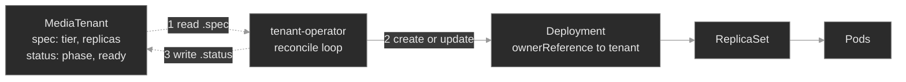

# M08 — CRDs & Operators

> The API server ships with a fixed vocabulary: Pods, Deployments, Services. A CustomResourceDefinition adds your own types to it. An operator is the program that gives those types meaning. Everything above the built-ins arrives this way, and it fails without a crash.

## What you'll learn

- Explain what a **CRD** does: it registers a new resource type, with a schema, so a custom resource gets `kubectl`, RBAC and admission validation like a built-in
- Read a **custom resource**: `.spec` is the state you declare, and `.status` is the state a controller writes through a separate subresource
- Describe the **controller** and **operator** pattern: a level-triggered reconcile loop, and an operator as a custom controller plus its CRD
- Read operator-managed state during an incident from three places: the custom resource's `.status`, its child objects and the operator's logs
- Tell the causes of **stuck reconciliation** apart: the controller is down, its RBAC forbids the write, or it reads a CRD version the API no longer serves
- Trace **owner references** and **finalizers**: how the garbage collector deletes a tree, how a missing reference leaves an orphan, and how a finalizer holds an object in `Terminating`

## Why it matters

Every capability above the built-in types arrives as an operator. Cert-manager issues certificates from a `Certificate` object. The Prometheus operator turns a `ServiceMonitor` into scrape configuration. External Secrets copies a secret from a vault. Each one pairs a CRD that adds a type with a controller that makes the cluster match it. You will run many operators and write few, so the skill that matters is reading one under pressure.

At Polyphone the platform team ships an operator so product teams do not write infrastructure by hand. A team that needs media capacity creates a **MediaTenant**, a custom resource that declares a tier and a replica count. The **tenant-operator** creates a correctly sized Deployment, links it to the tenant and reports progress in the tenant's `.status`. Intent goes in and capacity comes out.

Operators fail in ways that built-in controllers do not, and they fail quietly. A stalled operator's Pod stays `Running` while nothing it manages progresses. The API server rejects a schema-invalid resource before any controller sees it. A child survives the cleanup that should have removed it, and a delete hangs forever. None of these turns a status red. You catch them by checking that each link of the chain held: type, loop, version, owner reference and finalizer.

## Scope

**Covers:** the **CustomResourceDefinition** (group, version and kind, plural and scope, the structural **schema**, **pruning**, the `Established` condition, `served` and `storage` versions); the **custom resource** (the `.spec` and `.status` split, the status subresource); the **controller** and **operator** pattern (level-triggered reconciliation, reading operator-managed state, the three causes of stuck reconciliation); **owner references** (controller references, cascading deletion policies, orphans); and **finalizers**.

**Doesn't cover:** writing an operator (Go, controller-runtime, Kubebuilder, work queues) because this module teaches reading one; admission **webhooks**, **CEL** validation rules and conversion webhooks beyond a mention; aggregated API servers; the full **RBAC** model → M10; Helm or Kustomize packaging → M16, M17; specific operators: Prometheus → M13, cert-manager → M12, External Secrets → M11.

**Assumes:** M00 (every object has `spec` and `status`; group, version and kind; `kubectl get`, `describe` and `explain`) and M01 (a Deployment owns a ReplicaSet, which owns Pods; built-in controllers reconcile). ServiceAccounts and RBAC appear here on first use and get full treatment in M10.

## Vocabulary

| Term | Definition |
|------|------------|
| **CustomResourceDefinition (CRD)** | An object that registers a new resource type with the API server. Its name is `<plural>.<group>`, such as `mediatenants.polyphone.example`. After registration the API server serves the type like a built-in. |
| **custom resource (CR)** | The docs: "an extension of the Kubernetes API that is not necessarily available in a default Kubernetes installation." In practice, one object of the type a CRD defines. |
| **group / version / kind** | The three-part identity of a resource type, as in `apps/v1` `Deployment`. A CRD declares its own group, its versions and its kind. |
| **structural schema** | The OpenAPI v3 schema in a CRD. The API server validates every custom resource against it before it stores the object. |
| **pruning** | The API server removes fields that the schema does not list, before it stores the object. |
| **`Established`** | A CRD condition. When it is `True`, the API server serves the type. |
| **served / storage version** | `served: true` means the API accepts requests at that version. Exactly one version has `storage: true`: the form the API server writes to etcd. |
| **controller** | A control loop that watches a resource type and moves the cluster toward each object's declared state. |
| **operator** | The docs: "software extensions to Kubernetes that make use of custom resources to manage applications and their components." In short, a custom controller plus its CRDs. |
| **reconcile loop** | The controller's repeated cycle: read `.spec`, observe the cluster, act to close the gap, report in `.status`. |
| **level-triggered** | The loop acts on the current difference between desired and observed state, not on a one-time event. A missed event heals on the next pass. |
| **status subresource** | A separate write path, `/status`, enabled in the CRD. The controller writes `.status` there, and a normal `apply` of the object cannot change it. |
| **owner reference** | A `metadata.ownerReferences` entry on a child (the docs say *dependent*). It names the owner by kind, name and **uid**. With `controller: true` it marks the one managing owner. |
| **garbage collector** | The control-plane process that deletes objects whose owners are gone. |
| **orphan** | A child whose owner is gone and which still exists. It has no owner reference, or the deletion used the orphan policy. |
| **finalizer** | A key in `metadata.finalizers`. The API server does not remove an object while its list holds a key. It sets `deletionTimestamp` and waits for a controller to remove the key. |

## Mental model

A **CRD teaches the API server a new noun.** Register `MediaTenant`, and the server stores, validates, versions and serves tenants, with RBAC and `kubectl` treating them like built-ins. A noun alone does nothing. Creating a tenant changes no cluster state, just as a Deployment would do nothing with no Deployment controller running. The **operator is the verb**: a control loop that makes each tenant mean a running Deployment.

The loop is **level-triggered**<a href="https://kubernetes.io/docs/concepts/architecture/controller/">[4]</a>. It does not handle "a tenant was created" as an event. On each pass it asks whether reality matches every tenant's `.spec`, and it closes the gap it finds. A healthy operator therefore repairs drift. Delete a child, and the next pass recreates it.

One turn of the loop has three steps. The operator reads each tenant's `.spec` (1). It creates or updates the child Deployment to match (2). It writes what it observed into `.status` (3). The Deployment owns its ReplicaSet and the ReplicaSet owns the Pods, so the whole tree hangs from the custom resource. The ownerReference is the link that makes cascading deletion work. Read it in the other direction and it is a map: from any child, find its owner.

Five links can fail, and each leaves a different signature. The **type** can reject a resource. The **loop** can stall because the controller is down or forbidden. The **version** the loop reads can be unserved. The **owner link** can be missing, which leaves an orphan. A **finalizer** can hold a delete. Check the links in that order, because each check is cheap and each failure looks like a healthy cluster.

## Concept walkthrough

### The type: CRDs, schemas and versions

A **CustomResourceDefinition** is an object you apply like any other, and applying it makes the API server serve a new type<a href="https://kubernetes.io/docs/concepts/extend-kubernetes/api-extension/custom-resources/">[1]</a>. The CRD declares the group, the versions, the kind, the plural and short names, and the `scope` (`Namespaced` or `Cluster`). The name must be `<plural>.<group>`<a href="https://kubernetes.io/docs/tasks/extend-kubernetes/custom-resources/custom-resource-definitions/">[2]</a>.

Registration takes a moment. The API server sets the `Established` condition to `True` when it serves the type. Before then, `kubectl get mediatenants` fails with "the server doesn't have a resource type", the same message as a typo. When a custom type "does not exist", check that the CRD is installed and `Established`.

The **structural schema** makes a custom resource more than free-form data. The schema lists each field's type and limits: `spec.tier` is a string from the enum `gold`, `silver`, `bronze`, and `spec.replicas` is an integer from 1 to 5. The API server validates every object against the schema at admission. The API server rejects a value outside the enum, never stores the object, and names the field in the error. `kubectl explain` reads the same schema, so it shows what a valid object looks like.

The schema also controls **pruning**. The docs: "if you specify a field that the API server does not recognize, the unknown field is pruned (removed) before being persisted."<a href="https://kubernetes.io/docs/tasks/extend-kubernetes/custom-resources/custom-resource-definitions/#field-pruning">[2]</a> A misspelled or mis-nested optional field is dropped without an error. Recent `kubectl` versions reject unknown fields by default, but a GitOps controller or a client library may not request that check. If a setting "has no effect", compare the stored object with the manifest.

A CRD can serve several **versions** at once. Each version sets `served`, and exactly one sets `storage`<a href="https://kubernetes.io/docs/tasks/extend-kubernetes/custom-resources/custom-resource-definition-versioning/">[8]</a>. A request at a version that is not served fails, whatever the stored data holds. The docs' procedure for retiring a version says to migrate every client first, because "if any clients are still unexpectedly using the old version they may begin reporting errors." An operator that reads `v1` while a release serves only `v2` fails on every list call. The Pod stays `Running` and the RBAC is correct. Compare the version in the operator's logs with the `Served:` lines in `kubectl describe crd`. Upgrade an operator and its CRD together, and keep serving a version until no consumer uses it. The immediate repair is to serve the old version again.

📖 Going deeper: deleting a CRD, and storage versions<a href="https://kubernetes.io/docs/tasks/extend-kubernetes/custom-resources/custom-resource-definitions/">[2]</a>

Deleting a CRD is destructive. The docs: "When you delete a CustomResourceDefinition, the server will uninstall the RESTful API endpoint and delete all custom objects stored in it." Every tenant, certificate or scrape rule of that type disappears with it. A `helm uninstall` that removes a chart's CRDs does the same. Treat a CRD delete like a database drop, and back up the custom resources first.

The storage version decides how objects sit in etcd. When a CRD changes its storage version, objects written earlier stay in the old form until something rewrites them. `status.storedVersions` on the CRD lists every version that has stored objects. Remove an old version from `spec.versions` only after that list shows the old version is gone, or the API server cannot read those objects. With the default `None` conversion, the server changes only the `apiVersion` of an object, which is safe while the schemas match. A schema change between versions needs a conversion webhook.

### The controller pattern: reconciliation and stalls

A **controller** watches a resource type and moves the cluster toward each object's declared state<a href="https://kubernetes.io/docs/concepts/architecture/controller/">[4]</a>. You already depend on dozens: the Deployment controller turns Deployments into ReplicaSets, and the Job controller runs Pods to completion. An **operator** applies the same idea to a custom type<a href="https://kubernetes.io/docs/concepts/extend-kubernetes/operator/">[3]</a>. The pattern has no extra part. An operator is a custom controller and its CRD.

Each pass repeats the three steps in the diagram: read `.spec` and observe the cluster, act, and report. The report step is where an operator talks back. A well-behaved controller writes `.status` through the status subresource<a href="https://kubernetes.io/docs/tasks/extend-kubernetes/custom-resources/custom-resource-definitions/#status-subresource">[2]</a>. You write the desired half, and the controller writes the observed half. Neither overwrites the other. Reading **operator-managed state** means reading three places together: the `.status` (what the operator claims), the child objects (what exists) and the operator's **logs** (what it tried, and what stopped it). When they agree, the operator is healthy. A gap shows where the fault is.

**Stuck reconciliation** is the failure that misleads people. The operator Pod is `Running` with no restarts, and the controller makes no progress. Pod status says the program is alive. It says nothing about the loop. Work through three causes:

1. **The controller is down.** A crash loop or a scale to zero shows in `kubectl get pods`. Custom resources keep their last-written `.status`, so the data looks plausible while nothing updates it.
2. **The controller is forbidden.** It runs as a ServiceAccount, the identity a Pod uses to call the API. If that identity's role lacks a verb, every attempt returns a `403`. The tenants stay `Provisioning`, the logs repeat `Forbidden`, and `kubectl auth can-i --as=system:serviceaccount:<ns>:<name>` returns `no`.
3. **The controller reads a version the API does not serve.** The tenants show blank `.status`, the logs repeat a list error that names the version, and `auth can-i` returns `yes`. The CRD's `Served:` flags explain it.

The `auth can-i` check separates causes 2 and 3 in one command, and the logs name the cause in both.

### Owner references and the object graph

When the operator creates a child, it sets an **ownerReference** on the child that points at the custom resource<a href="https://kubernetes.io/docs/concepts/overview/working-with-objects/owners-dependents/">[5]</a>. The reference holds the owner's kind, name and **uid**. The uid pins it to that one object, so a new object that reuses the name does not match. The field `controller: true` marks the single managing owner. The docs state that a namespaced owner "must exist in the same namespace as the dependent", and that "cross-namespace owner references are disallowed by design." A cluster-scoped owner may have namespaced dependents.

The main job of an owner reference is **cascading deletion**. When you delete an owner, the **garbage collector** finds every object whose `ownerReferences` names it, and deletes those objects<a href="https://kubernetes.io/docs/concepts/architecture/garbage-collection/">[6]</a>. You do not delete an operator's children by hand. You delete the custom resource, and the tree goes with it. By default Kubernetes uses background cascading deletion: the owner goes first and the collector removes dependents afterwards. `--cascade=foreground` removes the dependents that block deletion before the owner, and `--cascade=orphan` leaves them behind on purpose<a href="https://kubernetes.io/docs/tasks/administer-cluster/use-cascading-deletion/">[9]</a>.

The failure is a missing reference. A child created without an ownerReference, by hand or by an older operator, gives the collector nothing to follow. Delete the child's logical owner and the child stays, as a silent **orphan** that holds resources for something that no longer exists. Nothing errors. You find orphans by comparing a suspect child's `ownerReferences` with a managed sibling's, and by looking for children whose named owner is gone. The reverse case is a reference to a uid that no longer exists. The docs say the dependent "is subject to deletion once all owners are verified absent", so a child that points at a deleted owner's old uid is deleted too.

### Finalizers: deletes that wait

Owner references handle cascade. **Finalizers** handle cleanup that must finish before an object may disappear<a href="https://kubernetes.io/docs/concepts/overview/working-with-objects/finalizers/">[7]</a>. A finalizer is a key in `metadata.finalizers`. When you delete an object that has one, the API server sets `metadata.deletionTimestamp`, keeps the object and returns `202 Accepted`. The controller that manages the key notices the timestamp, does its cleanup, such as deregistering an external load balancer, and removes the key. The API server deletes the object when the last key is gone.

That is why `kubectl delete` sometimes hangs, and the object reads `Terminating`. The usual cause is a controller that no longer runs: someone uninstalled the operator, scaled it to zero or crashed it, and nobody removes the key. A namespace delete wedges the same way while the namespace holds such an object. During the hang the object's children keep running, because cascading deletion starts only when the owner is gone.

Diagnose it with `kubectl describe`: read `Deletion Timestamp:` and `Finalizers:` in the metadata, then find the controller that owns that key. The safe fix restores that controller, so it runs its cleanup and removes its own key. You can also remove the key by hand with `kubectl patch`. The docs warn against it: "avoid manually removing finalizers to allow deletion to continue." It deletes the object at once and skips whatever the finalizer guarded, so an external resource can leak. Use it only when you know the cleanup is done another way.

## Hands-on

Five baseline steps and five break/fix scenarios run on the full Polyphone fleet on a 2-node cluster: one tainted control-plane node and one worker. They add the `MediaTenant` CRD, the `tenant-operator` and two tenants. The baseline tours a healthy operator, and each break/fix breaks one link.

- **`baseline/`** — the CRD as a registered type, the two tenants with the `.spec` and `.status` split, the operator and its children, the owner references, and a tour of self-healing and cascading deletion.
- **`breakfix-01-cr-schema-rejected/`** — a new tenant never appears, because its tier is outside the CRD's enum and admission rejects it.
- **`breakfix-02-reconcile-stuck-rbac/`** — the operator is `Running` and every tenant stays `Provisioning`, because its ServiceAccount cannot create Deployments.
- **`breakfix-03-unserved-crd-version/`** — the operator is `Running` and the tenants have blank status, because it reads a CRD version that a release stopped serving.
- **`breakfix-04-orphaned-owner-reference/`** — an offboarded tenant's Deployment still runs, because it carries no ownerReference.
- **`breakfix-05-finalizer-stuck-terminating/`** — a deleted tenant never disappears, because its finalizer's controller is scaled to zero.

Check yourself against `ANSWER-KEY.md` after each.

## Common failure modes

| Symptom | Likely cause | Where to look |
|---------|--------------|---------------|
| `kubectl get <kind>` returns "the server doesn't have a resource type" | The CRD is missing, not `Established`, or you typed the wrong plural or group | `kubectl get crd`; `kubectl api-resources`; the CRD's conditions |
| A custom resource will not apply: validation error | The object violates the schema: enum, type or a missing `required` field | The error message; `kubectl explain <kind>.spec`; the CRD's schema |
| The object applies, and a field has no effect | Pruning dropped a field that the schema does not list | `kubectl get <kind> -o yaml` against your manifest; the CRD's schema |
| Custom resources sit at `Provisioning`, no children, logs repeat `Forbidden` | The operator's role lacks a verb | Operator logs; `kubectl auth can-i --as=`; `kubectl describe clusterrole` |
| Custom resources have blank `.status`, no children, logs repeat a list error | The operator reads a version the CRD does not serve | Operator logs; `Served:` lines in `kubectl describe crd` |
| Custom resources keep an old `.status` and nothing updates it | The operator is down or scaled to zero | `kubectl get pods`; `kubectl get deployment` in the operator's namespace |
| A child keeps running after its custom resource was deleted | The child has no ownerReference, or the delete used `--cascade=orphan` | The child's `metadata.ownerReferences`; compare with a managed sibling |
| `kubectl delete` hangs; the object reads `Terminating` | A finalizer whose controller does not run | `Deletion Timestamp:` and `Finalizers:` in `kubectl describe`; the controller that owns the key |
| A child disappears soon after creation | A stale ownerReference: the uid names an owner that no longer exists | The child's `ownerReferences[].uid` against the owner's `metadata.uid` |

## Recap

- **A CRD adds a type, and an operator gives it meaning.** The CRD registers a type that the API server validates and `kubectl` serves. The controller is a level-triggered loop that makes instances of the type do something. An operator is a custom controller plus its CRD.
- **A schema is real validation, and it also prunes.** Admission rejects an invalid object and never stores it. A field that the schema does not list is dropped without an error.
- **An operator's Pod status is not its reconciliation status.** A `Running` operator can make no progress. Read the `.status`, the child objects and the logs, then separate the three causes: down, forbidden or reading an unserved version.
- **Owner references are the thread cascading deletion follows.** The garbage collector deletes dependents when the owner goes. A missing reference leaves an orphan, and a stale uid can delete a child early.
- **A finalizer is a promise of cleanup.** A delete that hangs points at the controller that owns the key. Restore that controller, and use a hand patch only when you know the cleanup is done.

## Production thinking

- An operator you did not write has left a custom resource at `Provisioning` for an hour. Order your checks and say why: `.status` and conditions, then events, then the operator's logs, then its ServiceAccount's permissions, then the CRD's served versions. Which check does the instinct "the Pod is Running, so it is fine" skip?
- A namespace has hung in `Terminating` for an hour on one custom resource with a finalizer, and the operator that owned the key was uninstalled last week. What blocks the delete, why can the namespace not finish, what is the safe fix, and what does a hand patch of the finalizer cost?
- A new platform capability could be a CRD with an operator, or a Helm chart of built-in objects. What does an operator add (continuous reconciliation, drift repair, encoded day-2 knowledge, a typed API), and what does it cost (a controller to run and upgrade, its RBAC, version discipline for the CRD)? Name one case where it is clearly worth it and one where it is over-engineering.

## References

1. Kubernetes — Custom Resources: https://kubernetes.io/docs/concepts/extend-kubernetes/api-extension/custom-resources/
2. Kubernetes — Extend the Kubernetes API with CustomResourceDefinitions: https://kubernetes.io/docs/tasks/extend-kubernetes/custom-resources/custom-resource-definitions/
3. Kubernetes — Operator pattern: https://kubernetes.io/docs/concepts/extend-kubernetes/operator/
4. Kubernetes — Controllers: https://kubernetes.io/docs/concepts/architecture/controller/
5. Kubernetes — Owners and Dependents: https://kubernetes.io/docs/concepts/overview/working-with-objects/owners-dependents/
6. Kubernetes — Garbage Collection: https://kubernetes.io/docs/concepts/architecture/garbage-collection/
7. Kubernetes — Finalizers: https://kubernetes.io/docs/concepts/overview/working-with-objects/finalizers/
8. Kubernetes — Versions in CustomResourceDefinitions: https://kubernetes.io/docs/tasks/extend-kubernetes/custom-resources/custom-resource-definition-versioning/
9. Kubernetes — Use Cascading Deletion in a Cluster: https://kubernetes.io/docs/tasks/administer-cluster/use-cascading-deletion/
