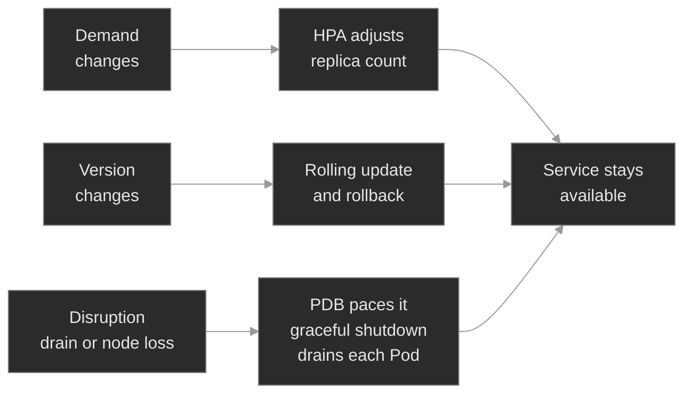

# M09 — Resilience & Autoscaling

> How Kubernetes keeps a service available while demand, versions, and nodes change, and how each control fails without raising an alarm.

## What you'll learn

- Name the three kinds of change a running service faces (demand, version, disruption) and the control for each
- Read a **HorizontalPodAutoscaler**: how it turns a metric into a replica count, why utilization is a percentage of the request, and what can stop replicas from appearing after the HPA asks for them
- Tell the four autoscalers apart by the axis each moves: HPA (replica count), VPA (Pod size), Cluster Autoscaler or Karpenter (nodes), KEDA (events)
- Drive a **rolling update** with `maxSurge` and `maxUnavailable`, read a stalled rollout, and recover it with `rollout undo`
- Compute a **PodDisruptionBudget**'s allowed disruptions and name each cause of a zero
- Trace **graceful shutdown** (endpoint removal, `preStop`, `SIGTERM`, grace period, `SIGKILL`) and find a Pod that ignores `SIGTERM`

## Why it matters

Kubernetes maintains availability against a constant stream of changes. Traffic doubles at the top of the hour. A release ships every afternoon. A node drains for a CVE patch on someone else's schedule. Each change can drop calls, and Kubernetes has one control for each.

Those controls are quiet when healthy and quiet when broken. An HPA that reads `<unknown>` raises no alert. It fails to add capacity during the surge, and the first symptom is latency. A budget set one too high breaks nothing today. Three weeks later it blocks a drain, and the on-call engineer watches a hung `kubectl drain` at 03:00. Read each control's own status instead of waiting for the downstream page.

## Scope

**Covers:** the HorizontalPodAutoscaler (control loop, resource-metrics pipeline, utilization against the request, scaling damping, and the path from desired replicas to running Pods); the autoscaler family (Cluster Autoscaler, Karpenter, VPA, KEDA) by the axis each moves; Deployment rolling updates, rollback, and the stalled rollout; PodDisruptionBudgets (voluntary and involuntary disruption, allowed disruptions, healthy-Pod counting, the eviction API, node drain); graceful shutdown.

**Doesn't cover:** installing the autoscalers (metrics-server is pre-installed; Cluster Autoscaler, VPA, and KEDA need infrastructure a lab cluster lacks); custom and external HPA metrics → M13; HPA `behavior` tuning beyond the defaults; PriorityClass and preemption; probe and `preStop` mechanics → M01; `minReadySeconds`, pause and resume, and traffic-split canaries → M15.

**Assumes:** M01 (Deployments, ReplicaSets, readiness probes, `terminationGracePeriodSeconds`), M06 (a resource request is the scheduler's reservation, and here it is also the autoscaler's 100%), and M00 fluency (`get → describe → events`).

## Vocabulary

| Term | Definition |
|------|------------|
| **HorizontalPodAutoscaler (HPA)** | "A HorizontalPodAutoscaler automatically updates a workload resource" to match demand<sup><a href="https://kubernetes.io/docs/tasks/run-application/horizontal-pod-autoscale/">[1]</a></sup>. It changes the replica count, never the Pod template. |
| **resource-metrics pipeline** | metrics-server scrapes live CPU and memory from each kubelet and serves them on the metrics API. The HPA reads that API. |
| **utilization** | "The ratio between the current usage of resource to the requested resources of the pod"<sup><a href="https://kubernetes.io/docs/tasks/run-application/horizontal-pod-autoscale/">[1]</a></sup>. The request is the denominator. |
| **ResourceQuota** | A namespace-level cap, enforced at admission, on object counts or summed requests. A Pod over the cap is never created<sup><a href="https://kubernetes.io/docs/concepts/policy/resource-quotas/">[2]</a></sup>. |
| **Cluster Autoscaler / Karpenter** | Node autoscalers. They add nodes for unschedulable Pods and remove idle nodes. |
| **Vertical Pod Autoscaler (VPA)** | Changes a workload's requests and limits from observed usage. It does not change the replica count. |
| **KEDA** | Event-driven autoscaling on external signals (queue depth, stream lag, cron). It can scale to zero. |
| **rolling update** | The default Deployment update. It replaces Pods gradually, bounded by `maxSurge` and `maxUnavailable`. |
| **revision** | One stored Pod template, kept as a ReplicaSet. `kubectl rollout undo` re-applies a previous revision. |
| **progressDeadlineSeconds** | Seconds without progress before the Deployment reports `Progressing=False` with reason `ProgressDeadlineExceeded`. Default 600. |
| **voluntary / involuntary disruption** | "We call other cases voluntary disruptions" (a drain, an upgrade, a scale-down). Involuntary cases are unavoidable (a node crash)<sup><a href="https://kubernetes.io/docs/concepts/workloads/pods/disruptions/">[7]</a></sup>. |
| **PodDisruptionBudget (PDB)** | "A PDB limits the number of Pods of a replicated application that are down simultaneously from voluntary disruptions"<sup><a href="https://kubernetes.io/docs/concepts/workloads/pods/disruptions/">[7]</a></sup>. |
| **healthy Pod (PDB)** | A Pod whose `Ready` condition is `True`. Only healthy Pods count toward the budget. |
| **allowed disruptions** | `currentHealthy − desiredHealthy`, floored at 0. The number of Pods the budget lets go now. |
| **eviction API** | The Pod subresource that `kubectl drain` and node autoscalers call. It checks PDBs before it deletes. |
| **graceful shutdown** | The termination sequence: `preStop` hook, `SIGTERM`, wait up to the grace period, `SIGKILL`. |

## Mental model

Three kinds of change hit a running fleet. Each has one control that keeps availability flat.



Two facts make this model pay off. First, each control has a signature failure that stays silent until its change arrives. A broken HPA looks fine until the surge. A bad budget looks fine until the drain. A stalled rollout looks fine because the old version still serves. So read the control's own state: `kubectl get hpa`, `kubectl get pdb`, `kubectl rollout status`.

Second, the controls share inputs with the scheduler. One request field sets placement and sets the HPA's 100%. A rolling update terminates Pods, a PDB paces how many go at once during a drain, and graceful shutdown decides whether each termination drops traffic. They are the same primitives (replicas, requests, ReplicaSets, reconciliation) under different controllers.

## Concept walkthrough

### Autoscaling: replica count follows load

**Rule.** The HPA changes a workload's replica count to hold the average metric per Pod near a target. It never creates Pods. It writes the replica field, and the ReplicaSet does the rest.

About every 15 seconds (the default sync period) the HPA reads the metric, computes the desired count, and clamps it between `minReplicas` and `maxReplicas`<sup><a href="https://kubernetes.io/docs/tasks/run-application/horizontal-pod-autoscale/">[1]</a></sup>:

```text
desiredReplicas = ceil( currentReplicas × currentMetricValue ÷ desiredMetricValue )
```

Four Pods at 80% CPU against a 50% target give ceil(4 × 80 ÷ 50) = 7. Three damping rules keep the count calm. The HPA skips a change when the ratio sits within a tolerance of 1.0 (0.1 by default), so 52% against 50% does nothing. Scale-down waits out a 5-minute stabilization window, while scale-up has none. On scale-up the HPA counts Pods that are not yet Ready as using 0% of the request, which prevents a runaway when new Pods start slowly.

**Utilization is usage divided by the request.** metrics-server supplies the numerator, and the container's `resources.requests` supplies the denominator. With no CPU request on a container, "CPU utilization for the Pod will not be defined and the autoscaler will not take any action for that metric"<sup><a href="https://kubernetes.io/docs/tasks/run-application/horizontal-pod-autoscale/">[1]</a></sup>. The HPA reports `<unknown>`, sets `ScalingActive=False`, and holds the current count. In v1.30 the condition message names the gap: `missing request for cpu in container app of Pod <name>`. The metrics pipeline can be healthy while this happens. The same request is the scheduler's reservation (M06) and the autoscaler's yardstick, so a request set too low makes the workload look busy and over-scales it.

**A desired count is not a running count.** The HPA writes replicas and moves on. Between that number and a serving Pod sit the ReplicaSet, admission, the scheduler, and a node. A ResourceQuota can refuse the Pod at admission, so the ReplicaSet reports `FailedCreate` and the Deployment holds fewer Ready Pods than the HPA wants<sup><a href="https://kubernetes.io/docs/concepts/policy/resource-quotas/">[2]</a></sup>. A full node leaves Pods `Pending` with `FailedScheduling`. The HPA looks healthy in both cases: `describe hpa` shows ScalingActive and a desired count above the current one. When `get deploy` is short of that count, walk down the chain.

Two operational rules close the section. Remove `spec.replicas` from any manifest an HPA manages, or the next `kubectl apply` or GitOps sync resets the count the HPA chose. And `<unknown>` has a second cause: no Running Pod, so no metrics to read.

<details>
<summary>📖 Going deeper: the four autoscalers and the axis each moves<sup><a href="https://kubernetes.io/docs/concepts/cluster-administration/node-autoscaling/">[3]</a></sup></summary>

The axes are orthogonal, and reaching for the wrong one wastes an incident.

- **HPA adds replicas.** It suits stateless request-serving workloads and needs a request for resource metrics.
- **VPA resizes Pods.** It adjusts requests and limits from observed usage<sup><a href="https://github.com/kubernetes/autoscaler/tree/master/vertical-pod-autoscaler">[4]</a></sup>. Older update modes recreate Pods to apply a change. Current VPA releases can resize in place first and recreate only as a fallback. Do not run VPA and HPA on the same resource: one grows the Pods while the other multiplies them. VPA fits workloads you cannot shard.
- **Cluster Autoscaler and Karpenter add nodes.** They react to `Pending` Pods that no node can fit, and they remove underused nodes through the eviction API, so PDBs apply. They pair with the HPA: the HPA asks for Pods and the node autoscaler supplies room.
- **KEDA scales on events, including to zero.** Resource metrics cannot see a queue backlog. KEDA scales on external signals and manages an HPA underneath<sup><a href="https://keda.sh/docs/latest/concepts/">[5]</a></sup>. It suits queue consumers and bursty work.

</details>

### Rolling updates and rollback: changing versions without downtime

**Rule.** During a rolling update the Deployment keeps at least `replicas − maxUnavailable` Pods available and creates at most `replicas + maxSurge` Pods.

Both settings default to 25%<sup><a href="https://kubernetes.io/docs/concepts/workloads/controllers/deployment/">[6]</a></sup>. `maxSurge` rounds up and `maxUnavailable` rounds down. With 2 replicas that gives a surge of 1 and an unavailable count of 0. The Deployment scales a new ReplicaSet up and the old one down, within those bounds at every step. A new Pod counts as available once it is Ready. Each template change is a numbered **revision**, and `revisionHistoryLimit` (default 10) bounds how many the Deployment keeps.

**A bad release stalls instead of crashing the service.** An image that will not pull, a crash loop, or a readiness probe that never passes leaves the new Pods unready. The Deployment cannot retire more old Pods than `maxUnavailable` allows, so it stops. With `maxUnavailable` of 0 every old Pod keeps serving. With a larger fleet the controller first retires up to `maxUnavailable` old Pods, so capacity drops by that amount before the stall. Read the stall on the Deployment (`UP-TO-DATE` below `READY`, `rollout status` waiting) and on the new ReplicaSet's Pods.

After `progressDeadlineSeconds` the Deployment reports `Progressing=False` with reason `ProgressDeadlineExceeded`. That is a report only: "Kubernetes takes no action on a stalled Deployment" beyond the status condition<sup><a href="https://kubernetes.io/docs/concepts/workloads/controllers/deployment/">[6]</a></sup>. A person or a pipeline must act.

**Recovery is `kubectl rollout undo`.** It re-applies the previous revision's Pod template and rolls forward to it, so a rollback is a rolling update aimed at an older revision. Only the template is restored. A replica count set by an HPA or by `kubectl scale` stays. `rollout status` blocks until the rollout lands. `rollout history` lists revisions, and `rollout undo --to-revision=N` picks one. `Recreate` is the other strategy: it stops all old Pods before it starts new ones, so use it only when two versions cannot run together.

### Disruption budgets: pacing voluntary disruption

**Rule.** A PodDisruptionBudget limits how many Pods of a workload voluntary disruption may take down at once. It binds only callers that use the eviction API.

You set `minAvailable` (a floor) or `maxUnavailable` (a ceiling), as an integer or a percentage<sup><a href="https://kubernetes.io/docs/tasks/run-application/configure-pdb/">[8]</a></sup>. Percentages round up. `maxUnavailable` works only for workloads with a controller that exposes a scale subresource, such as a Deployment or StatefulSet. The disruption controller turns the setting into status:

```text
allowed disruptions = currentHealthy − desiredHealthy   (floored at 0)
```

`currentHealthy` counts Ready Pods. `desiredHealthy` is `minAvailable`, or `expectedPods − maxUnavailable`. With 2 healthy replicas and `minAvailable: 1`, the budget allows 1. `kubectl get pdb` shows `ALLOWED DISRUPTIONS`, and `kubectl describe pdb` shows the inputs as `Current`, `Desired`, and `Total` (the status fields `currentHealthy`, `desiredHealthy`, and `expectedPods`).

**The eviction API enforces the budget.** `kubectl drain` evicts Pods, and the API refuses an eviction that would breach a budget<sup><a href="https://kubernetes.io/docs/concepts/scheduling-eviction/api-eviction/">[9]</a></sup>. The refusal is HTTP 429 with the message `Cannot evict pod as it would violate the pod's disruption budget`. The drain retries until the budget opens<sup><a href="https://kubernetes.io/docs/tasks/administer-cluster/safely-drain-node/">[10]</a></sup>. A safe rolling drain therefore evicts one Pod, waits for its replacement to become Ready elsewhere, and evicts the next. That needs spare capacity. When the drained node is the only schedulable one, the replacement stays `Pending` and the second eviction waits.

**Allowed disruptions is zero for four reasons.** Test them in this order:

1. **The floor equals the replica count.** `minAvailable: 2` on 2 replicas, or `maxUnavailable: 0`. The budget is the bug.
2. **Fewer Pods are healthy than expected.** A replica that is unready, crash-looping, `Pending`, or blocked by a ResourceQuota lowers `currentHealthy`. The budget is sane and the workload is the bug. Lowering the budget hides the fault.
3. **The default policy refuses to evict an unready Pod from an unhealthy budget.** Under `unhealthyPodEvictionPolicy: IfHealthyBudget` (the default), an unready Pod is evictable only while `currentHealthy ≥ desiredHealthy`. A fully broken workload therefore blocks the drain of its own broken Pods. `AlwaysAllow` lets the eviction API remove unready Pods regardless. The field is beta and on by default since v1.27, so it exists on a v1.30 cluster. Fix the workload first and treat the policy as a safety net.
4. **Two PDBs select one Pod.** The eviction API returns HTTP 500 and refuses, because it does not support overlap.

<details>
<summary>📖 Going deeper: what a PodDisruptionBudget does not protect<sup><a href="https://kubernetes.io/docs/concepts/workloads/pods/disruptions/">[7]</a></sup></summary>

A PDB is narrower than most teams assume.

- **It guards the eviction API only.** The docs state that "deleting deployments or pods bypasses Pod Disruption Budgets." A `kubectl delete pod` removes the Pod at once, whatever the budget says.
- **It does not slow rolling updates.** "workload resources (such as Deployment and StatefulSet) are not limited by PDBs when doing rolling upgrades." `maxUnavailable` on the Deployment bounds a rollout. Unavailable Pods from a rollout still count against the budget afterward.
- **It cannot prevent involuntary loss.** A crashed node takes its Pods with no eviction to check. Survive that with enough replicas and spread (M06).
- **It can starve maintenance.** A budget with zero allowed disruptions turns a routine drain into an indefinite hang. A blocked drain is more often a bad budget or an unhealthy workload than a bad node.

Express the budget as `maxUnavailable` when an HPA moves the replica count. A fixed `minAvailable` drifts between "block everything" and "protect nothing" as replicas scale.

</details>

### Graceful shutdown: each termination without dropped calls

**Rule.** When a Pod is deleted, the kubelet starts shutdown, and the control plane concurrently starts removing the Pod from its EndpointSlices<sup><a href="https://kubernetes.io/docs/concepts/workloads/pods/pod-lifecycle/">[11]</a></sup>. These two paths race. Traffic can still arrive for a moment after shutdown begins.

The kubelet then runs the `preStop` hook, sends `SIGTERM` to each container's main process, and waits. If any process is alive when `terminationGracePeriodSeconds` (default 30) expires, the runtime sends `SIGKILL`<sup><a href="https://kubernetes.io/docs/concepts/containers/container-lifecycle-hooks/">[12]</a></sup>. The grace period is a single budget that starts at deletion. It covers the `preStop` hook and the `SIGTERM` drain together. A hook that outlasts the budget gets a one-time 2-second extension, then the kill arrives.

A well-behaved app catches `SIGTERM`, stops taking new work, finishes in-flight requests, and exits. A short `preStop` sleep covers the endpoint-removal race, so late requests still find a live process.

**An app with no `SIGTERM` handler never exits early.** PID 1 in a container receives `SIGTERM` only if it installed a handler, and a shell wrapper that does not forward the signal has the same effect. The Pod then sits in `Terminating` for the full grace period and dies on `SIGKILL` (exit code 137). The symptom is slow change, not an error. Each drain and each `kubectl delete pod` waits out the whole grace period, and every Pod a rollout replaces lingers in `Terminating` for that long. In-flight work is still cut off at the end. Read it as a duration: time a delete, and compare it with the grace period.

Rolling updates, budgets, and shutdown compose. A rollout terminates Pods in batches, a PDB caps how many go during a drain, and graceful shutdown makes each exit clean. Get one wrong and the same operation drops traffic.

## Hands-on

The baseline has five steps and the module has six break/fix scenarios, all on the full Polyphone fleet on a 2-node cluster (one tainted control-plane node, one worker).

- **`baseline/`**: the healthy controls end to end. A rolling update and `rollout undo`, an HPA read and then pushed past its target by load, a PDB with one disruption of headroom and the eviction API enforcing it, and graceful termination with a delete that bypasses the budget.
- **`breakfix-01-pdb-blocks-drain`**: a drain that hangs because `minAvailable` equals the replica count. Drills reading allowed disruptions and the eviction refusal, and what the fix does and does not unblock.
- **`breakfix-02-hpa-no-requests`**: an HPA stuck at `<unknown>/50%` because the target has no CPU request. Drills the HPA condition and the request-as-denominator rule.
- **`breakfix-03-rollout-stuck`**: a rollout wedged on a bad image, old version serving, `ProgressDeadlineExceeded`. Drills the stall signature and `rollout undo`.
- **`breakfix-04-pdb-unready-pods`**: a drain that hangs on a sane budget because no replica is Ready. Drills allowed disruptions as a function of workload health, and the unhealthy-Pod eviction policy.
- **`breakfix-05-sigterm-ignored`**: a Pod that stays `Terminating` for the full grace period. Drills shutdown as a duration, and a `SIGTERM` handler as the fix.
- **`breakfix-06-hpa-quota-capped`**: an HPA that asks for 4 replicas while 2 exist. Drills the chain from desired count to running Pod, and ResourceQuota as a link in it.

Check each result against `ANSWER-KEY.md`.

## Common failure modes

| Symptom | Likely cause | Where to look |
|---------|--------------|---------------|
| HPA `TARGETS <unknown>/…`, never scales | Target container has no CPU request | `describe hpa` Conditions (`ScalingActive False`, `FailedGetResourceMetric`); the target's `resources.requests` |
| HPA `<unknown>`, requests set | metrics-server unhealthy, or no Pod is Running | `kubectl top pods`; `get pods` on the target |
| HPA healthy, Deployment short of the desired count | ResourceQuota refusal, or Pods `Pending` | `describe hpa` (`Deployment pods: N current / M desired`); `get events` (`FailedCreate`); `describe resourcequota`; `FailedScheduling` on a Pending Pod |
| HPA scales far over or under | Request far from real usage, or a tight target | `requests.cpu` against `kubectl top pod`; `averageUtilization` |
| HPA overrides itself after each deploy | `spec.replicas` still in the applied manifest | The manifest in Git; the Deployment's replica history |
| `kubectl drain` hangs, eviction refused | PDB with allowed disruptions 0 | `get pdb`; `describe pdb` (`Current`, `Desired`, `Total`) |
| Drain hangs and the PDB floor is below replicas | Replicas not Ready, so `currentHealthy` is low | `get pods` READY column; `describe pod` readiness events |
| Eviction returns 500 | Two PDBs select the same Pod | `get pdb -A` selectors |
| Rollout never finishes | New ReplicaSet's Pods are not Ready | `get rs`; `describe pod` on a new Pod; Deployment `Progressing` |
| Every delete or rollout step is slow | App ignores `SIGTERM`, so the grace period runs out | Time `delete pod`; Pod `terminationGracePeriodSeconds`; the app's signal handling |
| Dropped connections on deploy | Endpoint-removal race, or grace period too short | `preStop` sleep; `terminationGracePeriodSeconds` against drain time |

## Recap

- **Resilience answers three kinds of change with three controls, and each fails silently until its change arrives.** Read the control's own status: HPA, rollout, or PDB.
- **An HPA scales on usage ÷ request, and a desired count is not a running count.** No request means `<unknown>` and a frozen count. A short quota, an unschedulable Pod, or a missing node leaves the Deployment below the desired count.
- **A rolling update keeps `replicas − maxUnavailable` Pods available, so a bad release stalls instead of crashing.** `ProgressDeadlineExceeded` reports the stall and never rolls back. `rollout undo` recovers.
- **A PDB paces eviction, and allowed disruptions is `currentHealthy − desiredHealthy`.** Zero means a high floor, unhealthy replicas, the unhealthy-Pod policy, or overlapping budgets. Delete, rolling updates, and node crashes ignore it.
- **Graceful shutdown is one grace-period budget, and an app that ignores `SIGTERM` spends all of it every time.** Endpoint removal races the shutdown, and `preStop` plus a handler cover the race.

## Production thinking

- A team puts a CPU-based HPA on a bursty queue consumer, and it never scales during backlogs because CPU stays flat. Which signal should drive it, which tool supplies that signal, and what does scaling to zero between bursts buy and cost?
- You set `minAvailable: 3` on a 3-replica service so it never loses capacity. Months later an urgent patch needs a drain, and a later outage leaves one replica unready. Explain what each situation does to allowed disruptions, and what you would change.
- A release wedges on a failing readiness probe, the old version serves fine, and no alert fires for hours. Which signal should have alerted, and what in the pipeline should roll back on a missed progress deadline?

## References

1. Kubernetes — Horizontal Pod Autoscaling: https://kubernetes.io/docs/tasks/run-application/horizontal-pod-autoscale/
2. Kubernetes — Resource Quotas: https://kubernetes.io/docs/concepts/policy/resource-quotas/
3. Kubernetes — Node Autoscaling (Cluster Autoscaler, Karpenter): https://kubernetes.io/docs/concepts/cluster-administration/node-autoscaling/
4. Kubernetes Autoscaler — Vertical Pod Autoscaler: https://github.com/kubernetes/autoscaler/tree/master/vertical-pod-autoscaler
5. KEDA — Concepts: https://keda.sh/docs/latest/concepts/
6. Kubernetes — Deployments (rolling update, rollback, progress deadline): https://kubernetes.io/docs/concepts/workloads/controllers/deployment/
7. Kubernetes — Disruptions (voluntary, involuntary, PDB scope): https://kubernetes.io/docs/concepts/workloads/pods/disruptions/
8. Kubernetes — Specifying a Disruption Budget for your Application: https://kubernetes.io/docs/tasks/run-application/configure-pdb/
9. Kubernetes — API-initiated Eviction: https://kubernetes.io/docs/concepts/scheduling-eviction/api-eviction/
10. Kubernetes — Safely Drain a Node: https://kubernetes.io/docs/tasks/administer-cluster/safely-drain-node/
11. Kubernetes — Pod Lifecycle (Termination of Pods): https://kubernetes.io/docs/concepts/workloads/pods/pod-lifecycle/
12. Kubernetes — Container Lifecycle Hooks (preStop): https://kubernetes.io/docs/concepts/containers/container-lifecycle-hooks/
