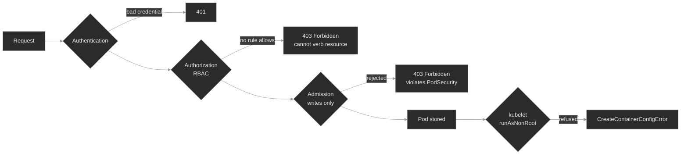

# M10 — Security I: RBAC & Pod Security

> Every API request passes three checks: who the caller is, what the caller may do, and whether the object is allowed. Then the kubelet runs one more check before a container starts. This module teaches you to read which check said no.

## What you'll learn

- Trace a request through the API server's three gates (**authentication**, **authorization**, **admission**) and name the gate behind a refusal
- Read an RBAC denial as a five-field sentence (identity, verb, resource, API group, scope) and match each field to the object that fixes it
- Write RBAC: a **Role** or **ClusterRole** holds rules, a **RoleBinding** or **ClusterRoleBinding** grants them to a subject, and the binding sets the scope
- Prove any authorization decision with `kubectl auth can-i`, with `--as` to test another identity and `--list` to see everything it holds
- Identify a Pod's API identity, its **ServiceAccount**, and explain why the `default` ServiceAccount has no useful permissions
- Set a **securityContext** that meets the `restricted` **Pod Security Standard**, and enforce that standard with **PodSecurity admission** labels
- Tell an admission rejection (no Pod exists) from a kubelet refusal (the Pod exists and its container never starts)

## Why it matters

Security failures do not crash a component. They deny a request. A Pod that the API server refuses does not run out of memory or sit `Pending`. Its process logs one `403 Forbidden` and exits or stalls. The usual workload reflexes (`logs --previous`, a restart, a new image) change nothing, because the application has no defect.

The diagnosis is already in the error. The API server writes a sentence that names the caller, the action, the resource, its API group, and the scope. Read that sentence first. Each field points at one object: the Pod's ServiceAccount, a Role's verbs, a rule's API group, or the kind of binding. Skip the sentence and you edit an application that was never wrong.

Pod security fails in a second, quieter way. A namespace that enforces a standard rejects a non-compliant Pod before the Pod exists. The Deployment shows `0/1` and `kubectl get pods` prints nothing. An engineer who looks only at Pods finds no evidence at all.

## Scope

**Covers:** the request pipeline (authentication, authorization, admission) and the response each gate returns; RBAC (Roles, ClusterRoles, RoleBindings, ClusterRoleBindings, rule matching, subresources, namespace and cluster scope, the built-in user-facing ClusterRoles, and privilege-escalation paths); `kubectl auth can-i`; ServiceAccounts and the projected token; Pod and container `securityContext`; the Pod Security Standards; PodSecurity admission modes; the kubelet's `runAsNonRoot` check.

**Doesn't cover:** user authentication mechanisms (client certificates, OIDC, webhook token authentication) beyond the identity they produce; the Node, ABAC, and webhook authorization modes; Secret management at scale → M11; certificates and mTLS → M12; the API audit log → M13; NetworkPolicy → M14; policy engines → M20; admission webhooks and ValidatingAdmissionPolicy → M21; PodSecurity exemptions and cluster-level defaults; AppArmor, SELinux, and Linux kernel constraints; multi-tenancy design.

**Assumes:** M00 (`get → describe → events → logs`; `spec` and `status`), M01 (a ReplicaSet creates a Deployment's Pods, which decides where an admission rejection appears), and M03 (projected and Secret volumes).

## Vocabulary

| Term | Definition |
|------|------------|
| **authentication** | The API server establishes who sent the request, from a client certificate or a bearer token. The result is a username and groups. A request with no credential becomes `system:anonymous` when anonymous access is on<sup><a href="https://kubernetes.io/docs/reference/access-authn-authz/authentication/">[1]</a></sup>. |
| **authorization** | The API server decides whether that identity may perform the verb on the resource. With RBAC, a request is denied unless a rule allows it. |
| **admission** | "Admission controllers act on requests that create, modify, delete, or connect to (proxy) an object"<sup><a href="https://kubernetes.io/docs/concepts/security/controlling-access/">[2]</a></sup>. They never see reads. |
| **RBAC** | "A method of regulating access to computer or network resources based on the roles of individual users"<sup><a href="https://kubernetes.io/docs/reference/access-authn-authz/rbac/">[3]</a></sup>. |
| **Role / ClusterRole** | A set of rules. A Role lives in one namespace. A ClusterRole is cluster-scoped and is the only kind that can describe cluster-scoped resources such as `nodes`. |
| **RoleBinding / ClusterRoleBinding** | Grants a Role or ClusterRole to subjects. A RoleBinding grants inside its own namespace. A ClusterRoleBinding grants across the cluster. |
| **rule** | `apiGroups` × `resources` × `verbs`. A request matches a rule only when all three lists contain its values. |
| **subject** | The identity a binding names: a user, a group, or a ServiceAccount with its namespace. |
| **subresource** | A path under a resource, such as `pods/log` or `pods/exec`. RBAC treats it as a separate resource string. |
| **ServiceAccount** | "A type of non-human account that, in Kubernetes, provides a distinct identity in a Kubernetes cluster"<sup><a href="https://kubernetes.io/docs/concepts/security/service-accounts/">[4]</a></sup>. A Pod authenticates as `system:serviceaccount:<namespace>:<name>`. |
| **projected token** | The short-lived token the kubelet mounts at `/var/run/secrets/kubernetes.io/serviceaccount/token`. The kubelet rotates it, and it stops working when the Pod is deleted. |
| **securityContext** | "A security context defines privilege and access control settings for a Pod or Container"<sup><a href="https://kubernetes.io/docs/tasks/configure-pod-container/security-context/">[5]</a></sup>. |
| **Pod Security Standards** | Three levels: Privileged ("unrestricted"), Baseline ("prevents known privilege escalations"), and Restricted ("following current Pod hardening best practices")<sup><a href="https://kubernetes.io/docs/concepts/security/pod-security-standards/">[6]</a></sup>. |
| **PodSecurity admission** | The built-in admission controller that applies a Standard to a namespace through the label `pod-security.kubernetes.io/<mode>: <level>`. The modes are `enforce`, `audit`, and `warn`. |

## Mental model

Every `kubectl` command and every API call from a Pod is an HTTPS request to the API server. The API server runs three gates in order<sup><a href="https://kubernetes.io/docs/concepts/security/controlling-access/">[2]</a></sup>. A Pod that passes all three still has one more check: the kubelet inspects the container before it starts it.



The response tells you the gate. An invalid credential gets `401 Unauthorized`. A missing credential is not a 401 when anonymous access is enabled, which is the API server default. The API server treats the request as `system:anonymous`, and authorization then refuses it with a 403. An authorization refusal names the five fields. An admission refusal names the policy and the failed checks. A kubelet refusal does not come from the API server at all. It appears as a container status and an event on a Pod that already exists.

RBAC is quick to reason about because it has one direction. "Permissions are purely additive (there are no "deny" rules)"<sup><a href="https://kubernetes.io/docs/reference/access-authn-authz/rbac/">[3]</a></sup>. A subject holds the union of every binding that reaches it. So "why is this denied?" always means "no rule matches", never "something blocks it". RBAC also matches exact strings. `get` is not `list`, `pods` is not `pods/log`, and API group `""` is not `apps`. A near miss is a silent denial.

## Concept walkthrough

### RBAC: the Forbidden sentence and the rule that answers it

**Rule.** The API server allows a request when one rule matches its API group, resource, and verb. A binding in the right scope must grant that rule to the caller.

The authorizer's refusal states every input it checked. This is the v1.30 format from the API server source, for a namespaced request:

```text
deployments.apps is forbidden: User "system:serviceaccount:provisioning:release-auditor"
cannot list resource "deployments" in API group "apps" in the namespace "provisioning"
```

Read it as five fields, and each field names one place to look:

| Field | In the message | Where the fix lives |
|-------|----------------|---------------------|
| identity | `User "system:serviceaccount:…"` | the Pod's `serviceAccountName`, or a binding's subject |
| verb | `cannot list` | the rule's `verbs` |
| resource | `resource "deployments"` (or `"pods/log"`) | the rule's `resources`, subresource included |
| API group | `in API group "apps"` | the rule's `apiGroups` (`""` is the core group) |
| scope | `in the namespace "…"` or `at the cluster scope` | the kind of binding |

The verb comes from the HTTP request. A GET on one named object is `get`. A GET on a collection is `list`, and a GET with `?watch=true` is `watch`. A controller that reads a collection on start needs `list`, even when it later reads single objects with `get`.

A rule is three lists:

```yaml
rules:
- apiGroups: ["apps"]          # "" is the core group: pods, services, endpoints, secrets
  resources: ["deployments"]
  verbs: ["get", "list", "watch"]
```

`kubectl describe role` prints each rule as a table row and qualifies the resource with its group. A core-group rule reads `deployments`. An `apps` rule reads `deployments.apps`. That suffix is the fastest check for a wrong API group, because a core-group rule for `deployments` matches no request that a client sends.

**Scope is a property of the binding.** A RoleBinding grants its rules only inside its own namespace, even when it references a ClusterRole. That reuse is the standard way to grant a built-in role such as `view` in one namespace. A ClusterRoleBinding grants across all namespaces. Cluster-scoped resources (`nodes`, `namespaces`, `persistentvolumes`) live in no namespace, so only a ClusterRole bound by a ClusterRoleBinding reaches them<sup><a href="https://kubernetes.io/docs/reference/access-authn-authz/rbac/">[3]</a></sup>. The API server accepts a Role that lists `nodes`. That Role grants nothing, and the refusal ends `at the cluster scope`.

**Prove the decision instead of reading YAML.** `kubectl auth can-i` sends the same question to the authorizer<sup><a href="https://kubernetes.io/docs/reference/access-authn-authz/authorization/">[7]</a></sup>:

```bash
kubectl auth can-i list deployments.apps -n provisioning \
  --as=system:serviceaccount:provisioning:release-auditor
kubectl auth can-i --list -n provisioning \
  --as=system:serviceaccount:provisioning:release-auditor
```

The first command answers `yes` or `no` for one request. The second prints every rule the identity holds in that namespace. `--as` requires impersonation rights, which `cluster-admin` has. Make this the first move on any 403: reproduce the denial as a `no`, then fix the object until it reads `yes`.

<details>
<summary>📖 Going deeper: built-in ClusterRoles and the grants that escalate<sup><a href="https://kubernetes.io/docs/concepts/security/rbac-good-practices/">[8]</a></sup></summary>

Kubernetes ships four user-facing ClusterRoles. Grant them per namespace with a RoleBinding before you write custom rules<sup><a href="https://kubernetes.io/docs/reference/access-authn-authz/rbac/">[3]</a></sup>:

- **view** reads most namespaced objects. It excludes Secrets, because "reading the contents of Secrets enables access to ServiceAccount credentials in the namespace". It also excludes Roles and RoleBindings.
- **edit** reads and writes most namespaced objects, but not Roles or RoleBindings. It does allow "accessing Secrets and running Pods as any ServiceAccount in the namespace". A holder of `edit` can therefore act as any ServiceAccount in that namespace.
- **admin** adds Roles and RoleBindings inside the namespace. It cannot write the ResourceQuota or the namespace itself.
- **cluster-admin** allows every action. The `system:masters` group holds it, and a credential in that group bypasses authorization.

Some grants are wider than they read. The good-practices guide lists the paths an on-call reviewer looks for:

- **Workload creation.** The right to create Pods, or a Deployment that creates them, "implicitly grants access to many other resources in that namespace, such as Secrets". The Pod mounts the Secret and reads it. It can also run as any ServiceAccount in the namespace.
- **`escalate`, `bind`, `impersonate`.** RBAC normally refuses to let you create a Role with permissions you do not hold. `escalate` and `bind` remove that check. `impersonate` lets the caller act as another identity.
- **`nodes/proxy`.** A `get` on this subresource reaches the kubelet API, which can execute commands in every Pod on the node. That access bypasses audit logging and admission control.

At 03:00 the useful question is narrow: which bindings reach this identity, and does any of them hold one of these paths? `kubectl auth can-i --list --as=…` answers it in one command.

</details>

### ServiceAccounts: a Pod's identity

**Rule.** Every Pod runs as exactly one ServiceAccount. It is the one in `spec.serviceAccountName`, or `default` when the field is empty.

The kubelet requests a token for that ServiceAccount and mounts it into each container at `/var/run/secrets/kubernetes.io/serviceaccount/`, next to the cluster CA and the namespace<sup><a href="https://kubernetes.io/docs/tasks/configure-pod-container/configure-service-account/">[9]</a></sup>. A client library reads those files and sends the token. The API server then authenticates the caller as `system:serviceaccount:<namespace>:<name>`. That string is the subject a RoleBinding must name. It is also the identity a refusal quotes back.

Kubernetes creates a `default` ServiceAccount in every namespace. Those accounts "get no permissions by default other than the default API discovery permissions"<sup><a href="https://kubernetes.io/docs/concepts/security/service-accounts/">[4]</a></sup>. A workload that omits `serviceAccountName` authenticates as `default` and is denied. This happens even when a correct Role and RoleBinding exist for the account the author intended. The identity field tells the two failures apart. If it names the intended account, the permission is wrong. If it names `default`, the Pod is wrong.

Never fix that case by granting the permission to `default`. Every Pod in the namespace that omits `serviceAccountName` runs as `default` and would inherit the grant. Give each workload its own ServiceAccount and bind only that account.

The token is a projected, bound token. The kubelet gets it from the TokenRequest API, rotates it before it expires, and the API server rejects it after the Pod is deleted. Before v1.24 Kubernetes created a Secret with a non-expiring token for every ServiceAccount. It no longer does. For a token outside a Pod, run `kubectl create token <serviceaccount>`. A workload that never calls the API sets `automountServiceAccountToken: false` and carries no token to steal.

### Pod security: admission checks the spec, the kubelet checks the image

**Rule.** PodSecurity admission compares a Pod's spec with the namespace's Standard when the Pod is created. The kubelet later checks the identity the container will actually run as.

A container runs as root by default, keeps the runtime's default Linux capabilities, and may gain privileges through setuid binaries. The `securityContext` removes each of these at Pod level (for all containers) or per container<sup><a href="https://kubernetes.io/docs/tasks/configure-pod-container/security-context/">[5]</a></sup>:

| Field | Effect |
|-------|--------|
| `runAsNonRoot: true` | The kubelet refuses to start a container whose user is UID 0 |
| `runAsUser: 1000` | Runs the process as this UID, overriding the image's user |
| `allowPrivilegeEscalation: false` | Sets `no_new_privs`, so a child process cannot gain privileges |
| `capabilities.drop: ["ALL"]` | Removes every Linux capability |
| `seccompProfile.type: RuntimeDefault` | Applies the container runtime's default syscall filter |

The three Standards are cumulative<sup><a href="https://kubernetes.io/docs/concepts/security/pod-security-standards/">[6]</a></sup>. **Baseline** forbids privileged containers, host namespaces, `hostPath` volumes, host ports, and added capabilities outside a default set. **Restricted** adds the rest: `runAsNonRoot: true`, no UID 0 in `runAsUser`, `allowPrivilegeEscalation: false`, `capabilities.drop: ["ALL"]` with only `NET_BIND_SERVICE` allowed back, a `RuntimeDefault` or `Localhost` seccomp profile, and a short list of volume types.

PodSecurity admission applies a Standard per namespace<sup><a href="https://kubernetes.io/docs/concepts/security/pod-security-admission/">[10]</a></sup>:

```bash
kubectl label ns payments \
  pod-security.kubernetes.io/enforce=restricted \
  pod-security.kubernetes.io/warn=restricted
```

The three modes act differently:

- `enforce` rejects a violating Pod.
- `audit` adds an annotation to the audit log entry and allows the Pod.
- `warn` returns a warning to the client and allows the Pod.

A namespace with no labels takes the cluster's default, which is `privileged` unless the cluster admission configuration sets another level.

**Admission and workload objects.** "Enforce mode is not applied to workload resources, only to the resulting pod objects"<sup><a href="https://kubernetes.io/docs/concepts/security/pod-security-admission/">[10]</a></sup>. `warn` and `audit` do check a Deployment's Pod template. So `kubectl apply` of a non-compliant Deployment prints `Warning: would violate PodSecurity "restricted:latest"` and still creates the Deployment. The ReplicaSet controller then creates the Pods, and `enforce` rejects each one. No Pod exists, so nothing is `Pending`. The refusal is a `FailedCreate` event on the ReplicaSet, and `kubectl describe deploy` shows the condition `ReplicaFailure True FailedCreate`. Enforcement checks only creation. Pods that existed before the label keep running until their next replacement.

**The kubelet's check.** `restricted` requires `runAsNonRoot: true`, but it does not require `runAsUser`. A Pod can pass admission and still fail to start. `runAsNonRoot` is a check, not a switch: it does not change the user. When no `runAsUser` is set, the kubelet reads the user from the image. An image with no `USER`, such as `busybox` or `nginx`, runs as root. The kubelet then refuses to create the container. The Pod exists with status `CreateContainerConfigError`, and its events say `container has runAsNonRoot and image will run as root`. The fix is a non-root `runAsUser`, or an image that declares a numeric non-root `USER`. A non-numeric `USER` fails the same check, because the kubelet cannot prove the name is not root.

Roll out enforcement in two passes. First set `warn` and `audit`, or run `kubectl label --dry-run=server --overwrite ns <name> pod-security.kubernetes.io/enforce=restricted`<sup><a href="https://kubernetes.io/docs/tasks/configure-pod-container/enforce-standards-namespace-labels/">[11]</a></sup>. The dry run prints a warning for each existing Pod that would violate the level. Fix those workloads, then set `enforce`.

## Hands-on

The baseline has five steps, and there are six break/fix scenarios. All run the full Polyphone fleet on a 2-node cluster. Scenarios 01, 02, 03 and 05 each break one field of the Forbidden sentence. Scenarios 04 and 06 split pod security between admission and the kubelet.

- **`baseline/`**: read Pod identities and RBAC objects, then grant `view` in one namespace and prove it with `auth can-i`. Read the fleet's `securityContext`, and watch PodSecurity reject a Pod and warn on a Deployment.
- **`breakfix-01-rbac-missing-verb`**: a reader in `CrashLoopBackOff` whose Role grants `get` and `watch` but not `list`. Field: verb.
- **`breakfix-02-serviceaccount-default`**: the same 403, but the identity is `default`. The RBAC is correct and the Pod is wrong. Field: identity.
- **`breakfix-03-rbac-cluster-scope`**: a Role that names `nodes`. The refusal ends `at the cluster scope`. Field: scope.
- **`breakfix-04-podsecurity-restricted`**: a Deployment at `0/1` with no Pods in a `restricted` namespace. Gate: admission.
- **`breakfix-05-rbac-wrong-apigroup`**: a Role for `deployments` in the core group. The refusal says `in API group "apps"`. Field: API group.
- **`breakfix-06-runasnonroot-root-image`**: a compliant spec that admission accepts, and a container the kubelet refuses to start. Gate: kubelet.

Check your path against `ANSWER-KEY.md` after each scenario.

## Common failure modes

| Symptom | Likely cause | Where to look |
|---------|--------------|---------------|
| `cannot list resource "…" … in the namespace` | The rule lacks the verb | `kubectl auth can-i --list --as=…`; `kubectl describe role` |
| The identity in the 403 is `…:default` | The Pod omits `serviceAccountName` | `kubectl describe pod` → `Service Account:` |
| `in API group "apps"`, and the Role shows `deployments` without `.apps` | The rule names the wrong API group | `kubectl describe role` → the `Resources` column |
| `cannot get resource "pods/log"` | The rule grants `pods` but not the subresource | the rule's `resources` |
| `… at the cluster scope` | A Role or RoleBinding for a cluster-scoped resource | `kubectl api-resources --namespaced=false`; the binding kind |
| `User "system:anonymous"` | The request carried no token | `automountServiceAccountToken`; the client's token path |
| Deployment `0/N`, no Pods at all | PodSecurity `enforce` rejected the Pods | `kubectl describe rs` → `FailedCreate`; the namespace labels |
| Pod `CreateContainerConfigError`, `image will run as root` | `runAsNonRoot: true` with no non-root user | `runAsUser`; the image's `USER` |
| `auth can-i` says `yes`, the app still gets 403 | You tested a different identity or namespace | the identity and namespace in the actual error |

## Recap

- **Three gates, then the kubelet.** A 401 means the credential failed. A 403 that says `cannot <verb>` comes from authorization. A 403 that says `violates PodSecurity` comes from admission. `CreateContainerConfigError` comes from the kubelet.
- **The RBAC refusal is a five-field sentence.** Identity, verb, resource, API group, and scope each map to one object. Read the sentence, prove it with `kubectl auth can-i`, and change the one object that does not match.
- **RBAC only adds.** Nothing blocks a request. A request is denied because no rule matches its exact strings in its scope.
- **A Pod's identity is its ServiceAccount.** An empty `serviceAccountName` means `default`, which has no useful permissions. Fix the Pod, not the `default` account.
- **Admission checks the spec, and the kubelet checks the user.** `enforce` leaves a Deployment with zero Pods and the reason on the ReplicaSet. A compliant spec can still fail at the kubelet when the image runs as root.

## Production thinking

- A ServiceAccount received `cluster-admin` to unblock an incident months ago. How would you find what the workload actually calls, and how would you shrink the grant without causing the next incident?
- A team holds `edit` in its namespace and asks why it cannot read one Secret through the API. What can that team already reach through Pod creation, and what does that imply for how you scope namespaces?
- You plan to enforce `restricted` on a namespace that runs twenty workloads. Which of them fail at admission, which pass admission and fail at the kubelet, and how would you find each group before the next deploy?

## References

1. Kubernetes — Authenticating (anonymous requests): https://kubernetes.io/docs/reference/access-authn-authz/authentication/
2. Kubernetes — Controlling Access to the Kubernetes API: https://kubernetes.io/docs/concepts/security/controlling-access/
3. Kubernetes — Using RBAC Authorization: https://kubernetes.io/docs/reference/access-authn-authz/rbac/
4. Kubernetes — Service Accounts: https://kubernetes.io/docs/concepts/security/service-accounts/
5. Kubernetes — Configure a Security Context for a Pod or Container: https://kubernetes.io/docs/tasks/configure-pod-container/security-context/
6. Kubernetes — Pod Security Standards: https://kubernetes.io/docs/concepts/security/pod-security-standards/
7. Kubernetes — Authorization (checking API access): https://kubernetes.io/docs/reference/access-authn-authz/authorization/
8. Kubernetes — Role Based Access Control Good Practices: https://kubernetes.io/docs/concepts/security/rbac-good-practices/
9. Kubernetes — Configure Service Accounts for Pods: https://kubernetes.io/docs/tasks/configure-pod-container/configure-service-account/
10. Kubernetes — Pod Security Admission: https://kubernetes.io/docs/concepts/security/pod-security-admission/
11. Kubernetes — Enforce Pod Security Standards with Namespace Labels: https://kubernetes.io/docs/tasks/configure-pod-container/enforce-standards-namespace-labels/
