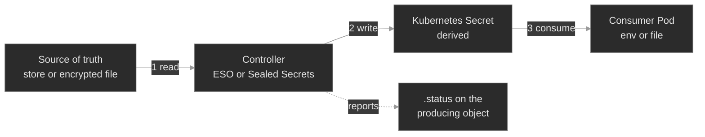

# M11 — Security II: Secrets at Scale

> A plaintext Secret cannot live in Git, so at scale a controller produces each Secret from a source of truth. The failure surface moves out of the Pod and into the pipeline that feeds it. This module teaches you to read that pipeline one link at a time.

## What you'll learn

- Explain why a Kubernetes Secret manifest is unsafe to commit, and what an etcd backup exposes when encryption at rest is off
- Name the three delivery patterns: **sync-from-store**, **mount-from-store**, and **encrypt-and-commit**
- Read the **materialization pipeline** (store → controller → Secret → consumer) and find the broken link from the producing object's status
- Map the **External Secrets Operator** model (`SecretStore`, `ExternalSecret`, `remoteRef`, refresh) onto that pipeline
- Name the coupling that breaks each encrypt-and-commit tool: a `SealedSecret`'s **scope**, a SOPS file's **decryption key**
- Predict whether a rotated value reaches a running process: an environment variable never does, a Secret volume does after a delay, and a `subPath` mount never does

## Why it matters

M03 assumed that a human wrote each Secret and applied it. GitOps breaks that assumption. The repository becomes the source of truth for the cluster, and a Secret manifest holds its values in base64. Base64 is an encoding, and the Git history keeps every committed value forever. So at scale nobody writes the Secret. A controller produces it, from an external secrets manager or from an encrypted file that is safe to commit.

That change adds a pipeline behind every credential. Assume `account-provisioner` cannot reach its database. The store credential can be expired, or the operator can have lost an RBAC grant. A key name can have a typo. A rotation can have missed the running process. None of these is an application defect. Each one breaks a different link in the pipeline. The producing object's status names the broken link, and the Pod's logs do not.

## Scope

**Covers:** why plaintext Secrets cannot go in Git; encryption at rest for etcd; sync-from-store with the External Secrets Operator (ESO) as the worked example (`SecretStore`/`ClusterSecretStore`, `ExternalSecret`, `remoteRef`, `refreshInterval`, status reasons, creation policy); mount-from-store with the Secrets Store CSI Driver; encrypt-and-commit with Sealed Secrets (scopes, key renewal) and SOPS (including Flux `kustomize-controller` decryption); rotation and how each consumption mode receives it.

**Doesn't cover:** Secret mechanics (env and volume consumption, `CreateContainerConfigError`, `FailedMount`) → M03; RBAC rules and `auth can-i` → M10; certificates and the `kubernetes.io/tls` type → M12; the API audit log → M13; Flux sources and reconciliation → M18; policy that forbids plaintext Secrets → M20; KMS plugin internals and per-provider authentication (cloud workload identity, Vault auth methods).

**Assumes:** M03 (a Pod reads a Secret as env or as a file; env is fixed at container start), M08 (a controller reconciles in a loop and reports in `.status`), and M10 (a controller runs as a ServiceAccount and can do only what RBAC grants it).

## Vocabulary

| Term | Definition |
|------|------------|
| **Secret** | "An object that contains a small amount of sensitive data such as a password, a token, or a key"<sup><a href="https://kubernetes.io/docs/concepts/configuration/secret/">[1]</a></sup>. |
| **GitOps-safe** | A manifest that you can commit without leaking a credential. An `ExternalSecret` or a `SealedSecret` is GitOps-safe. A plaintext Secret manifest is not. |
| **materialize** | A controller creates or updates a Kubernetes Secret from a declarative source. The result is a **derived Secret**: the controller owns its content. |
| **sync-from-store** | The value lives in an external manager. A controller copies it into a Kubernetes Secret and refreshes it. |
| **mount-from-store** | A Container Storage Interface (CSI) driver fetches the value from an external manager when the Pod starts and mounts it as a file. No Secret object is required. |
| **encrypt-and-commit** | You commit the value to Git in encrypted form. A component in the cluster decrypts it into a Secret. |
| **`SecretStore` / `ClusterSecretStore`** | ESO's description of where values come from and how to authenticate. A `SecretStore` is namespaced. A `ClusterSecretStore` serves every namespace. |
| **`ExternalSecret`** | ESO's declaration of which remote keys to fetch, from which store, into which target Secret. It names values and holds none. |
| **`remoteRef`** | The pointer in an `ExternalSecret` to one key (and optional property) in the store. |
| **`SealedSecret`** | A custom resource that holds values encrypted with the Sealed Secrets controller's public key. Only that controller's private key decrypts it. |
| **scope (Sealed Secrets)** | What a `SealedSecret` is bound to. The default, `strict`, binds the exact name and namespace into the ciphertext. |
| **SOPS** | A tool that encrypts the values in a YAML or JSON file and leaves the keys readable. The key backend is age (a small file-encryption tool), PGP, or a cloud key management service (KMS). |
| **encryption at rest** | An `EncryptionConfiguration` passed to the API server with `--encryption-provider-config`. The API server encrypts Secret data before it writes to etcd. |
| **rotation** | Replacing a credential's value. The store and the Secret change. A running process changes only if its consumption mode delivers the update. |

## Mental model

At scale a Secret is the output of a pipeline, not a leaf object. A source of truth sits outside the cluster, or sits in Git in encrypted form. A controller reads that source and materializes the Kubernetes Secret. The consumer reads the Secret with the M03 mechanics and never sees the controller.



Two rules follow. First, the Secret is derived. A hand edit lasts only until the next reconcile, so you change the source and never the Secret. Second, the failure surface moves upstream. A consumer in `CreateContainerConfigError` now has three causes before the Pod: the controller cannot read the source, cannot resolve a reference, or cannot write the target. Start at the producing object and read its `.status`, which is the M08 reflex for any controller.

## Concept walkthrough

### What a Secret protects, and what it does not

A Secret manifest stores each value in base64, and `base64 -d` reverses it. The docs state it plainly: "Base64 encoding is _not_ an encryption method, it provides no additional confidentiality over plain text"<sup><a href="https://kubernetes.io/docs/concepts/security/secrets-good-practices/">[2]</a></sup>. Commit that manifest and every clone of the repository holds the credential. A later rotation does not remove the old value from the history.

The cluster side has the same gap. "Kubernetes Secrets are, by default, stored unencrypted in the API server's underlying data store (etcd)"<sup><a href="https://kubernetes.io/docs/concepts/configuration/secret/">[1]</a></sup>. Base64 is only the API's JSON encoding. In etcd the value is raw bytes inside a protobuf record. Anyone who reads etcd, or an etcd snapshot, reads every credential.

**Encryption at rest** closes that gap. You pass an `EncryptionConfiguration` to the API server with `--encryption-provider-config`. The first provider in the list encrypts new writes, and every listed provider can decrypt reads. The `identity` provider means no encryption<sup><a href="https://kubernetes.io/docs/tasks/administer-cluster/encrypt-data/">[3]</a></sup>. A `kms` provider keeps the key in an external key management service, so an etcd snapshot alone is not enough to decrypt. Existing Secrets stay unencrypted until something rewrites them. The docs use `kubectl get secrets --all-namespaces -o json | kubectl replace -f -` for that rewrite.

Encryption at rest is independent of the delivery pattern. Every pattern below ends with a Secret in etcd, so you want it under all of them. A kubeadm cluster does not set the flag. Many managed control planes encrypt by default. On a self-managed cluster a missing flag is an audit finding.

Two more limits come from M10. A user who can create a Pod in a namespace can mount any Secret in that namespace and read it. RBAC `list` on Secrets returns their contents, not only their names. Encryption protects the disk, and RBAC protects the API.

### Sync-from-store: the pipeline and its status

The **External Secrets Operator** "fetches secrets from an external API and creates Kubernetes secrets"<sup><a href="https://external-secrets.io/latest/introduction/overview/">[4]</a></sup>. It splits the job into two objects. A `SecretStore` says where values come from and how to authenticate: a provider (Vault, a cloud secrets manager, or another namespace through the Kubernetes provider) plus a credential. An `ExternalSecret` says what to fetch and where to write it:

```yaml
apiVersion: external-secrets.io/v1
kind: ExternalSecret
metadata:
  name: db-credentials
  namespace: provisioning
spec:
  refreshInterval: 1h               # the default
  secretStoreRef: { name: polyphone-vault, kind: SecretStore }
  target:
    name: db-credentials            # the Secret ESO writes
    creationPolicy: Owner           # the default: ESO sets an ownerReference
  data:
    - secretKey: DB_PASSWORD        # the key in the target Secret
      remoteRef:
        key: prod/database          # the path in the store
        property: password          # the field at that path
```

The `ExternalSecret` names `prod/database` and holds no value, so you can commit it. ESO authenticates to the store, reads the property, and writes the target Secret. With the default `Periodic` refresh policy it repeats the read every `refreshInterval`<sup><a href="https://external-secrets.io/latest/api/externalsecret/">[5]</a></sup>. ESO also watches the target Secret. A hand edit changes the data hash that ESO records in an annotation, and ESO rewrites the Secret. The `Orphan` creation policy turns that protection off.

ESO reports on the M08 channel. The `ExternalSecret` has a `Ready` condition. Its reason is `SecretSynced` after a good sync and `SecretSyncedError` when a read or write fails. The message names the failing step. `kubectl get externalsecret` shows the state of every object, and `kubectl describe` shows the provider's error and the events.

A failed sync has three places to break, and each one has a different blast radius:

| Link | What breaks | What fails |
|------|-------------|-------------|
| Reference | A `remoteRef` names a key that the store does not have | That one `ExternalSecret` |
| Store read | The store's credential or RBAC grant is gone | Every `ExternalSecret` that uses the store |
| Target write | The controller cannot create or update Secrets in one namespace | Every `ExternalSecret` in that namespace |

So the pattern of failures is the first clue. One failed object points at its reference. A fan-out across namespaces that names one store points at the store. A failure confined to one namespace points at the controller's grant in that namespace. In all three cases the target Secret is absent or stale, and the consumer shows the M03 symptom. The cause is upstream.

Every ESO failure here fails closed. A missing key produces no Secret rather than a partial one. A Secret that already exists keeps its last good value while the sync fails. Running Pods keep working, and the outage starts when a Pod restarts or a new Pod schedules.

<details>
<summary>📖 Going deeper: the store has its own identity<sup><a href="https://external-secrets.io/latest/provider/kubernetes/">[6]</a></sup></summary>

A `SecretStore` does not authenticate as the ESO controller. It authenticates as an identity that you give it: a Vault role, a cloud workload identity, or a ServiceAccount for the Kubernetes provider. That identity needs read access to the backend. With the Kubernetes provider, "the `SecretStore` reconciler checks if you have read access for secrets in that namespace using `SelfSubjectRulesReview` and will fallback to `SelfSubjectAccessReview` when that fails"<sup><a href="https://external-secrets.io/latest/provider/kubernetes/">[6]</a></sup>. If the check fails, the store's `Ready` condition goes `False` with the reason `ValidationFailed`.

The store is a shared dependency, so alert on it directly. Forty failing `ExternalSecret` objects that name one store are one incident. Read `kubectl get secretstore -A` before you open any single `ExternalSecret`. Then prove the identity with `kubectl auth can-i get secrets -n <backend-namespace> --as=system:serviceaccount:<ns>:<sa>`. That command sends a `SelfSubjectAccessReview` for one verb. Add `--list` to send the `SelfSubjectRulesReview` that ESO tries first.

A store credential that expires overnight produces no immediate outage. Existing Secrets keep their last value. The first symptom appears hours later, when a rescheduled Pod finds a Secret that never refreshed, or a new namespace finds no Secret at all. Alert on the store's `Ready` condition and on the age of the last sync, not on Pod failures.

</details>

**Mount-from-store** removes the Secret object from the pipeline. The Secrets Store CSI Driver runs on every node as a DaemonSet. It "lets the kubelet retrieve Secrets from external stores, and mount the Secrets as a volume into specific Pods"<sup><a href="https://kubernetes.io/docs/concepts/security/secrets-good-practices/">[2]</a></sup>. A `SecretProviderClass`, a custom resource that the driver installs, names the store and the keys<sup><a href="https://github.com/kubernetes-sigs/secrets-store-csi-driver">[7]</a></sup>. The value never sits in etcd unless you turn on the optional sync to a Secret. The trade-off is the failure point. The fetch runs at volume mount time, so a store outage holds new Pods in `ContainerCreating` with a `FailedMount` event that names the provider.

### Encrypt-and-commit: Sealed Secrets and SOPS

The second pattern keeps Git as the source of truth. **Sealed Secrets** uses asymmetric encryption<sup><a href="https://github.com/bitnami-labs/sealed-secrets">[8]</a></sup>. The in-cluster controller holds a private key and publishes the public key. `kubeseal` encrypts a Secret with that public key and writes a `SealedSecret`. Only the controller can decrypt it, so you can commit it. The controller watches `SealedSecret` objects and writes a normal Secret for each one.

The sharp edge is **scope**. By default a `SealedSecret` is `strict`: "the secret must be sealed with exactly the same *name* and *namespace*"<sup><a href="https://github.com/bitnami-labs/sealed-secrets#scopes">[9]</a></sup>. The controller adds the name and namespace to the encryption. A user who can read Secrets in namespace `A` cannot copy your `SealedSecret` from namespace `B` into `A` and get it decrypted there. A rename or a namespace move therefore causes a decryption error, and no Secret appears. The `namespace-wide` scope allows a rename, and the `cluster-wide` scope allows both. Each wider scope gives up that protection.

Sealed Secrets renews its sealing key every 30 days by default and keeps the old keys. Old `SealedSecret` objects still decrypt. Key renewal does not rotate your credentials. The README says renewal is "not a substitute for periodical rotation of your actual secret values." Back up the sealing keys. A rebuilt cluster with new keys cannot decrypt anything in the repository.

**SOPS** encrypts the values in a YAML or JSON file and leaves the keys readable<sup><a href="https://github.com/getsops/sops">[10]</a></sup>. A diff shows which keys changed and never their values. The key backend is age, PGP, or a cloud KMS. In Flux, the `kustomize-controller` (the Flux controller that applies manifests from Git) decrypts at apply time when the `Kustomization` sets `spec.decryption.provider: sops` and names a `secretRef` that holds the private key<sup><a href="https://fluxcd.io/flux/guides/mozilla-sops/">[11]</a></sup>. If that key is absent, or is not one of the recipients the file was encrypted for, the `Kustomization` reports `Ready=False` with the decryption error. No Secret is applied.

Both tools fail closed on a coupling. Sealed Secrets couples the ciphertext to its scope. SOPS couples it to a key. A broken coupling produces no Secret, never a wrong one.

### Rotation: the Secret updates, the process may not

Rotation is the reason to run any of this. A credential should change on a schedule, and a leaked one must change within minutes. Sync-from-store makes the first half automatic: change the store, and the next refresh updates the Secret. The second half depends on how the consumer reads the Secret. The kubelet delivers an update to a running container in exactly one of three consumption modes:

| Consumption mode | Does a Secret update reach the running container? |
|------------------|-----------------------------------------------------|
| Environment variable (`secretKeyRef`, `envFrom`) | No. The kubelet sets env once, at container start. |
| Secret volume, whole directory | Yes, after a delay. Kubernetes "updates the data in the volume, using an eventually-consistent approach"<sup><a href="https://kubernetes.io/docs/concepts/configuration/secret/">[1]</a></sup>. |
| Secret volume with `subPath` | No. "A container using a Secret as a subPath volume mount does not receive automated Secret updates"<sup><a href="https://kubernetes.io/docs/concepts/configuration/secret/">[1]</a></sup>. |

The volume delay can be as long as the kubelet sync period plus its cache propagation delay. The default sync period is one minute, so plan for a minute or more. A file that updates still needs the application to read it again. A process that loads a password once at startup holds the old value until it restarts.

This produces the signature failure of secrets at scale. The store holds the new value. The `ExternalSecret` reads `SecretSynced`. The Secret is correct. The process still sends the old credential. Nothing is red, because the stale value lives past the last object with a status. The headline status lies again: `Running` is not `Ready` (M01), `Complete` is not correct (M01b), and `Synced` is not adopted. Read what the process holds: `kubectl exec ... -- printenv NAME` or `cat` on the mounted file.

Close the gap by construction. A checksum annotation on the Pod template (M03) works only when your deploy tool renders the Secret. A Secret that ESO syncs later never passes through the renderer, so the hash never changes. For a synced Secret, run a controller that watches the Secret and restarts its consumers. Alternatively, mount the whole directory and make the application reload the file. During rotation, keep the old credential valid in the backend until every consumer runs on the new one.

## Hands-on

The lab runs a stand-in for ESO on the Polyphone fleet. A `SecretSync` custom resource models an `ExternalSecret`. The `secret-operator` reconcile loop reads a backing store: the Secret `vault-backend` in `secrets-source`, in place of Vault. It writes one target Secret per `SecretSync`. It reports `Synced`, `SyncError`, `StoreNotReady`, or `SecretWriteError` in `.status`. Two syncs feed two consumers: `db-credentials` → `billing-processor` (`provisioning`) and `partner-api` → `partner-connector` (`media`).

- **`baseline/`**: read the store, the syncs, the derived Secrets, and the consumers. Hand-edit a derived Secret and watch the operator revert it. Read a Secret straight from etcd and find it in plaintext.
- **`breakfix-01-source-key-missing`**: one sync in `SyncError`, because its source key does not exist in the store. Link: reference.
- **`breakfix-02-store-access-denied`**: every sync in `StoreNotReady` at once. The store RoleBinding names the wrong ServiceAccount. Link: store read.
- **`breakfix-03-rotation-not-propagated`**: a green pipeline and an env consumer that still holds the old password. Link: consumer (env).
- **`breakfix-04-target-write-denied`**: one namespace's sync in `SecretWriteError`, while the other namespace syncs. Link: target write.
- **`breakfix-05-subpath-rotation-stale`**: a file consumer that never sees the rotated token, because it mounts the key with `subPath`. Link: consumer (file).

Sealed Secrets, SOPS, and the CSI driver have no lab. Each needs a controller install and key material that an offline, time-boxed lab cannot hold, so this module teaches them in prose. Check yourself against `ANSWER-KEY.md` after each lab.

## Common failure modes

| Symptom | Likely cause | Where to look |
|---------|--------------|---------------|
| Consumer in `CreateContainerConfigError`; target Secret absent; one `ExternalSecret` failed | The `remoteRef` names a key or property that the store lacks | `kubectl describe externalsecret`; compare the key with the store |
| Many `ExternalSecret` objects fail at once and name one store | The store's identity lost access, or its credential expired | `kubectl get secretstore -A`; `auth can-i ... --as=<store identity>` |
| `ExternalSecret` objects fail in one namespace only | The controller cannot write Secrets in that namespace | The `ExternalSecret` message; `auth can-i create secrets -n <ns> --as=<controller SA>` |
| `ExternalSecret` green, Secret correct, process uses the old value | Env consumer, or a `subPath` mount, read the value before rotation | `kubectl exec ... printenv` or `cat`; `describe pod` `Mounts:` for `path=` |
| Hand edit to a synced Secret reverted | The Secret is derived, and the controller rewrote it | Change the source or the `ExternalSecret` |
| `SealedSecret` applied, no Secret appears | Scope mismatch after a rename or a namespace move, or wrong cluster keys | Controller logs and events; re-seal for the target name and namespace |
| `Kustomization` reports a decryption error | The SOPS key is missing from the cluster or is not a recipient of the file | `kubectl describe kustomization`; the `spec.decryption.secretRef` Secret |
| New Pods stuck in `ContainerCreating` with `FailedMount` from a CSI driver | Mount-from-store cannot reach the store | Pod events; the `SecretProviderClass` and the driver's logs |
| etcd snapshot shows readable credentials | No encryption at rest | `--encryption-provider-config` in the API server manifest |

## Recap

- A Secret manifest is base64, and etcd stores Secrets unencrypted by default. At scale a controller materializes each Secret from a store or from an encrypted file, and encryption at rest protects the result on disk.
- A derived Secret has its failure story in the object that produces it. Read the producing object's `.status` before the consumer's logs, and change the source, not the Secret.
- The pattern of failures locates the link. One failed `ExternalSecret` means a bad reference. A fan-out that names one store means the store. Failures in one namespace mean the controller's write grant there.
- Encrypt-and-commit fails closed on a coupling: Sealed Secrets on name and namespace scope, SOPS on the decryption key. A broken coupling produces no Secret.
- Rotation has two steps. The pipeline updates the Secret, and the consumer must adopt it. Env and `subPath` consumers never adopt it without a restart, so read what the process holds when the status is green.

## Production thinking

- A store credential expires at 02:00, and every `ExternalSecret` that depends on it starts to fail. No Pod restarts until 09:00. Which signal pages you before the first rescheduled Pod fails, and which signal pages forty times for one cause?
- A team moves a workload and its `SealedSecret` from `staging` to `prod`, and no Secret appears. Which scope would have allowed the move, and which reader would that scope also let decrypt the value?
- You rotate a database password in the store, and every `ExternalSecret` reads green. An hour later half the Pods fail to connect. What evidence shows which Pods hold the old value, and what in the rotation procedure should have kept the old password valid until they rolled?

## References

1. Kubernetes — Secrets: https://kubernetes.io/docs/concepts/configuration/secret/
2. Kubernetes — Good practices for Kubernetes Secrets: https://kubernetes.io/docs/concepts/security/secrets-good-practices/
3. Kubernetes — Encrypting Confidential Data at Rest: https://kubernetes.io/docs/tasks/administer-cluster/encrypt-data/
4. External Secrets Operator — API overview: https://external-secrets.io/latest/introduction/overview/
5. External Secrets Operator — ExternalSecret: https://external-secrets.io/latest/api/externalsecret/
6. External Secrets Operator — Kubernetes provider: https://external-secrets.io/latest/provider/kubernetes/
7. Secrets Store CSI Driver (kubernetes-sigs): https://github.com/kubernetes-sigs/secrets-store-csi-driver
8. Sealed Secrets (Bitnami Labs): https://github.com/bitnami-labs/sealed-secrets
9. Sealed Secrets — Scopes: https://github.com/bitnami-labs/sealed-secrets#scopes
10. SOPS — Secrets OPerationS: https://github.com/getsops/sops
11. Flux — Manage Kubernetes secrets with SOPS: https://fluxcd.io/flux/guides/mozilla-sops/
