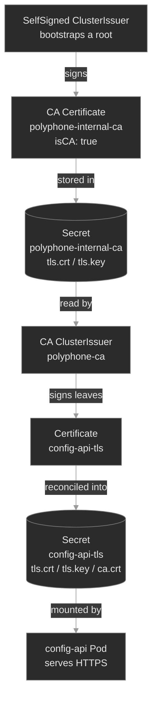

# M12 — PKI & TLS

> How workloads get a cryptographic identity and use it to talk securely. cert-manager turns a declared `Certificate` into a signed key pair. An internal CA signs the east-west certs. Mutual TLS proves both ends. Every TLS failure is one of three questions: was the cert **issued**, does its **identity** match, is it **trusted**?

## What you'll learn

- Read the **cert-manager issuance chain** (`Issuer` or `ClusterIssuer`, `Certificate`, `CertificateRequest`, a `kubernetes.io/tls` Secret) and diagnose a `Certificate` that never goes `Ready`
- Explain why an issuer that exists can still block every issuance
- Stand up an **internal CA** in the cluster and explain why a private CA secures east-west traffic
- Read a certificate's **identity**, its Subject Alternative Names (SANs), and recognize the failure when a client dials a name the cert does not cover
- Explain **trust**: why a client accepts or rejects a server by its signer, and how `ca.crt` reaches the workloads that need it
- Run **mutual TLS (mTLS)** between two workloads and tell which side rejects from the error text and the server log
- Place **ACME**, the protocol behind public certificate authorities, in the picture

## Why it matters

A flat internal network is one compromised Pod from a full read of east-west traffic. TLS encrypts each connection and verifies the peer. PKI, public key infrastructure, is the machinery that issues and vouches for the identities that TLS checks. A SIP credential, a call detail record or tenant provisioning data should never cross the network unencrypted or unauthenticated.

TLS failures look the same from outside: "the call did not connect." They have three different causes. The cert was never issued, so nothing exists to serve. The cert exists but claims the wrong name, so the client refuses it. The cert is fine, but the client does not trust its signer. A wrong guess burns an hour rotating a key that was never the problem.

Certificates also expire. If nobody renews a cert, an outage with a timer on it follows, and the classic 02:00 page reads `certificate has expired` on a service that worked yesterday. cert-manager turns issuance and renewal into a control loop. This module teaches you to read that loop when it stalls.

## Scope

**Covers:** the cert-manager model (`Issuer`, `ClusterIssuer`, `Certificate`, `CertificateRequest`, and the `Ready` condition); an internal CA built from the `SelfSigned` and `CA` issuer types; the `kubernetes.io/tls` Secret and how a workload mounts it; SANs and hostname verification; certificate `usages` (Extended Key Usage); the chain of trust and `ca.crt` distribution; mTLS and the side that rejects; renewal, and a running process that keeps an old cert; ACME as a concept.

**Doesn't cover:** public ACME issuance end to end, because an offline lab has no public name or inbound path; secret distribution and rotation at fleet scale (External Secrets, sealed-secrets, `sops`) → M11; mesh-managed mTLS, where a sidecar injects and rotates certs → M15; TLS termination at the Ingress edge, including the `cert-manager.io/cluster-issuer` Ingress annotation → M14; the cluster's own control-plane certificates and the `CertificateSigningRequest` API (cluster administration, outside this curriculum); cipher suites and key exchange.

**Assumes:** M03 (a cert lives in a Secret), M08 (cert-manager is an operator: CRDs plus a reconcile loop), M10 (the controller authenticates as a ServiceAccount that may write Secrets), and M04 (a SAN is a DNS name from M04, and hostname verification checks the name you dialed).

## Vocabulary

| Term | Definition |
|------|------------|
| **Certificate (X.509)** | A signed document that binds a **public key** to a set of names. A CA's signature vouches for it. It is public. |
| **Private key** | The secret half of the key pair. Whoever holds it *is* the identity. It lives in `tls.key`. |
| **CA (certificate authority)** | An entity whose signature vouches for certificates. A **root CA** signs itself. |
| **Leaf certificate** | A certificate issued *to* a workload, not to a CA. |
| **Chain of trust** | Leaf, optional intermediate, root. A verifier accepts a leaf when it can follow the signatures to a root it already trusts. |
| **SAN (Subject Alternative Name)** | The list of names a cert is valid for. Clients match the dialed name against it. |
| **CN (Common Name)** | The legacy single-name field. Clients must not check it when the cert lists a DNS SAN. |
| **EKU (Extended Key Usage)** | The extension that lists what a cert may be used for, such as server authentication or client authentication. |
| **mTLS (mutual TLS)** | Both ends present and verify certificates. |
| **Issuer / ClusterIssuer** | cert-manager objects that "represent certificate authorities (CAs) that are able to generate signed certificates by honoring certificate signing requests."<sup><a href="https://cert-manager.io/docs/concepts/issuer/">[1]</a></sup> An `Issuer` is namespaced. A `ClusterIssuer` is not. |
| **`Certificate` (the CRD)** | The cert-manager object where you declare the names, the issuer and the lifetime. The controller reconciles it into a Secret. In prose, *cert* means the X.509 certificate, and `Certificate` means this object. |
| **CertificateRequest** | The one-shot request that cert-manager creates for each issuance. It holds the reason an issuance stalls. |
| **`kubernetes.io/tls` Secret** | The Secret type that holds `tls.crt` and `tls.key`. |
| **ACME** | The protocol that issues *public* certs after you prove control of a domain. |

## Mental model

A certificate answers *who are you?* with a signature that anyone can check without asking. Three separable properties make that work, and every TLS problem is a failure of exactly one:

- **Issuance.** A signed cert must *exist*. Someone with a CA key signed the workload's public key.
- **Identity.** The cert must claim the *right name*. A cert for `config-api` proves nothing about `session-broker`.
- **Trust.** The verifier must *believe the signer*. A cert is only as good as the verifier's trust in its CA.

cert-manager automates the first. It is an operator (the M08 pattern): you declare a `Certificate`, the controller creates a `CertificateRequest`, an issuer signs it, and the result lands in a Secret that the workload mounts. The chain for the internal CA in this module:



The load-bearing point: **the Secret is the deliverable, and the CA cert is the trust anchor.** The server mounts the Secret to *serve* TLS. A client that wants to *verify* that server must hold the CA cert on its own. Issuance produces the first. Trust distribution produces the second. Keep the two jobs apart and the module fits together.

## Concept walkthrough

### cert-manager and the issuance chain

Before cert-manager, a human ran `openssl`, submitted a signing request, and pasted the result into a Secret every 90 days. Now a certificate is a declarative object. Two kinds of object drive it. An **issuer** declares *how* certs get signed. A **`Certificate`** declares *what* you want: the DNS names, the lifetime, the Secret to write and the issuer to use.

The controller does not sign anything itself. It creates a **`CertificateRequest`**, the issuer signs that request, and the controller writes the signed cert and its key into the Secret. This indirection gives diagnosis a ladder. The `Certificate` tells you it is not `Ready`. The `CertificateRequest` below it tells you why.

```bash
kubectl get certificate -n media                       # READY: True or False
kubectl describe certificate config-api-tls -n media   # conditions and events
kubectl describe certificaterequest -n media           # the reason an issuance stalls
```

Two failures sit on that ladder. In the first, the `Certificate` names an issuer that does not exist, or names it with the wrong `kind`. The request reads `Referenced "ClusterIssuer" not found`. In the second, the issuer exists but cannot sign. The documentation states the rule: "All cert-manager certificates require a referenced issuer that is in a ready condition to attempt to honor the request."<sup><a href="https://cert-manager.io/docs/concepts/issuer/">[1]</a></sup> A CA issuer whose signing Secret is missing reports `Ready` False, and the request reads `Referenced issuer does not have a Ready status condition`. The second failure is the dangerous one. Every `Certificate` that shares the issuer stalls together, and every renewal behind it stalls too.

In both cases the `Certificate` never writes its Secret. A Pod that mounts the missing Secret stays in `ContainerCreating` with a `FailedMount` event. The kubelet retries the mount on its own, after a delay. Read the `Certificate`, not the Pod.

The Secret is derived state. The controller treats a missing Secret as a reason to issue, so deleting the Secret makes cert-manager issue a second time and write a new key pair. The `Certificate` holds the intent.

**The Secret contract.** Kubernetes requires only `tls.crt` and `tls.key` in a `kubernetes.io/tls` Secret, and the API server does not validate their contents<sup><a href="https://kubernetes.io/docs/concepts/configuration/secret/#tls-secrets">[2]</a></sup>. The `ca.crt` key is a cert-manager addition. It is the controller's best guess at the issuing CA, and some issuer types, such as ACME, do not write it<sup><a href="https://cert-manager.io/docs/usage/certificate/">[3]</a></sup>.

<details>
<summary>📖 Going deeper: the issuer types, and why the chain is SelfSigned then CA<sup><a href="https://cert-manager.io/docs/configuration/ca/">[4]</a></sup></summary>

An issuer backend is one of several types:

- **SelfSigned.** The cert signs itself. This type does one useful job: it bootstraps a root, because a root is self-signed by definition.
- **CA.** It signs leaf certs with a CA key pair that already lives in a Secret. This is the internal CA. It signs east-west certs at no cost.
- **ACME.** It requests *publicly trusted* certs and proves domain control with a challenge.
- **Vault, Venafi or external.** They delegate signing to an enterprise PKI.

An internal CA is a two-step chain. A CA issuer cannot sign its own CA cert, because no CA exists yet. A **SelfSigned** issuer mints the root with `isCA: true`, the root lands in a Secret, and a **CA** issuer points at that Secret to sign every leaf. A `ClusterIssuer` reads its signing Secret from the cluster resource namespace, `cert-manager` by default. The CA `Certificate` therefore lives there, not in `media`.

The **03:00 view.** An issuer is shared infrastructure. One bad edit stops every issuance and every renewal that depends on it. Certs that already exist keep working until they expire, so the damage stays hidden for weeks. Alert on any issuer that is not `Ready`, not only on `Certificate` objects.

</details>

### Certificate identity: SANs and hostname verification

A signed cert proves that a public key belongs to *some* identity. The SAN list says which. When a client opens `https://config-api.media.svc.cluster.local`, TLS runs two independent checks. Is the cert **trusted**: does a CA I believe sign it? Does the name I **dialed** appear in the SANs? Both must pass. A freshly issued, fully trusted cert still fails when it covers `config-api-legacy` and the client asked for `config-api`<sup><a href="https://cert-manager.io/docs/usage/certificate/">[3]</a></sup>.

The Common Name looks like "the name", and it is not. RFC 6125 states that a client must not seek a match against the CN when the cert presents a DNS SAN. cert-manager writes every entry of `dnsNames` into the SANs, so put every name there. The error is specific:

```text
curl: (60) SSL: no alternative certificate subject name matches target host name 'config-api.media.svc.cluster.local'
```

Read the SANs from the Secret. This is a muscle to build:

```bash
kubectl get secret config-api-tls -n media -o jsonpath='{.data.tls\.crt}' | base64 -d \
  | openssl x509 -noout -ext subjectAltName
```

The operational rule: **a cert must list every name that any client uses.** A Service has three forms: `config-api`, `config-api.media.svc` and `config-api.media.svc.cluster.local`. A same-namespace caller uses the short form, and a cross-namespace caller uses the full name. Miss one form and some callers fail while others pass. The bug looks intermittent and is deterministic.

### Trust: the chain, the CA, and `ca.crt`

Issuance and identity concern the cert that the *server* holds. Trust concerns what the *client* holds. A client ships with a set of trusted CAs. For the public web, your operating system supplies that set. An internal CA is in nobody's set, so verification fails with the second error to know cold:

```text
curl: (60) SSL certificate problem: unable to get local issuer certificate
```

That message does not say the cert is bad. It says the client does not recognize the signer. The fix is never to weaken verification. `curl -k` and `insecureSkipVerify` turn internal TLS into unauthenticated traffic with extra steps. The fix is to **give the client the CA's public cert**. Distribute it as its own **CA bundle**, which the client mounts and passes to its verifier (`--cacert`). A client that mounts the wrong CA gets the error above, even though the server's cert is flawless.

<details>
<summary>📖 Going deeper: why <code>ca.crt</code> is a poor trust source, and how bundles scale<sup><a href="https://cert-manager.io/docs/faq/">[5]</a></sup></summary>

The CA cert is **public**. It holds no private key, so handing it to every workload leaks nothing. The system's security rests on the CA's *private* key, which only cert-manager reads. Trust distribution is a plumbing problem: get one public file to many Pods.

Do not use the `ca.crt` inside a leaf Secret as that source. The cert-manager FAQ explains why. The controller fills `ca.crt` with a best guess, it can change when the issuer changes, and it updates only when the leaf renews. A trust anchor that moves with leaf renewals cannot support a controlled rotation. This module's server reads `ca.crt` from its own Secret because the CA issuer fills it reliably. A production design distributes a separate CA bundle.

Copying a CA bundle by hand into each namespace does not scale. **trust-manager** is a cert-manager companion whose `Bundle` resource syncs CA certs into every namespace<sup><a href="https://cert-manager.io/docs/trust/trust-manager/">[6]</a></sup>. It also solves rotation. When you replace a CA, clients must trust the *new* CA before servers present certs that it signed. A CA bundle that holds *both* CAs during the overlap rotates a root without an outage.

</details>

### Mutual TLS: both ends prove identity

Server TLS authenticates one direction. The client checks the server, and the server accepts anyone. **Mutual TLS** closes the loop: the server also demands a client cert and verifies it against a CA. The server then knows the caller holds an identity from the internal CA. A Pod that merely reached the server's IP has no such identity. The server adds two settings: "require a client cert" and "trust clients signed by *this* CA". nginx implements the first with `ssl_verify_client on`<sup><a href="https://nginx.org/en/docs/http/ngx_http_ssl_module.html">[7]</a></sup>.

```bash
# config-client calls config-api: --cert/--key are its identity, --cacert is its trust anchor
curl --cert /etc/tls/id/tls.crt --key /etc/tls/id/tls.key \
     --cacert /etc/tls/trust/ca.crt \
     https://config-api.media.svc.cluster.local/
```

mTLS adds one new check and one new question. The new check is **purpose**. A cert lists what it may be used for in its Extended Key Usage. A server cert carries `server auth`, and a client cert carries `client auth`. A verifier rejects a cert whose purpose does not fit the role, even when a trusted CA signed it and the name is right. cert-manager issues exactly the `usages` that the `Certificate` lists. The default list is `digital signature`, `key encipherment` and `server auth`, so a client identity copied from a server template carries the wrong purpose<sup><a href="https://cert-manager.io/docs/usage/certificate/">[3]</a></sup>.

The new question is **who rejects**. The two directions fail in two different places:

- The client rejects the server. The handshake fails inside curl, with `no alternative certificate subject name matches` (identity) or `unable to get local issuer certificate` (trust).
- The server rejects the client. The TLS channel opens, and the server answers with an HTTP `400`, such as `No required SSL certificate was sent` or `The SSL certificate error`. The reason sits in the **server's log**, for example `client SSL certificate verify error: (26:unsuitable certificate purpose)`.

nginx records client-cert failures at the `info` level, and its default log level is `notice`. Set the level high enough to keep that line, or the one record of the cause disappears. Even so, mTLS adds no new kind of failure. It is issuance, identity, trust and purpose, from two vantage points.

### Renewal, and the process that never reloads

cert-manager renews a cert at two thirds of its lifetime by default. The default duration is 90 days, so renewal starts about 30 days before expiry<sup><a href="https://cert-manager.io/docs/usage/certificate/">[3]</a></sup>. The controller writes the new cert into the same Secret. The kubelet refreshes the files of a mounted Secret on its periodic sync. A process that loaded the cert at startup, nginx for example, keeps serving the old cert until it reloads.

That gap is a classic expiry outage: renewal succeeded, the Secret is correct, and the running process still serves the dead cert. Two controls close it. Alert on the **served** cert's expiry, not on the renewal loop. Give each TLS workload a reload path: a restart, a signal, or a sidecar that watches the Secret. Changing `dnsNames` or `usages` has the same effect. cert-manager reissues, and the process keeps the old cert until it reloads.

### ACME and public certificates (concept)

A private CA suits internal traffic, because you control both ends. A browser that opens `portal.polyphone.example` trusts only public CAs. You cannot self-sign for that audience. **ACME** automates public issuance<sup><a href="https://letsencrypt.org/how-it-works/">[9]</a></sup>, and cert-manager speaks it through an ACME issuer<sup><a href="https://cert-manager.io/docs/configuration/acme/">[8]</a></sup>.

A **challenge** proves that you control the domain before the CA signs. **HTTP-01** asks you to serve a random token at `/.well-known/acme-challenge/`, which proves control of the web server. **DNS-01** asks you to publish a `TXT` record, which proves control of the DNS zone and allows wildcards. cert-manager drives the exchange through `Order` and `Challenge` objects that you inspect when it stalls.

The rule: **internal traffic uses a private CA, and public traffic uses ACME.** An ACME issuer never signs `config-api.media.svc.cluster.local`, because you cannot prove control of a name that exists only inside the cluster.

## Hands-on

Five steps in the baseline and five break/fix scenarios, all on the full Polyphone fleet on a 2-node cluster with cert-manager and an internal CA installed. Each scenario breaks one PKI link.

- **`baseline/`**: read the healthy chain end to end, decode a cert and read its SANs, make an mTLS call, read the renewal time, then delete a Secret and watch cert-manager rebuild it.
- **`breakfix-01-certificate-not-ready`**: a Pod waits in `ContainerCreating` and its `Certificate` reads `Ready` False because the `issuerRef` names an issuer that does not exist. Drills the issuance ladder.
- **`breakfix-02-san-mismatch`**: the cert issues, but the call fails the name check. Drills reading SANs and fixing `dnsNames`.
- **`breakfix-03-trust-mismatch`**: a valid server cert fails with `unable to get local issuer certificate`. Drills the client's CA.
- **`breakfix-04-issuer-not-ready`**: two workloads in two namespaces stall together because their shared issuer cannot sign. Drills the rung below the `CertificateRequest`.
- **`breakfix-05-client-cert-purpose`**: the server answers `400` to a client cert that carries the wrong purpose. Drills the server's side of mTLS.

Check yourself against `ANSWER-KEY.md` after each scenario.

## Common failure modes

| Symptom | Likely cause | Where to look |
|---------|--------------|---------------|
| `Certificate` stuck `Ready` False, no Secret | Issuer missing, wrong `kind`, or not `Ready` | `describe certificate`, then `describe certificaterequest` |
| Several `Certificate` objects stuck together | A shared issuer is not `Ready` (missing signing Secret) | `describe clusterissuer` |
| Pod in `ContainerCreating`, `FailedMount` on a `tls` volume | The `Certificate` behind that Secret has not issued | the `Certificate`, not the Pod |
| `no alternative certificate subject name matches target host name` | The SANs omit the name the client dialed | `openssl x509 -text` on `tls.crt`: SANs against the URL |
| `unable to get local issuer certificate` | The client holds the wrong CA (or none) | the client's CA bundle against the server cert's issuer |
| HTTP `400` from the server, no handshake error | The server rejects the client cert: no cert, wrong signer, or wrong purpose | the server's log, then the client cert's EKU |
| `certificate has expired` on a service that worked yesterday | Renewal failed, or the process never reloaded the renewed cert | `Not After` on the `Certificate` and on the served cert |
| ACME `Certificate` never `Ready`, `Order` or `Challenge` pending | The challenge cannot be solved | `describe order`, `describe challenge` |

## Recap

- **Every TLS failure is issuance, identity or trust, and mTLS adds purpose.** Was a cert signed, does it claim the right name, does the verifier trust the signer, and is it fit for this role? Name the layer and the fix halves.
- **cert-manager makes certs a reconciliation loop.** An issuer says how to sign, and a `Certificate` says what you want. When it stalls, climb the ladder: Pod events, `Certificate`, `CertificateRequest`, issuer.
- **A cert that cannot issue leaves a stuck Pod.** The missing Secret is the visible symptom. Diagnose the cert, not the Pod. When several `Certificate` objects fail together, look for the issuer they share.
- **Identity is SANs, not CN, and trust is the client's CA.** List every name any client uses. Distribute the CA apart from the cert. `ca.crt` is public and safe to spread, and a wrong one rejects a flawless server. Never fix a trust error by disabling verification.
- **In mTLS, read who rejects.** A handshake error is the client rejecting the server. An HTTP error from the server is the server rejecting the client, and its log names the reason.

## Production thinking

- A leaf cert renews automatically at two thirds of its life, but only while cert-manager and the issuer work, and only a reload makes the process serve it. What do you alert on, and why does the served cert's expiry beat the renewal loop as the signal?
- You must rotate the internal CA. Which goes first: the new CA in every client's CA bundle, or new leaf certs signed by the new CA? Why does a CA bundle that holds both CAs prevent a fleet-wide outage?
- A teammate fixes `unable to get local issuer certificate` with `--insecure`, and the ticket closes. What did that turn off, how large is the blast radius, and which review rule keeps `insecureSkipVerify` out of the codebase?

## References

1. cert-manager — Issuer and ClusterIssuer: https://cert-manager.io/docs/concepts/issuer/
2. Kubernetes — TLS Secrets (`kubernetes.io/tls`): https://kubernetes.io/docs/concepts/configuration/secret/#tls-secrets
3. cert-manager — Certificate usage (names, usages, renewal, `ca.crt`): https://cert-manager.io/docs/usage/certificate/
4. cert-manager — CA Issuer: https://cert-manager.io/docs/configuration/ca/
5. cert-manager — FAQ (what `ca.crt` holds): https://cert-manager.io/docs/faq/
6. cert-manager — trust-manager: https://cert-manager.io/docs/trust/trust-manager/
7. nginx — ngx_http_ssl_module (`ssl_verify_client`): https://nginx.org/en/docs/http/ngx_http_ssl_module.html
8. cert-manager — ACME issuer (HTTP-01 and DNS-01): https://cert-manager.io/docs/configuration/acme/
9. letsencrypt.org — How it works (ACME challenges): https://letsencrypt.org/how-it-works/
