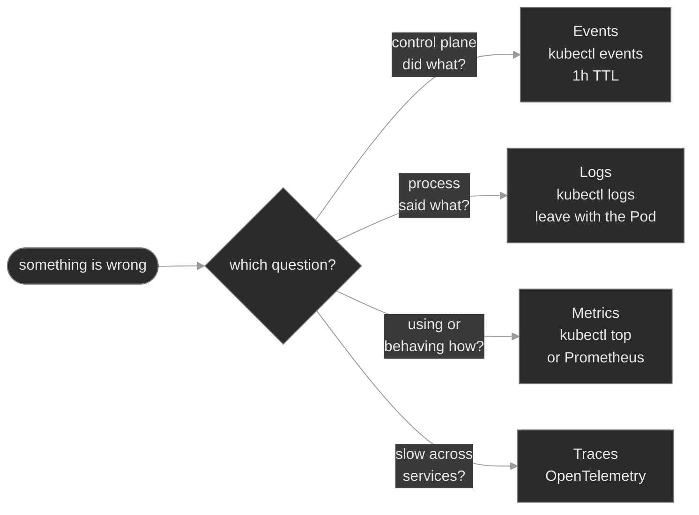

# M13 — Observability

> A running cluster gives you three signals: **events**, **logs** and **metrics**. Each answers one question and each expires. This module teaches you to pick the right signal first, to read it fast, and to see what the durable stack above it is for. **Traces** are the fourth signal, which you add yourself.

## What you'll learn

- Match each built-in signal to its question: **events** (what the control plane did), **logs** (what the process said), **metrics** (how much the workload uses, and how it behaves)
- Read an **Event** as a structured object, and survey events with `kubectl events`
- Retrieve container logs under pressure: `--previous`, `-c`, `--all-containers`, `--since`, `--tail`
- State the **container logging contract**: the kubelet captures only stdout and stderr. Name the two fixes for an app that logs to a file.
- Tell the **two metrics pipelines** apart: the Resource Metrics API (`kubectl top`) and application metrics (Prometheus scraping `/metrics`)
- Tell a scrape target that is **DOWN** from a target that is **absent**
- Place **traces** (OpenTelemetry) in the picture

## Why it matters

Observability answers the question "what is this workload doing right now" without a shell on the node. Each signal answers a different question. An event tells you what the control plane tried and decided. A log line tells you what the process reported. A metric tells you how much the workload consumes, or how it behaves over time. A wrong first choice costs an hour: you read application code for a scheduling failure, or you stare at CPU graphs for a configuration error that one log line names.

Two failures hide in the gaps between signals. A telemetry sidecar dies and the app keeps serving. The Pod reads `1/2`, nothing pages, and that workload goes dark. A scrape target loses its port or its Service endpoints. Every dashboard for it goes flat while the app stays healthy and `kubectl top` still works, because `kubectl top` reads a different pipeline.

All three built-in signals are also ephemeral. Events expire. Logs leave the node with the Pod. `kubectl top` keeps no history. That fact is the reason a platform adds durable pipelines on top. This module teaches you to read the live signal at 03:00, and to know what the durable stack must replace.

## Scope

**Covers:** the three built-in signals and the question each answers; Events as API objects (`type`, `reason`, `involvedObject`, count, TTL), read with `kubectl events`, `describe` and `get events`; `kubectl logs` and its flags, the stdout contract, which container instance the command returns, kubelet log rotation and the two shipping patterns; the Resource Metrics API and `kubectl top`; Prometheus as a pull model (the exposition format, the four metric types, the scrape annotation convention, ServiceMonitor, and the DOWN versus absent target); traces and OpenTelemetry as a concept.

**Doesn't cover:** installing a metrics, logging or tracing stack. Prometheus, Loki, Grafana and an OpenTelemetry Collector are described, not deployed, because each needs storage or an operator that one lab cannot start. PromQL, alerting rules and SLO math. Dashboards. The audit log, which records authorization decisions → M10. Instrumentation SDKs. Pod-level `kubectl debug` and ephemeral containers → M01.

**Assumes:** M00 (the `get`, `describe`, events, logs loop), M01 (the Pod lifecycle, probes, restarts), M04 (a Service selects Pods and owns endpoints), M06 (requests and limits: a usage number means something only against a request), M09 (the HPA reads the Resource Metrics API) and M08 (a ServiceMonitor is a custom resource).

## Vocabulary

| Term | Definition |
|------|------------|
| **Event** | An API object that records something that happened to another object. The scheduler, the kubelet and controllers create Events. An Event is not a log line. |
| **type** | `Normal` or `Warning`. Triage reads Warnings first. |
| **reason** | A short machine token such as `FailedMount`, `BackOff` or `Unhealthy`. It is the best key for a selector. |
| **involvedObject** | The object an Event describes: its kind, name and namespace. |
| **event TTL** | The age at which the API server deletes an Event. The `kube-apiserver --event-ttl` flag sets it. The default is 1h0m0s.<sup><a href="https://kubernetes.io/docs/reference/command-line-tools-reference/kube-apiserver/">[3]</a></sup> |
| **container logging contract** | The kubelet captures a container's stdout and stderr. Text written to a file inside the container is not captured. |
| **instance** | One run of a container. A restart creates a new instance. `kubectl logs --previous` reads the last terminated instance. |
| **streaming sidecar** | A second container in the Pod that reads a log file and prints it to its own stdout. |
| **Resource Metrics API** | The `metrics.k8s.io` API that metrics-server serves. It holds current CPU and memory for Pods and Nodes. `kubectl top` and the HPA read it. |
| **application metrics** | Numbers a workload publishes about itself at an HTTP `/metrics` endpoint in the Prometheus exposition format. |
| **scrape target** | One endpoint that Prometheus fetches on an interval. Prometheus pulls. The workload does not push. |
| **ServiceMonitor** | A Prometheus Operator custom resource. It selects Services by label and names the Service port to scrape.<sup><a href="https://prometheus-operator.dev/docs/api-reference/api/">[10]</a></sup> |
| **span / trace** | A span is one timed operation in one service. A trace is the tree of spans for one request, tied together by a propagated trace ID. |

## Mental model

Match the question to the signal. Each signal has a different lifetime.



The three built-in signals share one weakness: they are ephemeral. A durable layer fixes that. A log store takes lines from node collectors. A Prometheus database takes samples from scrapes. A tracing backend takes spans. `kubectl` reads the live signal at 03:00. The durable stack answers "what happened last Tuesday". Know which one you hold.

## Concept walkthrough

### Events: the control plane narrating itself

An Event is not a log line. The control plane writes it. The scheduler, the kubelet and the controllers create an Event when they act on an object. `Scheduled`, `Pulled`, `Created` and `Started` are routine Normal events. `FailedScheduling`, `FailedMount`, `Unhealthy` and `BackOff` are Warnings. A Pod that waits in `ContainerCreating` has no logs. Its events are the only signal that exists.

Two commands read events. Use `kubectl describe <kind> <name>` when you know the suspect. It prints the events for that one object at the bottom. Use `kubectl events` when you do not. It lists events for the namespace, sorted by time. Three flags matter<sup><a href="https://kubernetes.io/docs/reference/kubectl/generated/kubectl_events/">[1]</a></sup>:

```bash
kubectl events -A --types=Warning                 # all namespaces, only trouble
kubectl events --for pod/web-0                    # one object, by kind and name
kubectl events --for pod/web-0 --watch            # follow new events
```

```text
LAST SEEN         TYPE      REASON        OBJECT      MESSAGE
3m (x7 over 9m)   Warning   FailedMount   pod/web-0   MountVolume.SetUp failed for volume "cfg" : configmap "app-cfg" not found
```

Events are **namespaced**. `kubectl events` reads the current namespace unless you add `-A`. When you do not know where the problem lives, start with `-A --types=Warning`.

The kubectl `get events` command is the older reader. It does not sort. It hides the count column unless you add `-o wide`. Add a sort when you use it, and use `--field-selector` to select on `reason`, `type` or `involvedObject.name`:

```bash
kubectl get events -n signaling --sort-by=.metadata.creationTimestamp
kubectl get events -A --field-selector reason=BackOff
```

The components that emit events collapse repeats into one Event object and raise its count. A line that reads `x7 over 9m` means the same event happened seven times in nine minutes. The count is the severity signal. A Warning with count 1 an hour ago is stale. A Warning with a climbing count is active.

Events are ephemeral. The API server deletes each one after the event TTL, one hour by default<sup><a href="https://kubernetes.io/docs/reference/command-line-tools-reference/kube-apiserver/">[3]</a></sup>. Deleting a Pod does not delete its events. The TTL does. A failure that healed two hours ago leaves nothing to read. Teams run an event exporter to keep events somewhere durable.

<details>
<summary>📖 Going deeper: why events deduplicate, and why <code>kubectl events</code> sorts correctly<sup><a href="https://kubernetes.io/docs/reference/kubectl/generated/kubectl_events/">[1]</a></sup></summary>

A crashlooping container could emit a `BackOff` event every few seconds. That volume would load etcd for no gain. The event recorders therefore collapse identical events into one object. The object's count rises and its last-seen time moves forward.

Two Event APIs exist. The original `core/v1` Event records a `lastTimestamp` and a `count`. The newer `events.k8s.io/v1` Event records an `eventTime` and, for repeats, a `series`. Some components write the newer form. A single sort key therefore does not fit every event. In the kubectl source, `kubectl events` sorts by the series time, then `lastTimestamp`, then `eventTime`. The sort on `get events` uses one field you choose.

</details>

### Logs: what the process said

`kubectl logs <pod>` returns the stdout and stderr of one container. That is the whole **container logging contract**. The kubelet redirects each container's stdout and stderr to a file on the node, and `kubectl logs` reads that file through the API server<sup><a href="https://kubernetes.io/docs/concepts/cluster-administration/logging/">[2]</a></sup>. An app that writes its log to a file inside the container produces an empty `kubectl logs`. The app logs. You cannot see it.

Two fixes exist. The first is to make the app log to stdout. This is the default choice, because a node-level collector already ships stdout. The second is a **streaming sidecar** for an app you cannot change. The sidecar shares a volume with the app, runs `tail -F` on the file, and prints the lines to its own stdout.

Know the flags before the incident<sup><a href="https://kubernetes.io/docs/reference/kubectl/generated/kubectl_logs/">[4]</a></sup>:

- `-c <container>` selects one container. `--all-containers` reads all of them. On a Pod with several containers, `kubectl logs` without `-c` prints a `Defaulted container` notice and picks one.
- `--previous` (`-p`) reads the last terminated instance of the container.
- `--since=15m` and `--tail=100` limit the output. `-f` follows.

Know which instance you read. The kubelet chooses by container state. When an instance runs, `kubectl logs` returns that instance. When the container waits in back-off after a crash, `kubectl logs` returns the last terminated instance. `--previous` always selects the last terminated instance. After a restart, the new instance often runs and has logged only its startup banner. The banner looks clean and hides the crash. Use `--previous` to pin the instance that died. Read `describe` for the exit code and reason under `Last State`.

A container that waits to start has no instance to read. `kubectl logs` then fails with `container "…" in pod "…" is waiting to start: ContainerCreating`. Read the events instead.

Logs are as ephemeral as the Pod. The kubelet rotates each file at 10Mi by default and keeps five files. `kubectl logs` returns at most 10MiB of data by default. When the node removes a Pod, it removes the logs with it<sup><a href="https://kubernetes.io/docs/concepts/cluster-administration/logging/">[2]</a></sup>.

<details>
<summary>📖 Going deeper: node collectors, streaming sidecars and native sidecars<sup><a href="https://kubernetes.io/docs/concepts/cluster-administration/logging/">[2]</a></sup></summary>

A **node-level collector** is a DaemonSet with one agent per node, for example Fluent Bit or Vector. It reads every container's log file, labels each line with the Pod and namespace, and forwards the lines to a store. It needs no change in the app if the app logs to stdout.

A **streaming sidecar** costs one container and some memory per Pod. If a node-level agent also runs, a streamed file can double the storage the lines use on the node. Prefer a direct write to `/dev/stdout` when the app allows it.

Since Kubernetes v1.29 you can declare a sidecar as an init container with `restartPolicy: Always`. The kubelet starts it before the app containers and stops it after them.<sup><a href="https://kubernetes.io/docs/concepts/workloads/pods/sidecar-containers/">[6]</a></sup> The feature is on by default since v1.29 and stable in v1.33. A `1/2` Pod still means one container is not Ready. Read `describe` to see which.

</details>

### Metrics: two pipelines

"Metrics" names two separate pipelines. Pin the difference before you debug either.

**Pipeline 1: the Resource Metrics API.** metrics-server collects CPU and memory from each kubelet and serves them on `metrics.k8s.io`<sup><a href="https://kubernetes.io/docs/tasks/debug/debug-cluster/resource-metrics-pipeline/">[5]</a></sup>. `kubectl top nodes` and `kubectl top pods` read it. The HPA divides this usage by the Pod's request to get the utilization it scales on (M09). The pipeline reports CPU and memory only. It reports the present only. Without metrics-server, `kubectl top` fails and the HPA shows `<unknown>`.

**Pipeline 2: application metrics.** A workload publishes anything richer, such as calls per second or queue depth, at an HTTP endpoint. By convention the path is `/metrics`. Prometheus pulls it on an interval. The endpoint returns the **exposition format**<sup><a href="https://prometheus.io/docs/instrumenting/exposition_formats/">[7]</a></sup>:

```text
# HELP calls_active Calls in progress.
# TYPE calls_active gauge
calls_active 42
# HELP calls_total Calls handled since start.
# TYPE calls_total counter
calls_total 18734
```

A **counter** only rises, and you read its rate. A **gauge** rises and falls. A **histogram** counts observations in buckets, so you can compute percentiles. A **summary** reports percentiles that the client computed.

Keep label values bounded. Every distinct label value creates a new time series, so a label such as `call_id` with millions of values can overload the database<sup><a href="https://prometheus.io/docs/practices/naming/">[8]</a></sup>.

**How Prometheus finds a target.** Prometheus itself reads no Pod annotation by default. The `prometheus.io/scrape`, `prometheus.io/port` and `prometheus.io/path` annotations are a community convention. They work only when the scrape configuration contains relabeling rules that read them.<sup><a href="https://prometheus.io/docs/prometheus/latest/configuration/configuration/">[9]</a></sup> Prometheus's own example configuration shows the pattern with a placeholder name. Two discovery styles exist:

- **Pod discovery.** The `pod` role makes one target per declared container port. Annotations on the Pod can then change the address. A wrong `prometheus.io/port` points the scraper at a port nothing serves.
- **Service discovery.** The Prometheus Operator reads a **ServiceMonitor**. It selects Services by label and scrapes the endpoints behind them, on the Service port that it names.<sup><a href="https://prometheus-operator.dev/docs/api-reference/api/">[10]</a></sup>

Two silent failures follow. In both, the app is healthy and `kubectl top` works:

| Failure | Cause | What Prometheus shows |
|---|---|---|
| Target **DOWN** | Discovery works. The scrape fails: wrong port, wrong path, refused connection. | A target with `up` equal to 0<sup><a href="https://prometheus.io/docs/concepts/jobs_instances/">[11]</a></sup> |
| Target **absent** | Discovery finds nothing: the Service selector matches no Pod, so it has no endpoints. | No target and no `up` series |

An alert on `up == 0` catches the first failure only. An absent target produces no series, so the alert has nothing to evaluate. Check the Service endpoints before you check ports.

### Traces: the fourth signal

Metrics aggregate across calls. Logs describe one process. Neither shows which of the services that one slow call touched consumed the delay. **Distributed tracing** shows it. A span records one timed operation. A trace is the tree of spans for one request. Each hop passes the trace ID to the next service in the W3C `traceparent` header<sup><a href="https://www.w3.org/TR/trace-context/">[12]</a></sup>. Read the trace, and the slow hop is the long bar.

**OpenTelemetry** is the vendor-neutral standard: instrumentation SDKs, the OTLP wire format, and the Collector. The Collector receives spans, processes them and exports them to a backend such as Jaeger or Tempo<sup><a href="https://opentelemetry.io/docs/concepts/signals/traces/">[13]</a></sup>. This module does not install it. Tracing needs app instrumentation and a backend. When metrics say "slow" and every log says "fine", the missing signal is a trace.

## Hands-on

The baseline has five steps. Five break/fix scenarios follow. Each runs on the full Polyphone fleet and breaks the reading of one signal.

- **`baseline/`** — read events with `kubectl events`, logs with their flags, `kubectl top`, and a healthy `/metrics` target. In the last step, watch a container restart and see why `--previous` matters.
- **`breakfix-01-logs-to-stdout`** — a Pod is `Running 1/1` and its log holds one line. The app writes to a file. Make its output visible.
- **`breakfix-02-sidecar-crashloop`** — a Pod reads `1/2`. A telemetry sidecar dies after it starts. Name the container, then read the instance that died.
- **`breakfix-03-metrics-scrape-port`** — dashboards are flat, the app is healthy. The scrape annotation names a port nothing serves. The target is DOWN.
- **`breakfix-04-event-only-failure`** — a workload never starts and has no logs. Only an event names the cause. Find it with no namespace given.
- **`breakfix-05-scrape-target-absent`** — dashboards are flat, the port is right. The Service has no endpoints. The target is absent.

Check yourself against `ANSWER-KEY.md` after each scenario.

## Common failure modes

| Symptom | Likely cause | Where to look |
|---------|--------------|---------------|
| `kubectl logs` is empty and the Pod is `Running` | The app writes to a file | `kubectl exec … -- ls /var/log` |
| `kubectl logs` shows a clean start for a Pod that restarts | You read the new instance | `kubectl logs --previous`; `describe` → `Last State` |
| `kubectl logs` says `waiting to start` | The container has not started | `kubectl events --for pod/<name>` |
| Pod `1/2` and nothing else looks wrong | One container is down | `describe` for the container; `kubectl logs -c … --previous` |
| A failure "has no events" | The TTL deleted them, or you read the wrong namespace | `kubectl events -A`; export events next time |
| `kubectl top` fails with `Metrics API not available` | metrics-server is missing or starting | the metrics-server Deployment in `kube-system` |
| Dashboards flat, app healthy, `kubectl top` fine | Scrape target DOWN or absent | the scrape port; then the Service endpoints |
| Prometheus slow and its disk fills | A high-cardinality label | the label set on the busiest metric |

## Recap

- **Three signals, three questions.** Events show what the control plane did. Logs show what the process said. Metrics show how much the workload uses. Choose the signal before you type.
- **All three are ephemeral.** Events expire after the TTL. Logs leave with the Pod. `kubectl top` keeps no history. A durable stack exists to replace all three.
- **A container that never started has no logs, only events.** `kubectl events --for` and `-A --types=Warning` find the cause.
- **The logging contract is stdout and stderr.** A file is invisible. `--previous` pins the instance that died, and `-c` pins the container.
- **Metrics are two pipelines, and a scrape fails in two ways.** `kubectl top` can work while a target is DOWN or absent. Check the endpoints, then the port.

## Production thinking

- A failure happened at 02:00 and healed by 02:20. At 09:00 the Pod is gone, its events are past the TTL, and `kubectl top` has no history. Which signal would have told the story if you had shipped it? What do you stand up so the next review is not a guess?
- An alert on `up == 0` stays quiet while a workload's dashboards are blank. What state could produce this, and which expression would catch it?
- You standardize on "log to stdout" so a node collector ships the fleet. One vendored component only writes to a file. What do you add for that Pod, what does it cost, and why is it the exception?

## References

1. Kubernetes — `kubectl events` reference: https://kubernetes.io/docs/reference/kubectl/generated/kubectl_events/
2. Kubernetes — Logging Architecture: https://kubernetes.io/docs/concepts/cluster-administration/logging/
3. Kubernetes — `kube-apiserver` reference (`--event-ttl`): https://kubernetes.io/docs/reference/command-line-tools-reference/kube-apiserver/
4. Kubernetes — `kubectl logs` reference: https://kubernetes.io/docs/reference/kubectl/generated/kubectl_logs/
5. Kubernetes — Resource Metrics Pipeline: https://kubernetes.io/docs/tasks/debug/debug-cluster/resource-metrics-pipeline/
6. Kubernetes — Sidecar Containers: https://kubernetes.io/docs/concepts/workloads/pods/sidecar-containers/
7. Prometheus — Exposition formats: https://prometheus.io/docs/instrumenting/exposition_formats/
8. Prometheus — Metric and label naming: https://prometheus.io/docs/practices/naming/
9. Prometheus — Configuration (`kubernetes_sd_config`): https://prometheus.io/docs/prometheus/latest/configuration/configuration/
10. Prometheus Operator — API reference (ServiceMonitor): https://prometheus-operator.dev/docs/api-reference/api/
11. Prometheus — Jobs and instances (`up`): https://prometheus.io/docs/concepts/jobs_instances/
12. W3C — Trace Context: https://www.w3.org/TR/trace-context/
13. OpenTelemetry — Traces: https://opentelemetry.io/docs/concepts/signals/traces/
