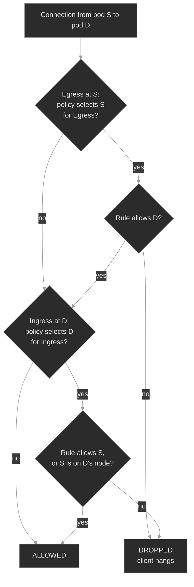

# M14 — Networking II: Policy & Ingress

> Two controls shape traffic that a Service leaves open. **NetworkPolicy** splits the flat pod network into lanes. **Ingress** routes outside HTTP to Services. Each control fails in a quiet way that the top-level objects do not show.

## What you'll learn

- State the NetworkPolicy model: a pod is **isolated** for one direction only when a policy selects it for that direction. Policies add permissions and never remove them.
- Read a NetworkPolicy: `podSelector` (who it governs), `policyTypes` (which directions), and `from`/`to` peers with `ports`
- Write peers correctly: a bare `podSelector` stays in the policy's namespace, `namespaceSelector` crosses namespaces, and both in one list element mean AND
- Explain why an egress restriction breaks DNS, and write the allow that fixes it
- Recognize a policy drop: the client **hangs to a timeout**. That is a new branch of M04's connectivity differential.
- Explain what an Ingress is and is not: routing rules that stay inert until an **Ingress controller** claims them through an **IngressClass**
- Work an Ingress failure from the status code. In ingress-nginx, `404` means no rule matched and `503` means a rule matched and the backend failed

## Why it matters

M04 gave every workload a stable name. It also left the network flat. By default any pod can open a connection to any other pod in any namespace. A compromised `sip-app` can then reach `cdr-storage` directly. An auditor can ask you to prove that only the billing plane reaches the billing database, and you have no object to show. **NetworkPolicy** is the in-cluster segmentation control that answers those questions.

NetworkPolicy also causes self-inflicted outages. A policy changes a pod's default from allow to deny for one direction. An engineer who locks down egress forgets that every name lookup is egress. The pod then reports "DNS is broken" while CoreDNS is healthy.

**Ingress** is the north-south half. A ClusterIP Service is reachable only inside the cluster. Something must accept outside HTTP and route it by hostname and path. An Ingress object that looks perfect in `kubectl get ingress` routes nothing when no controller claims it. It returns `404` when no rule matches and `503` when the backend has no endpoints. Both controls fail quietly. An SRE needs to know where to look.

## Scope

**Covers:** the NetworkPolicy object. Per-direction isolation, `policyTypes`, ingress and egress rules, the three peer kinds (`podSelector`, `namespaceSelector`, `ipBlock`), `ports`, additive rules, and the rule that both ends of a connection must allow it. Enforcement by the CNI, and what policy does not cover. The egress and DNS trap. On the north-south side: the Ingress object (`ingressClassName`, `host`, `path`, `pathType`, backend Service and port), the controller, the IngressClass, and the `404` and `503` signatures. The IngressClass link is diagnosed from the ADDRESS column and the class check.

**Doesn't cover:** the CNI dataplane below policy → M22. Service mesh and L7 mTLS → M15. TLS termination on an Ingress and certificate issuance → M12. The Gateway API beyond a named successor. Admission-time policy engines → M20 and M21. CNI-specific policy CRDs such as Cilium or Calico policies. Cloud load balancer provisioning (M04 covered the Service types).

**Assumes:** M04 is load-bearing: Services, selectors, EndpointSlices, cluster DNS, and the connectivity differential. M01 labels and selectors are the language that peers use. M00 namespaces are the boundary both controls cross.

## Vocabulary

Capital-I **Ingress** is the object. Lowercase ingress is the traffic direction.

| Term | Definition |
|------|------------|
| **NetworkPolicy** | A namespaced object that lists the traffic allowed to or from a set of pods. It contains allow rules only. |
| **isolated** | A pod is isolated for a direction when a NetworkPolicy selects it and lists that direction in `policyTypes`. The word "isolation" means "some restrictions apply".<sup><a href="https://kubernetes.io/docs/concepts/services-networking/network-policies/">[1]</a></sup> |
| **`podSelector`** (of the policy) | The label selector that chooses the pods in the policy's namespace that it governs. An empty `{}` selects every pod in the namespace. |
| **`policyTypes`** | The directions the policy governs: `Ingress`, `Egress`, or both. If you omit it, `Ingress` is always set, and `Egress` is set only when the policy has egress rules. |
| **peer** | An entry under `from` or `to`: `podSelector`, `namespaceSelector`, or `ipBlock`. A `podSelector` and a `namespaceSelector` in one entry mean AND. |
| **default-deny** | A policy that selects pods and lists a direction with no allow rules. It isolates those pods for that direction. |
| **additive** | Policies on one pod combine as a union. Order does not matter, and no rule subtracts an allow. |
| **CNI enforcement** | The network plugin enforces policy. The API server only stores it. On a plugin that does not implement policy, the object has no effect. |
| **Ingress** | A namespaced object with HTTP and HTTPS routing rules by `host` and `path`. It is a spec. A controller does the routing. |
| **Ingress controller** | A workload, such as ingress-nginx, that watches Ingress objects and proxies matching requests to backend Services. |
| **IngressClass** | The object that names a controller. An Ingress selects one with `ingressClassName`. |
| **`pathType`** | How a rule's `path` matches: `Exact`, `Prefix` or `ImplementationSpecific`. |

## Mental model

Two axes of traffic. **East-west** is pod to pod, and NetworkPolicy shapes it at L3 and L4 (IPs and ports). **North-south** is outside HTTP, and Ingress shapes it at L7 (hostnames and paths). They are independent. The controller forwards an Ingress request to a Pod, and that hop is east-west traffic. A NetworkPolicy can block that hop even when the Ingress is perfect.

For NetworkPolicy, hold one rule: **a policy is a whitelist that switches on when it selects a pod for a direction.** Before any policy selects the pod, that direction is open. After one does, only the listed peers get through.



The two checks are independent, and their order does not matter. Both ends must allow the connection. If either side refuses, the connection does not happen.<sup><a href="https://kubernetes.io/docs/concepts/services-networking/network-policies/">[1]</a></sup> Most plugins drop silently. The packet is discarded, no reset returns, and the client waits for a timeout. That adds a branch to the M04 differential: `NXDOMAIN` (the name did not resolve), empty endpoints (the Service had no backends), `connection refused` (a pod answered with no listener), and now **a timeout with everything else healthy** (a policy dropped it).<sup><a href="https://kubernetes.io/docs/tasks/debug/debug-application/debug-service/">[7]</a></sup>

North-south, an Ingress request walks a fixed chain. Each link has its own failure code:

```text
client ──HTTP, Host: portal.polyphone.example──▶ Ingress controller (class "nginx")
                                                   │  no rule matches host and path? → 404
                                                   │  rule matches → backend Service:port
                                                   ▼
                                           Service ───▶ EndpointSlice
                                                   │  no endpoints for that port?    → 503
                                                   ▼
                                             backend Pod (:80)
```

A `404` means the request reached the controller and no rule matched. A `503` means a rule matched and the backend had nothing to receive the request. The client's status code names the half. The Ingress rules and the backend endpoints name the spot.

## Concept walkthrough

### The NetworkPolicy model: isolation per direction

A NetworkPolicy is a namespaced list of allowed pod traffic.<sup><a href="https://kubernetes.io/docs/concepts/services-networking/network-policies/">[1]</a></sup> It has three parts. A `podSelector` chooses the pods it governs. A `policyTypes` list names the directions. The `ingress` and `egress` rules list allowed peers.

Isolation is **per direction**. A pod is isolated for ingress when a policy selects it and lists `Ingress` in `policyTypes`. Egress works the same way and is independent. A pod that no policy selects for a direction stays open in that direction.<sup><a href="https://kubernetes.io/docs/concepts/services-networking/network-policies/">[1]</a></sup> A policy with only `Ingress` in `policyTypes` leaves egress open.

The canonical default-deny is a policy with no rules:<sup><a href="https://kubernetes.io/docs/tasks/administer-cluster/declare-network-policy/">[2]</a></sup>

```yaml
apiVersion: networking.k8s.io/v1
kind: NetworkPolicy
metadata: { name: default-deny-ingress, namespace: media }
spec:
  podSelector: {}          # every pod in `media`
  policyTypes: [Ingress]   # isolate for ingress, with no rules: deny all ingress
```

Policies are **additive**. A connection is allowed when any applicable policy allows it. There is no deny rule and no ordering. You cannot write "allow X but not Y". Isolation comes from the absence of an allow. The default-deny plus an "allow from the app plane" policy yields exactly: app-plane pods in, everything else dropped.

Five facts complete the model. Each one explains a surprise:

- **The node is always allowed.** An ingress-isolated pod still accepts connections from its own node. Upstream states this as the current behavior of conformant plugins.<sup><a href="https://kubernetes.io/docs/concepts/services-networking/network-policies/">[1]</a></sup> The kubelet's probes come from the node, so a deny-all policy does not fail readiness.
- **Replies are implicit.** When a policy allows a connection, the reply traffic is allowed too.
- **Policy sees TCP, UDP and SCTP.** For other protocols, such as ICMP, the behavior depends on the network plugin.
- **A new pod may start unprotected.** A policy applies "eventually". A pod that starts before the plugin finishes its work can run for a moment with different rules.
- **The CNI enforces.** The API server accepts and stores a NetworkPolicy whether or not anything acts on it. On a plugin that does not implement policy, a stored default-deny changes nothing, and only a connection test shows it. Prove enforcement on every cluster you inherit with one allowed call and one denied call.

### Peers and selectors: the AND and OR trap

An allow rule lists peers, the other end of the permitted connections:<sup><a href="https://kubernetes.io/docs/concepts/services-networking/network-policies/">[1]</a></sup>

- **`podSelector`** selects pods in the policy's own namespace. It never crosses a namespace.
- **`namespaceSelector`** selects all pods in the namespaces whose labels match. Every namespace carries `kubernetes.io/metadata.name: <name>`, so that label is the reliable handle for "namespace X".
- **`ipBlock`** selects a CIDR range. Use it for cluster-external addresses, not for pod IPs, which change.

The YAML list shape encodes AND and OR:

```yaml
# AND: sip-app pods that are ALSO in the app-services namespace
from:
  - namespaceSelector: { matchLabels: { kubernetes.io/metadata.name: app-services } }
    podSelector:       { matchLabels: { app: sip-app } }

# OR: any pod in app-services, PLUS any sip-app pod in THIS namespace
from:
  - namespaceSelector: { matchLabels: { kubernetes.io/metadata.name: app-services } }
  - podSelector:       { matchLabels: { app: sip-app } }
```

The first form has one `from` entry with two selectors, so both must match. The second has two entries, so the result is a union. The classic bug follows from this. An engineer wants `sip-app` from another namespace and writes `from: [{ podSelector: { matchLabels: { app: sip-app } } }]`. The policy silently allows nothing, because there is no `sip-app` pod in the policy's namespace. A cross-namespace allow always needs a `namespaceSelector`. When in doubt, run `kubectl describe` on the policy to see how Kubernetes read it.

### Egress and the DNS trap

A pod that resolves `session-broker.media` sends a UDP packet to CoreDNS on port 53. That packet is egress. The moment a policy isolates a pod for egress, the pod can send only what a rule allows. A rule that allows the pod's own namespace does not include `kube-system`, where CoreDNS runs. Every lookup then times out.

The symptom misleads. The application reports a name failure. CoreDNS is healthy and other namespaces resolve. Calls to a Service by its ClusterIP still work when the rule allows the backend, so the failure looks like DNS and is policy. Remember the both-ends rule: egress at the caller and ingress at the destination are separate checks, and each needs an allow.

The companion allow that every egress lockdown needs:

```yaml
egress:
  - to:
      - namespaceSelector: { matchLabels: { kubernetes.io/metadata.name: kube-system } }
        podSelector:       { matchLabels: { k8s-app: kube-dns } }
    ports:
      - { protocol: UDP, port: 53 }
      - { protocol: TCP, port: 53 }
```

An egress policy is as complete as its list of dependencies, and DNS is a dependency of nearly everything. Isolate for ingress first, because its blast radius is smaller. Add egress when you have listed what the workload calls, DNS included.

### Ingress: an L7 router that stays inert without a controller

An Ingress is a set of HTTP routing rules: host `portal.polyphone.example`, path `/`, send to Service `portal-ui` port 80.<sup><a href="https://kubernetes.io/docs/concepts/services-networking/ingress/">[3]</a></sup> It does nothing by itself. The Service layer has a proxy that every cluster runs, usually kube-proxy or the CNI. An Ingress has an **Ingress controller**, an ordinary workload that someone installs and that many clusters lack.<sup><a href="https://kubernetes.io/docs/concepts/services-networking/ingress-controllers/">[4]</a></sup> The controller watches Ingress objects and programs its proxy for each rule.

The **IngressClass** links the two. An Ingress sets `ingressClassName: nginx`, and the controller that owns the class claims it. If you set no class, the cluster can assign a default. An IngressClass with the annotation `ingressclass.kubernetes.io/is-default-class: "true"` becomes that default. With no class and no default, no controller claims the Ingress. It stays inert. With ingress-nginx, an unclaimed Ingress gets no ADDRESS, and a claimed one shows the controller's address. Other controllers report status in their own way.

```yaml
apiVersion: networking.k8s.io/v1
kind: Ingress
metadata: { name: portal, namespace: admin-portal }
spec:
  ingressClassName: nginx
  rules:
    - host: portal.polyphone.example
      http:
        paths:
          - path: /
            pathType: Prefix
            backend:
              service:
                name: portal-ui      # a Service in this namespace
                port: { number: 80 } # a port that Service exposes
```

Both the host and the path must match before the controller forwards a request.<sup><a href="https://kubernetes.io/docs/concepts/services-networking/ingress/">[3]</a></sup> The controller resolves the backend to the Service's EndpointSlice and balances across Ready pods. `kubectl get endpoints` shows the same addresses through the older Endpoints object. An Ingress therefore inherits every Service failure from M04. A wrong Service name, a port the Service does not expose, or no Ready endpoints leaves the controller nothing to forward to. ingress-nginx then answers **`503`**. In ingress-nginx, a **`404`** is earlier: no rule matched the request. The cause is a wrong `host`, a wrong `path`, or a `pathType` that does not match.

`pathType` is required on every path.<sup><a href="https://kubernetes.io/docs/concepts/services-networking/ingress/">[3]</a></sup> `Exact` matches the whole URL path, case sensitive. `Prefix` matches by path element: `/foo/bar` matches `/foo/bar/baz` and does not match `/foo/barbaz`. A rule with `Exact` and path `/` matches only `/`. A request for `/index.html` matches no rule and gets a `404`, while the backend would serve it. `ImplementationSpecific` leaves matching to the controller.

When a `404` could come from the rule or the backend, read the controller's access log. Each line names the upstream that served the request.<sup><a href="https://kubernetes.github.io/ingress-nginx/user-guide/nginx-configuration/log-format/">[6]</a></sup> A request that matched no rule goes to the default backend. A request that matched a rule names the backend Service and port.

<details>
<summary>📖 Going deeper: why Ingress is frozen and what replaces it<sup><a href="https://kubernetes.io/docs/concepts/services-networking/ingress-controllers/">[4]</a></sup></summary>

The Kubernetes project recommends the **Gateway API** over Ingress. The Ingress API is frozen: it stays generally available under the stability guarantees, and it receives no new features.<sup><a href="https://kubernetes.io/docs/concepts/services-networking/ingress-controllers/">[4]</a></sup> Ingress handles HTTP and HTTPS by host and path. Anything more, such as rewrites, canaries or authentication, lives in controller-specific annotations that do not port between controllers.

The Gateway API models routing as typed resources with separate roles (`GatewayClass`, `Gateway`, `HTTPRoute`).<sup><a href="https://kubernetes.io/docs/concepts/services-networking/gateway/">[5]</a></sup> It is an add-on that you install, and many implementations support it.

ingress-nginx, the long-standing reference controller, ended best-effort maintenance in March 2026. Existing installations keep running, and no fixes follow.<sup><a href="https://github.com/kubernetes/ingress-nginx">[8]</a></sup> It needs no cloud load balancer, which makes it common on small clusters. A new design should evaluate another controller or the Gateway API. Every skill here transfers: the class links object to controller, `404` means no rule matched, and `503` means no backend.

</details>

## Hands-on

The baseline has five steps. Five break/fix scenarios follow. Each runs on the full Polyphone fleet. The baseline installs ingress-nginx and applies a healthy policy set. Throwaway `busybox` pods drive the traffic, because the fleet's own pods do not originate calls.

- **`baseline/`** — the two controls working. Read a default-deny and an allow. Prove enforcement with a call that succeeds and a call that hangs. Read a cross-namespace peer and route an Ingress request. Then prove two guarantees: the node is always allowed, and a second policy adds access without touching the first.
- **`breakfix-01-networkpolicy-default-deny`** — a service went dark after a lockdown. A default-deny has no companion allow. Add the allow and keep the deny.
- **`breakfix-02-networkpolicy-cross-namespace`** — an allow that allows nothing. Its peer is a bare `podSelector`. Add the `namespaceSelector`.
- **`breakfix-03-ingress-misrouting`** — an Ingress returns `503` while the backend is healthy. The rule names a port the Service does not expose.
- **`breakfix-04-egress-dns-timeout`** — every name lookup in a namespace times out while CoreDNS is healthy. An egress policy does not allow DNS.
- **`breakfix-05-ingress-404-pathtype`** — the home page loads and a deep link returns `404`. The rule uses `Exact`.

Check yourself against `ANSWER-KEY.md` after each scenario.

## Common failure modes

| Symptom | Likely cause | Where to look |
|---------|--------------|---------------|
| Connection **times out**; endpoints populated, DNS resolves, pods Ready | A NetworkPolicy drops it | `kubectl get netpol -n <ns>`; `describe` the policy; compare `from` peers with the caller's labels and namespace |
| Works in the same namespace, blocked across namespaces | The peer is a bare `podSelector`, or the source namespace lacks the label | add `namespaceSelector`; `kubectl get ns --show-labels` |
| Every name lookup in a namespace fails after a policy landed; ClusterIP calls work | Egress isolation without a DNS allow | policies with `Egress` in `policyTypes`; add an allow to `kube-dns` on port 53 |
| A whole namespace lost connectivity after a policy landed | A default-deny with missing allows | any policy with `podSelector: {}`; check both directions |
| Policy applied, traffic unchanged | The CNI does not enforce policy | the network plugin pods in `kube-system`; run an allowed and a denied call |
| Ingress has **no ADDRESS** | No controller claimed it: wrong or missing `ingressClassName`, or no controller | `kubectl get ingressclass`; the controller pods; the Ingress `Ingress Class` line |
| Ingress returns **503** | The Service is missing, has no endpoints, or the rule names a port it does not expose | `kubectl get svc,endpoints`; the Service `PORT(S)` against the rule port |
| Ingress returns **404** | No rule matched the host or path | `describe ingress` rule against the request; `pathType`; the controller access log |

## Recap

- **A policy is a whitelist that switches on when it selects a pod for a direction.** An unselected direction stays open. Isolation comes from the absence of an allow, and no deny rule exists.
- **Policies add up, and both ends must allow.** The egress policy at the caller and the ingress policy at the destination are separate checks. The pod's own node is always allowed. The CNI enforces all of it, so prove enforcement with a test.
- **Peers are exact.** A bare `podSelector` stays in the policy's namespace. A cross-namespace allow needs a `namespaceSelector`. Two selectors in one entry mean AND.
- **Egress isolation needs a DNS allow.** Lookups are egress to `kube-dns` on port 53. Without the allow, names fail while IP calls work.
- **An Ingress is inert without a claiming controller.** `404` means no rule matched (host, path or `pathType`). `503` means a rule matched and the backend failed (name, port or endpoints).
- **The differential now has six branches.** `NXDOMAIN`, empty endpoints, `connection refused`, a **timeout** (policy drop), **`503`** and **`404`**. The client's error names the class. Policies, endpoints and rules name the spot.

## Production thinking

- A security review asks you to lock a tenant namespace to "only its own pods, plus DNS". You apply a default-deny for ingress and egress. Half the workloads fail within a minute. What did the egress half break first, and what is the smallest allow that restores a working, isolated namespace?
- You inherit a cluster where every namespace has tidy NetworkPolicies, and someone says traffic is "properly segmented". Which test shows whether the policies are enforced? Which property of the cluster would turn every one of them into a no-op?
- A team exposes a service through the shared Ingress. It works for them and returns `503` for users for about 30 seconds after each deploy, then recovers. No Ingress or policy changed. Which interaction between rolling updates, readiness and endpoints produces the `503`, and which M04 mechanism heals it?

## References

1. Kubernetes — Network Policies: https://kubernetes.io/docs/concepts/services-networking/network-policies/
2. Kubernetes — Declare Network Policy (walkthrough): https://kubernetes.io/docs/tasks/administer-cluster/declare-network-policy/
3. Kubernetes — Ingress: https://kubernetes.io/docs/concepts/services-networking/ingress/
4. Kubernetes — Ingress Controllers: https://kubernetes.io/docs/concepts/services-networking/ingress-controllers/
5. Kubernetes — Gateway API: https://kubernetes.io/docs/concepts/services-networking/gateway/
6. Ingress-NGINX — Log format: https://kubernetes.github.io/ingress-nginx/user-guide/nginx-configuration/log-format/
7. Kubernetes — Debug Services: https://kubernetes.io/docs/tasks/debug/debug-application/debug-service/
8. Ingress-NGINX — project repository (retirement notice): https://github.com/kubernetes/ingress-nginx
