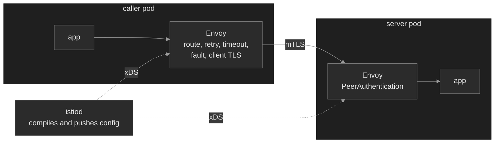

# M15 — Service Mesh

> A service mesh puts a proxy beside every workload and sends the workload's traffic through it. Routing, retries, timeouts, circuit breaking, and mutual TLS then become platform configuration instead of application code. The mesh also adds a second dataplane with its own failure signatures. Most of them reach the caller as the same `503`.

## What you'll learn

- Describe the two planes of a mesh: the **control plane** (`istiod`) compiles configuration, and the **dataplane** of **Envoy sidecars** carries the traffic
- Explain sidecar injection: a mutating admission webhook adds the proxy when a pod is created, so `2/2` versus `1/1` is the fastest membership check
- Shape L7 traffic with a **VirtualService** (routes, timeouts, retries, fault injection) and a **DestinationRule** (subsets, connection pool, outlier detection, client TLS). The caller's sidecar applies both.
- Treat mesh mTLS as a two-sided contract: a **PeerAuthentication** sets what a server accepts, and the DestinationRule `tls` mode sets what a client sends
- Read the dataplane with `istioctl proxy-status`, `istioctl proxy-config`, and the sidecar **access log**, whose **response flag** names the failed link

## Why it matters

M14 shaped traffic with NetworkPolicy at L3 and L4 and with Ingress at the edge. Neither control can retry a failed request, cap a call with a timeout, remove a failing replica from the pool, or authenticate one pod to another. Without a mesh, each service writes that logic itself, in its own language, with its own bugs. A **service mesh** moves that layer into a proxy. Retries become a field in a VirtualService. mTLS becomes one policy object. The application still makes a plain HTTP call to `session-broker`.

The cost lands on the SRE. The mesh adds a dataplane that the usual checks do not see. A pod can be `Running` and `Ready`, with a healthy Service and populated endpoints, and still return `503` to every caller. The cause can be a missing sidecar, a route to a subset with no pods, a TLS disagreement, or a test fault that nobody removed. `kubectl get pods` reports no problem in any of these cases. The evidence is in the Envoy configuration that the mesh compiled and in the line that the sidecar logged for the failed request. This module uses **Istio**, whose dataplane is **Envoy**, so debugging the mesh means reading Envoy configuration and Envoy logs.

## Scope

**Covers:** the two-plane model (`istiod` and Envoy sidecars); sidecar injection by the mutating webhook, the `istio-injection=enabled` namespace label, the `sidecar.istio.io/inject` pod label, the `istio-init` redirect, and injection at pod creation only; protocol selection by Service port name; the VirtualService (`hosts`, routes, `timeout`, `retries`, `fault`) and the DestinationRule (`subsets`, `connectionPool`, `outlierDetection`, `tls`); PeerAuthentication modes, DestinationRule TLS modes, and automatic mTLS; `istioctl proxy-status`, `proxy-config`, and `analyze`; the Envoy access log and its response flags; the `503` and connection-reset differential.

**Doesn't cover:** mesh installation, revisions, and control-plane upgrades (the lab installs Istio for you); ingress and egress gateways, and the Gateway API for mesh traffic (M14 covers north-south Ingress); multi-cluster meshes; `AuthorizationPolicy` and other L7 authorization (no module; read the Istio security docs); Kiali dashboards and distributed tracing (no module; M13 covers the Prometheus scrape model that mesh metrics feed); ambient mode beyond a named alternative.

**Assumes:** M04 is load-bearing: Services, ClusterIP, EndpointSlices, cluster DNS, and the connectivity differential. M14's reflex carries over: the client's error names the class of failure, and the configuration names the spot. M10's ServiceAccount is the identity that mesh mTLS is built on. M12 taught workload mTLS with hand-issued certificates; here the mesh issues and rotates them.

## Vocabulary

| Term | Definition |
|------|------------|
| **Service mesh** | An infrastructure layer that runs a proxy beside each workload and sends the workload's traffic through it. The platform then applies routing, resilience, and mTLS. |
| **Control plane (`istiod`)** | The Istio component that watches Kubernetes and mesh objects, compiles them into Envoy configuration, and pushes that configuration to each sidecar over the xDS API. It does not carry application traffic. |
| **Dataplane, sidecar** | The Envoy proxies that carry the traffic. Istio injects one per pod as the `istio-proxy` container. It intercepts the pod's inbound and outbound connections. |
| **Sidecar injection** | The addition of the sidecar to a pod at creation. "Injection occurs at pod creation time."<sup><a href="https://istio.io/latest/docs/setup/additional-setup/sidecar-injection/">[1]</a></sup> |
| **VirtualService** | A namespaced object with L7 routing rules for a host: which requests go to which destination, with per-route `timeout`, `retries`, and `fault`. |
| **DestinationRule** | A namespaced object with the policy for traffic to a host after routing: named `subsets`, `connectionPool` limits, `outlierDetection`, and the client-side `tls` mode. |
| **Subset** | A named group of a host's pods, selected by labels. A VirtualService routes to a subset by name. |
| **PeerAuthentication** | The server-side mTLS policy: `STRICT` (mTLS only), `PERMISSIVE` (mTLS or plaintext), or `DISABLE` (plaintext only). With no policy, Istio uses `PERMISSIVE`. |
| **Automatic mTLS** | The default caller behavior when a DestinationRule sets no `tls` mode: the caller's sidecar sends Istio mTLS to destinations that have a sidecar and plaintext to destinations that do not. |
| **Listener, route, cluster, endpoint** | Envoy's configuration types. A listener accepts connections on an address and port. A route maps a request to a cluster. A cluster is an upstream group. Its endpoints are pod IPs. |
| **Response flag** | A short code in the Envoy access log that states why Envoy answered the way it did, for example `UH` (no healthy upstream) or `FI` (fault injected).<sup><a href="https://www.envoyproxy.io/docs/envoy/latest/configuration/observability/access_log/usage">[2]</a></sup> |

## Mental model

The control plane, `istiod`, compiles the objects that you apply into Envoy configuration and pushes it to every sidecar. It never touches application traffic. Each request leaves through the caller's Envoy and enters through the server's Envoy. The objects state intent. The compiled configuration decides what happens to each request.



Two facts do most of the diagnostic work. First, **the caller's sidecar applies the traffic rules**: the route, the subset, the timeout, the retries, any injected fault, and the TLS mode that the caller sends. **The server's sidecar applies admission**: it accepts or rejects the connection by its PeerAuthentication. A failure therefore has a side. Second, **a pod without a sidecar is outside the mesh**. No mesh rule applies to its traffic.

Each failure in this module breaks one link on the request path. The response flag in the caller's access log names the link:

```text
app ─▶ caller Envoy ─▶ route ─▶ cluster (subset) ─▶ endpoint ─▶ server Envoy ─▶ app
         │               │          │                              │
         │               │          │                              └─ plaintext into STRICT: UC, server logs filter_chain_not_found
         │               │          │                                 TLS into a pod with no sidecar: UF, TLS_error
         │               │          └─ subset selects 0 pods: UH, no healthy upstream
         │               └─ fault left in the route: FI, fault filter abort
         └─ caller has no sidecar: no Envoy, no 503. The caller sees a connection reset.
```

## Concept walkthrough

### The dataplane: injection and mesh membership

A workload joins the mesh when its pod gets a sidecar. Istio adds the sidecar through a **mutating admission webhook**<sup><a href="https://kubernetes.io/docs/reference/access-authn-authz/extensible-admission-controllers/">[3]</a></sup>. When a namespace carries the label `istio-injection=enabled`, the webhook intercepts every new pod in it and adds two containers. The `istio-proxy` container is the Envoy sidecar. The `istio-init` init container runs first and installs iptables rules in the pod's network namespace. Those rules redirect the pod's inbound and outbound TCP through Envoy<sup><a href="https://istio.io/latest/docs/ops/deployment/architecture/">[4]</a></sup>. The application container does not change. It still listens on port 80 and still makes ordinary calls. The kernel sends those calls through the proxy. The visible sign is the container count: a meshed pod reports `2/2`, and a pod with no sidecar reports `1/1`.

Two properties of injection cause most injection incidents.

- **Injection happens at pod creation only.** A label on an existing namespace changes nothing for the pods that already run. They stay `1/1` until something recreates them, for example `kubectl rollout restart`.
- **A pod can opt out.** The pod label `sidecar.istio.io/inject: "false"` on a pod template disables injection, even in an enabled namespace. Istio's rule: "If either label (`istio-injection` or `sidecar.istio.io/inject`) is disabled, the pod is not injected."<sup><a href="https://istio.io/latest/docs/setup/additional-setup/sidecar-injection/">[1]</a></sup> Istio deprecates the older annotation of the same name.

A pod that skipped injection is not partly in the mesh. It is fully outside it. No route, retry, or mTLS rule applies to its traffic, and it never connects to `istiod`. `istioctl proxy-status` lists every sidecar that `istiod` knows, so a pod without a sidecar is absent from that list<sup><a href="https://istio.io/latest/docs/ops/diagnostic-tools/proxy-cmd/">[5]</a></sup>. When a workload behaves as if the mesh ignores it, count its containers first.

The direction of the failure depends on which end lost its sidecar. A server without a sidecar receives Istio mTLS from a caller sidecar that was told to send it, cannot answer in TLS, and the caller's Envoy returns `503`. A caller without a sidecar sends plaintext straight to the server's Envoy. Under `STRICT`, the server's Envoy closes the connection. The caller has no Envoy to turn that into an HTTP response, so the caller sees a connection reset (`curl: (56) Recv failure: Connection reset by peer`). A `503` means a caller sidecar answered. A reset means no caller sidecar was there.

<details>
<summary>📖 Going deeper: what the injector writes, native sidecars, and ambient mode<sup><a href="https://istio.io/latest/docs/overview/dataplane-modes/">[6]</a></sup></summary>

The webhook does more than append a container. The injection template runs Envoy as UID 1337, and `istio-init` excludes that UID from the redirect, so Envoy's own outbound traffic does not loop back into Envoy. The template also mounts the pod's mesh identity. The Istio agent in the sidecar requests a certificate for that identity from `istiod`. The certificate carries a SPIFFE ID built from the ServiceAccount, `spiffe://<trust-domain>/ns/<namespace>/sa/<serviceaccount>`, and the default lifetime is 24 hours. The agent rotates it before expiry. `istioctl proxy-config secret` shows the current certificate and its `NOT AFTER` time.

Kubernetes **native sidecars** are init containers with `restartPolicy: Always` that run for the whole pod lifetime<sup><a href="https://kubernetes.io/docs/concepts/workloads/pods/sidecar-containers/">[7]</a></sup>. Istio can inject `istio-proxy` that way. In Istio 1.24 this mode is off by default. Istio 1.27 turned it on by default. In native mode, `kubectl describe pod` lists `istio-proxy` under `Init Containers:`, and the `READY` column still counts it.

**Ambient mode** is Istio's sidecarless dataplane. A per-node component carries L4 traffic and mTLS, and optional per-namespace proxies add L7 features. Istio declared ambient mode generally available in 1.24. It removes the per-pod proxy cost, and its diagnostic tools differ.

</details>

### Traffic management: VirtualService and DestinationRule

Two objects shape traffic to a meshed host, and they divide the work. A **VirtualService** answers *where does this request go*. It matches on host, and optionally on path or headers, and routes to a destination. Each route can carry a `timeout`, which caps how long the caller waits, and a `retries` block with an attempt count, a per-try timeout, and the conditions that trigger a retry<sup><a href="https://istio.io/latest/docs/concepts/traffic-management/">[8]</a></sup>. A **DestinationRule** answers *how does the caller talk to that destination*. It defines named `subsets` of the host's pods, `connectionPool` limits, `outlierDetection`, and the client-side `tls` mode<sup><a href="https://istio.io/latest/docs/reference/config/networking/destination-rule/">[9]</a></sup>. The caller's sidecar applies both objects on the way out. The rules for reaching `session-broker` act in the proxy of each caller, not in the proxy of `session-broker`.

A **subset** is a label-selected group of a host's pods, usually one version. The DestinationRule declares subsets such as `stable` and `canary`, and the VirtualService routes to one by name. `istiod` compiles each subset into its own Envoy cluster, named like `outbound|80|canary|session-broker.media.svc.cluster.local`. When a subset's labels select zero pods, the cluster is valid but has no endpoints. Envoy then answers every request routed there with `503` and the body `no healthy upstream`. No pod is unhealthy. The route points at an empty group. `istioctl analyze` reports a route to a subset that no DestinationRule defines, but it does not report a defined subset that selects zero pods. Only the endpoint list shows that case.

The circuit breaker lives in the DestinationRule. `outlierDetection` ejects an endpoint from the load-balancing pool after `consecutive5xxErrors` errors, for `baseEjectionTime`, up to `maxEjectionPercent` of the pool<sup><a href="https://istio.io/latest/docs/tasks/traffic-management/circuit-breaking/">[10]</a></sup>. `connectionPool` caps concurrent connections and pending requests. Together they stop one failing replica from tying up every caller.

A VirtualService can also inject faults. A `fault.delay` adds latency, and a `fault.abort` returns a chosen status code for a percentage of requests<sup><a href="https://istio.io/latest/docs/tasks/traffic-management/fault-injection/">[11]</a></sup>. The caller's Envoy produces the fault itself. The request never reaches the server, so the server's logs show only the requests that succeeded. Retries do not repeat an injected abort. A fault that stays in a route after a resilience test produces a steady fraction of errors with healthy pods, healthy endpoints, and nothing in the server logs.

Istio needs to know the protocol of a Service port to apply HTTP rules. It reads the port name (`http`, `http-web`, `grpc`) or the `appProtocol` field. When neither is set, Istio tries automatic detection, and treats traffic that it cannot identify as plain TCP<sup><a href="https://istio.io/latest/docs/ops/configuration/traffic-management/protocol-selection/">[12]</a></sup>. A port declared as HTTP gets a shared listener for that port number, with routes matched by the `Host` header. `istioctl analyze` reports an unnamed port as an informational message.

### Mesh-managed mTLS

The mesh can require that every hop between pods is mutually authenticated and encrypted. The sidecars do the TLS work with the identities from injection, and the application handles no certificate. The control is the **PeerAuthentication**, and it is a **server-side** policy: it sets what a workload's sidecar accepts<sup><a href="https://istio.io/latest/docs/tasks/security/authentication/mtls-migration/">[13]</a></sup>. `STRICT` accepts only Istio mTLS. `PERMISSIVE` accepts mTLS or plaintext. `DISABLE` accepts plaintext only. A PeerAuthentication named `default` with no `selector` applies to every workload in its namespace.

The client side is a separate setting. The DestinationRule `tls` mode sets what a caller's sidecar sends: `ISTIO_MUTUAL` sends Istio mTLS, and `DISABLE` sends plaintext. The two sides must agree. A caller with `tls.mode: DISABLE` sends plaintext to a `STRICT` server. The server's Envoy has no filter chain for plaintext, logs `filter_chain_not_found`, and closes the connection. The caller's Envoy reports the closed connection as `503` with the flag `UC`. Both pods are healthy and meshed. Only reading the PeerAuthentication and the DestinationRule together shows the conflict. Repair the caller's side, not the server. A change of the server to `PERMISSIVE` makes the `503` stop, and it also makes the hop accept plaintext again.

<details>
<summary>📖 Going deeper: automatic mTLS, and the silent downgrade<sup><a href="https://istio.io/latest/docs/tasks/security/authentication/authn-policy/">[14]</a></sup></summary>

Most meshes need no DestinationRule `tls` block. Automatic mTLS is on by default: "Istio tracks the server workloads migrated to Istio proxies, and configures client proxies to send mutual TLS traffic to those workloads automatically, and to send plain text traffic to workloads without sidecars."<sup><a href="https://istio.io/latest/docs/tasks/security/authentication/authn-policy/">[14]</a></sup> When a DestinationRule sets a `tls` mode, that mode always wins. So a `tls.mode: DISABLE` against a `STRICT` server is self-inflicted: someone replaced the automatic behavior with the wrong value.

Automatic mTLS also creates a quiet hazard. When a server loses its sidecar, no Envoy is left to enforce its PeerAuthentication, and automatic mTLS on each caller switches to plaintext. The hop works, and it is unencrypted. Nothing returns an error. An explicit `ISTIO_MUTUAL` makes the same missing sidecar fail loudly with `503`, because the caller must send mTLS. Automatic mTLS favors availability. An explicit mode favors a guarantee that fails visibly.

The safe rollout of `STRICT` follows the same logic. Start in `PERMISSIVE`, which accepts both. Inject every workload. Confirm in telemetry that all traffic to the namespace is mTLS. Then switch to `STRICT`. A direct switch to `STRICT` resets every caller that is still outside the mesh at the same moment.

</details>

### Reading the dataplane

The objects that you apply are intent. Three tools show what the dataplane does with them.

**`istioctl proxy-status`** lists every sidecar and its configuration state per xDS type: `CDS` (clusters), `LDS` (listeners), `EDS` (endpoints), and `RDS` (routes)<sup><a href="https://istio.io/latest/docs/ops/diagnostic-tools/proxy-cmd/">[5]</a></sup>. `SYNCED` means Envoy acknowledged the last configuration that `istiod` sent. `NOT SENT` means `istiod` sent nothing of that type. `STALE` means `istiod` sent an update and Envoy has not acknowledged it. Version 1.24 adds an age in parentheses, such as `SYNCED (9s)`, and shows `IGNORED` for types that the sidecar does not use. A pod that is not in the list has no sidecar.

**`istioctl proxy-config`** prints the compiled configuration of one sidecar. It accepts a pod name or `deployment/<name>`. `clusters` lists the upstream groups, one per subset. `endpoints` lists the pod IPs in each cluster with `HEALTHY` or `UNHEALTHY`, and a cluster with no rows has no endpoints. `routes` shows which VirtualService produced a route. `listeners` shows the ports that Envoy accepts on. `istioctl analyze` adds a static check of the objects themselves, for example a reference to an undefined subset.

**The access log** is the fastest of the three. When the mesh sets `accessLogFile`, every sidecar writes one line per request to its `istio-proxy` container log. The line carries the status code, the response flag, a detail string, and the upstream cluster. `kubectl logs <pod> -c istio-proxy` on the caller shows why Envoy answered `503`, before any other command:

| Response flag | Meaning in Envoy | Typical mesh cause |
|---|---|---|
| `UH` | no healthy upstream hosts | the routed subset selects zero pods |
| `UF` | upstream connection failure | TLS sent to a pod that has no sidecar; the detail names a `TLS_error` |
| `UC` | upstream connection termination | plaintext sent to a `STRICT` server |
| `URX` | retry limit reached | added beside `UF` or `UC` when the route retries |
| `FI` | request aborted by fault injection | a `fault.abort` in the VirtualService |
| `NR` | no route configured | no route matched; on a server inbound listener, `filter_chain_not_found` |

The client receives the same information as the response body, for example `no healthy upstream` or `fault filter abort`.

## Hands-on

The baseline has four steps. Five break/fix scenarios follow. Each runs on the full Polyphone fleet with Istio 1.24 installed, access logging on, and the `media` namespace in the mesh. Traffic comes from a long-lived `mesh-client` pod through `kubectl exec`, because a sidecar keeps a run-to-completion client pod alive after its command ends.

- **`baseline/`** — a healthy mesh. Read injection and `2/2`, the VirtualService and DestinationRule, `STRICT` mTLS with a rejected plaintext caller, and the `istioctl` toolkit.
- **`breakfix-01-sidecar-not-injected`** — callers get `503`; the server pod is `1/1` because its template opts out of injection. Remove the opt-out.
- **`breakfix-02-virtualservice-subset`** — callers get `503 no healthy upstream`; the route targets a subset with no pods. Route to `stable`.
- **`breakfix-03-mtls-mode-mismatch`** — callers get `503`; the DestinationRule sends plaintext to a `STRICT` server. Set the client to mTLS.
- **`breakfix-04-injection-not-restarted`** — a caller in `signaling` gets a connection reset, not a `503`. Its namespace was enrolled after the pod started. Restart the caller.
- **`breakfix-05-fault-injection-left-on`** — about half the calls fail with `fault filter abort`. A test fault is still in the route. Remove it.

Check yourself against `ANSWER-KEY.md` after each scenario.

## Common failure modes

| Symptom | Likely cause | Where to look |
|---|---|---|
| A workload ignores all mesh rules | It has no sidecar | `READY` column (`1/1`); `istioctl proxy-status`; pod labels for `sidecar.istio.io/inject` |
| Namespace is labeled for injection, pods are still `1/1` | Pods started before the label | pod age versus the label; `kubectl rollout restart` |
| `503`, flags `URX,UF`, detail `TLS_error` | Caller sends mTLS; server has no sidecar | server pod `READY`; DestinationRule `tls` |
| `503 no healthy upstream`, flag `UH` | Route targets a subset with zero pods | VirtualService `subset`; DestinationRule subset labels; `proxy-config endpoints` |
| `503`, flags `URX,UC`; server log `filter_chain_not_found` | Caller sends plaintext to a `STRICT` server | PeerAuthentication mode and DestinationRule `tls` mode, read together |
| Connection reset (`curl` exit 56), no HTTP status | Caller has no sidecar; server is `STRICT` | caller `READY`; namespace label; PeerAuthentication |
| A fixed fraction of calls fail, flag `FI` | A fault injection stayed in the route | VirtualService `fault` |
| A change applied, behavior unchanged | The sidecar did not take the new configuration | `istioctl proxy-status` for `STALE` or `NOT SENT`; `istiod` health |
| `404` through the mesh, flag `NR` | No route matched the request path | VirtualService `match` rules; `proxy-config routes` |

## Recap

- **A pod is in the mesh only if it has a sidecar, and injection happens at creation.** `2/2` and a line in `istioctl proxy-status` mean that mesh rules apply. A namespace label does nothing for pods that already run.
- **The caller's sidecar applies traffic rules; the server's sidecar applies admission.** Routes, subsets, retries, faults, and client TLS act on the way out. PeerAuthentication acts on the way in.
- **The objects are intent; the compiled Envoy configuration is behavior.** `istioctl proxy-config` shows the clusters and endpoints, and a subset with no endpoints is a valid rule that returns `503`.
- **mTLS is a two-sided contract.** PeerAuthentication sets what the server accepts. The DestinationRule `tls` mode sets what the caller sends. Repair a mismatch on the client side.
- **The access log names the link.** `UH`, `UF`, `UC`, and `FI` are four causes behind one `503`. A reset with no status means the caller has no sidecar.

## Production thinking

- A team labels its namespace for injection and reports that "the mesh does nothing." Every pod predates the label. What recreates the pods with sidecars, and what is the risk of doing it to every Deployment in the namespace at once during business hours?
- You must move a namespace to `STRICT` while some of its callers are still outside the mesh. Which signal tells you that every caller now sends mTLS, and what happens to a caller you missed at the moment you switch?
- A canary route sends 10% of `session-broker` traffic to `subset: canary`, and 10% of requests return `503`. The canary Deployment has zero ready pods. Which response flag do you expect in the caller's access log, and why did the VirtualService apply without an error?

## References

1. Istio — Installing the sidecar (automatic injection, injection labels): https://istio.io/latest/docs/setup/additional-setup/sidecar-injection/
2. Envoy — Access logging (format, response flags): https://www.envoyproxy.io/docs/envoy/latest/configuration/observability/access_log/usage
3. Kubernetes — Dynamic admission control (mutating webhooks): https://kubernetes.io/docs/reference/access-authn-authz/extensible-admission-controllers/
4. Istio — Architecture (istiod and the Envoy dataplane): https://istio.io/latest/docs/ops/deployment/architecture/
5. Istio — Debugging Envoy and istiod (proxy-status, proxy-config): https://istio.io/latest/docs/ops/diagnostic-tools/proxy-cmd/
6. Istio — Dataplane modes (sidecar and ambient): https://istio.io/latest/docs/overview/dataplane-modes/
7. Kubernetes — Sidecar containers: https://kubernetes.io/docs/concepts/workloads/pods/sidecar-containers/
8. Istio — Traffic management (VirtualService, subsets, timeouts, retries): https://istio.io/latest/docs/concepts/traffic-management/
9. Istio — DestinationRule reference: https://istio.io/latest/docs/reference/config/networking/destination-rule/
10. Istio — Circuit breaking: https://istio.io/latest/docs/tasks/traffic-management/circuit-breaking/
11. Istio — Fault injection: https://istio.io/latest/docs/tasks/traffic-management/fault-injection/
12. Istio — Protocol selection: https://istio.io/latest/docs/ops/configuration/traffic-management/protocol-selection/
13. Istio — Mutual TLS migration: https://istio.io/latest/docs/tasks/security/authentication/mtls-migration/
14. Istio — Authentication policy (automatic mutual TLS): https://istio.io/latest/docs/tasks/security/authentication/authn-policy/
