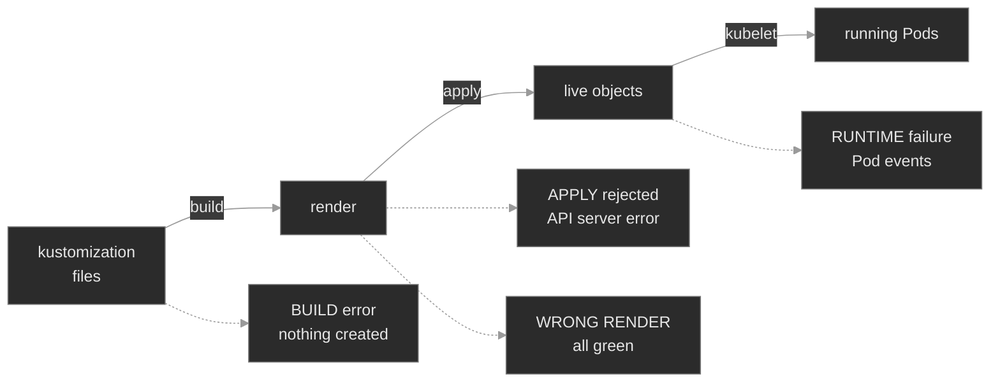

# M16 — Kustomize Bases & Overlays

> One base, many environments, no templating language. How Kustomize composes and transforms plain YAML, and how to find which stage of the pipeline broke.

## What you'll learn

- Compose an environment from a shared **base** plus environment-specific **overlays**, and read any `kustomization.yaml`
- Render with `kubectl kustomize`, compare with the live cluster through `kubectl diff -k`, and apply with `kubectl apply -k`
- Write strategic-merge and JSON 6902 patches, and predict when a patch that matches nothing fails the build and when Kustomize skips it in silence
- Generate ConfigMaps and Secrets, and reason about the **name-suffix hash** and the reference rewriting it drives
- Apply transformers (`namespace`, `labels`, `images`, `namePrefix`) without changing an immutable selector
- Reuse an optional change across overlays with a **component**
- Locate any Kustomize failure to one stage (**build**, **apply**, or **runtime**), and know when every stage is green and the render is still wrong

## Why it matters

Every Polyphone environment runs the same workloads with different settings. Prod wants more replicas and a pinned image, lab wants verbose logging, and each region wants its own node placement. A folder of complete manifests per environment does not survive contact with change. A security fix to a Pod spec must be copied into a dozen files, and the day someone misses one, lab and prod diverge without notice.

Kustomize<sup><a href="https://kubernetes.io/docs/tasks/manage-kubernetes-objects/kustomization/">[1]</a></sup> removes the copies. One base holds what every environment shares. Each environment is a small overlay that states only how it departs from the base. Kustomize has no templating language and no string interpolation. It transforms YAML with more YAML, and `kubectl` has it built in. Flux renders the same files for you in M18.

The failure surface is different from earlier modules. A broken Deployment shows up in `kubectl describe`. A broken kustomization can fail before any object exists. It can produce a valid render that the API server rejects. It can apply cleanly and fail only when a Pod starts. Or every stage can succeed while the render quietly omits a change. The stage decides your first command.

## Scope

**Covers:** the base/overlay composition model; `kubectl kustomize` (render), `kubectl diff -k` (render compared with live), and `kubectl apply -k` (render, then apply); patches in both dialects and how a patch finds its target; generators (`configMapGenerator`, `secretGenerator`, `generatorOptions`), the content-hash suffix, and reference rewriting; transformers (`namespace`, `labels`, `commonLabels`, `images`, `namePrefix`/`nameSuffix`); components; and the build → apply → runtime failure model.

**Doesn't cover:** `replacements` and the deprecated `vars`, `commonAnnotations`, custom transformer `configurations`, and remote bases (read the field reference when you need them); Helm and the Kustomize-versus-Helm decision (M17); Flux, reconciliation, and pruning by a controller (M18); multi-cluster promotion and per-cluster variables (M19); encrypting Secrets for git (M11).

**Assumes:** you can read a Deployment, Service, and ConfigMap (M01, M03, M04); you know labels and selectors (M00, M04); you know that a container reads `envFrom` values once, at start (M03); you know `kubectl apply`'s declarative model (M00).

## Vocabulary

| Term | Definition |
|------|------------|
| **kustomization** | A directory with a `kustomization.yaml` file. The unit Kustomize builds. |
| **Base** | "A directory with a `kustomization.yaml`, which contains a set of resources and associated customization"<sup><a href="https://kubernetes.io/docs/tasks/manage-kubernetes-objects/kustomization/">[1]</a></sup>. A base has no knowledge of the overlays that use it. |
| **Overlay** | A kustomization whose `resources:` list names one or more other kustomizations, then customizes the combined result. Usually one overlay per environment. |
| **Render** | The YAML stream that a build produces. `kubectl kustomize <dir>` prints it. The cluster only ever receives a render. |
| **Transformer** | A field that rewrites every resource in the build: `namespace`, `labels`, `commonLabels`, `namePrefix`, `nameSuffix`, `images`. |
| **Patch** | A change to selected resources, listed under `patches:`. Two dialects: strategic-merge and JSON 6902. |
| **Strategic-merge patch** | A partial resource. Kustomize merges it onto the resource with the same kind and name, and it merges lists by their merge key (a container by its `name`). |
| **JSON 6902 patch** | An RFC 6902 operation list (`add`, `replace`, `remove`) against exact paths such as `/spec/replicas`. It needs a `target:`. |
| **Target selector** | The `target:` of a patch: `group`, `version`, `kind`, `name`, `namespace`, `labelSelector`, `annotationSelector`. The patch applies to every resource that matches all specified fields. |
| **Generator** | `configMapGenerator` or `secretGenerator`. It builds a ConfigMap or Secret from literals, files, or env files. |
| **Name-suffix hash** | A hash of a generated object's contents, appended to its name (`edge-relay-config-df6tkm6c7t`). New content gives a new name. |
| **Reference rewriting** | Kustomize replaces the generator's declared name with the hashed name in every reference to it, such as an `envFrom` `configMapRef`. |
| **Component** | A kustomization with `kind: Component`. An overlay includes it through `components:`, and the component's changes apply to that overlay's resources. |
| **`behavior`** | On an overlay generator: `create` (the default), `merge` (add or override keys of the base generator with the same name), or `replace`. |

## Mental model

Kustomize is a **renderer, not a runtime**. `kubectl kustomize <dir>` reads a directory of YAML and prints one stream of YAML. It contacts no cluster. `kubectl apply -k <dir>` runs the same build, then applies the result. The API server receives ordinary objects that look hand-written. No cluster component knows that Kustomize exists.

That fact organizes every diagnosis. A failure lands in one stage, and each stage leaves a different trace:



- **Build.** `kubectl kustomize` prints an error and exits non-zero. Nothing reaches the cluster, so `describe` has nothing to show. First command: `kubectl kustomize <dir>`, then read the error.
- **Apply.** The render is valid YAML, and the API server rejects an object: an immutable field, a quota, a failed admission check. First command: `kubectl diff -k <dir>` or the failed `apply -k`, then read the field the API server names.
- **Runtime.** Build and apply succeed, and a Pod fails when it starts. First command: the normal `get → describe → events → logs` loop, then compare the live reference with the render.
- **Wrong render.** Every stage succeeds, and the render does not contain the change you intended. No error exists anywhere. First command: `kubectl kustomize <dir>`, read the field you expected to change, and trace back which mechanism should have changed it.

The last row is the hardest, because the headline status lies. A green deploy job, a complete rollout, and `Running` Pods all report on the render you produced, not the render you meant.

## Concept walkthrough

### Composition: bases and overlays

A base lists raw resources and the changes every environment shares:

```yaml
# base/kustomization.yaml
namespace: edge
resources:
  - deployment.yaml
  - service.yaml
configMapGenerator:
  - name: edge-relay-config
    literals: [LOG_LEVEL=info, MAX_SESSIONS=500]
```

An overlay names the base in its `resources:` list and adds the environment's departures:

```yaml
# overlays/prod/kustomization.yaml
resources:
  - ../../base
images:
  - {name: nginx, newTag: "1.27"}
patches:
  - path: replicas-patch.yaml
```

`resources:` accepts raw manifest files and other kustomization directories. That second form is how composition works. The base renders on its own. Each overlay renders to the base plus its changes. A fix to the base reaches every environment on the next build. Overlays can stack on overlays, though two levels serve most fleets.

A wrong path in `resources:` stops the build at accumulation with `no such file or directory`. The usual cause is a directory that moved. A resource listed twice, once through the base and once as a file, stops the build with `may not add resource with an already registered id`.

### Rendering, comparing, applying

Three commands run the same build and differ only in what they do with the render:

| Command | Contacts the cluster | Use it to |
|---------|---------------------|-----------|
| `kubectl kustomize <dir>` | No | See exactly what the build produces |
| `kubectl diff -k <dir>` | Yes, a server-side dry run | See what would change in the live objects<sup><a href="https://kubernetes.io/docs/reference/kubectl/generated/kubectl_diff/">[2]</a></sup> |
| `kubectl apply -k <dir>` | Yes | Create and update the rendered objects |

`kubectl diff` exits 0 when nothing would change, 1 when a difference exists, and above 1 on an error. It sends the objects through the API server as a dry run, so admission and validation run. An immutable-field change shows up as the same error that `apply` returns, before anything changes.

`apply -k` is not a transaction. It sends each rendered object on its own. When the API server rejects one object, the objects before and after it still apply. A rejected promotion can leave the cluster in a mixed state that neither environment describes. Render before you apply, and diff before you apply to a cluster that already runs the workload.

### Patches: how a change finds its target

A transformer touches every resource. A patch touches selected resources, so the selection is the crux<sup><a href="https://kubectl.docs.kubernetes.io/references/kustomize/kustomization/patches/">[3]</a></sup>.

A strategic-merge patch file with no `target:` names its own target. Kustomize finds the resource with the patch's kind and `metadata.name`, and merges the fragment onto it:

```yaml
# replicas-patch.yaml targets Deployment/edge-relay by its own identity
apiVersion: apps/v1
kind: Deployment
metadata: {name: edge-relay}
spec: {replicas: 3}
```

If no resource carries that name, the build fails. The error ends with `no matches for Id Deployment.v1.apps/edge-relayer.[noNs]; failed to find unique target for patch`. The patch named exactly one resource, and that resource is missing.

A patch with a `target:` behaves differently. The target is a **selector**, and the patch applies to every resource that matches all the fields you specify. The `name` and `namespace` fields are anchored regular expressions, so `name: relay` means `^relay$`. A selector that matches zero resources is not an error. Kustomize applies the patch to nothing, prints nothing, and exits 0:

```yaml
patches:
  - target: {kind: Deployment, name: relay}   # matches edge-relay? No: ^relay$
    patch: |
      - {op: replace, path: /spec/replicas, value: 3}
```

This difference is the most important fact about patches. Two patches with the same name mistake fail in opposite ways. The patch file without a target stops the build. The selector patch disappears without a trace, and the environment ships without the change. The only evidence is the render, so read the field you meant to change.

The JSON 6902 dialect is the operation list shown above<sup><a href="https://kubernetes.io/docs/tasks/manage-kubernetes-objects/update-api-object-kubectl-patch/">[4]</a></sup>. It needs a `target:`, because the operations carry no resource identity. A `patches:` entry detects the dialect from what you write. The older `patchesStrategicMerge` and `patchesJson6902` fields are deprecated in favor of `patches:`.

<details>
<summary>📖 Going deeper: strategic-merge vs JSON 6902, and the cost of a selector<sup><a href="https://kubectl.docs.kubernetes.io/references/kustomize/kustomization/patches/">[3]</a></sup></summary>

**Strategic-merge** knows the Kubernetes merge keys. A patch that lists one container by `name` merges into that container and leaves the others alone. It reads like the resource it changes, so use it to set fields.

**JSON 6902** works on positions and has no merge-key knowledge. `/spec/template/spec/containers/0/image` addresses the first container by index, and a reordered list breaks it. Use it to `remove` a field, to `add` at a specific list position, or to change a field that has no merge key.

**Selectors buy reach and lose loudness.** A target such as `{kind: Deployment, labelSelector: "plane=edge"}` patches every edge Deployment, including ones added next month. The same reach means a typo or a renamed label matches nothing, with no error. Two habits keep that safe. First, keep a CI check that renders each overlay and asserts the fields the overlay exists to set, such as `replicas: 3` in prod. Second, use a patch file with no target when you mean exactly one resource, because then a missing resource stops the build.

</details>

### Generators and the name-suffix hash

You can write a ConfigMap by hand and list it in `resources:`. A generator builds it for you, and it changes the object's name when the contents change<sup><a href="https://kubectl.docs.kubernetes.io/references/kustomize/kustomization/configmapgenerator/">[5]</a></sup>:

```yaml
configMapGenerator:
  - name: edge-relay-config
    literals: [LOG_LEVEL=info, MAX_SESSIONS=500]
```

The rendered ConfigMap is `edge-relay-config-df6tkm6c7t`, the declared name plus a hash of the data. The hash exists to make config changes roll the workload. A container reads `envFrom` values once, when it starts. ConfigMaps "consumed as environment variables are not updated automatically and require a pod restart"<sup><a href="https://kubernetes.io/docs/concepts/configuration/configmap/#using-configmaps-as-files-from-a-pod">[6]</a></sup>. With a fixed name, an edit to the ConfigMap changes no Pod template, so the Deployment controller has nothing to roll. With a hashed name, the chain is mechanical:

1. New data gives a new hash and a new ConfigMap name.
2. Kustomize writes the new name into every reference.
3. The Deployment's Pod template changes.
4. The Deployment controller starts a rollout, and the new containers read the new values.

Step 2 depends on a name match. The docs rule is short: "reference it by the name of the configMapGenerator"<sup><a href="https://kubernetes.io/docs/tasks/manage-kubernetes-objects/kustomization/">[1]</a></sup>. Kustomize rewrites a reference only when it names the generator's declared name exactly. A Deployment that asks for `edge-relay-conf` keeps that bare name. The render then holds a hashed ConfigMap and a Deployment that references a ConfigMap that does not exist. Build succeeds, apply succeeds, and the kubelet fails the container with `CreateContainerConfigError`.

`generatorOptions: {disableNameSuffixHash: true}` turns the hash off for every generator in that kustomization<sup><a href="https://kubectl.docs.kubernetes.io/references/kustomize/kustomization/generatoroptions/">[7]</a></sup>. In an overlay, that includes a base generator that the overlay merges with `behavior: merge`. The name becomes stable, and step 1 of the chain disappears. A config edit now updates the ConfigMap in place, and no Pod restarts. The ConfigMap reads the new value while every running container still holds the old one. Teams usually disable the hash to stop old ConfigMaps from accumulating. That trade gives up the automatic rollout.

Three more rules matter in operations:

- **`behavior: merge` binds by name.** An overlay generator with `behavior: merge` adds or overrides keys of the base generator with the same name and namespace. Prod can override `MAX_SESSIONS` and inherit `REGION`. A merge whose name matches no generator stops the build with `does not exist; cannot merge or replace`.
- **Old generated objects stay.** `apply -k` creates and updates; it never deletes. Each config change leaves the previous `edge-relay-config-<hash>` behind. `kubectl apply -k <dir> --prune -l <selector>` deletes objects that carry the label and left the render. A GitOps controller does the same garbage collection (M18).
- **`secretGenerator` works the same way.** It base64-encodes values. Base64 is an encoding, not encryption (M11).

### Transformers and the immutable selector

Transformers rewrite fields across the whole build. `namespace` sets the namespace on every resource. `images` changes image names, tags, or digests without a patch<sup><a href="https://kubectl.docs.kubernetes.io/references/kustomize/kustomization/images/">[8]</a></sup>. `namePrefix` and `nameSuffix` rename resources and update the references to them. The label transformers are where promotions break.

Kustomize has two label transformers<sup><a href="https://kubectl.docs.kubernetes.io/references/kustomize/kustomization/labels/">[9]</a></sup>:

| Field | Writes labels to |
|-------|------------------|
| `commonLabels` (deprecated) | metadata, Pod templates, and every selector |
| `labels:` (defaults) | metadata only |
| `labels:` with `includeTemplates: true` | metadata and Pod templates |
| `labels:` with `includeSelectors: true` | metadata, Pod templates, and selectors |

The selector column is the trap. A Deployment's label selector is immutable after creation in `apps/v1`<sup><a href="https://kubernetes.io/docs/concepts/workloads/controllers/deployment/#label-selector-updates">[10]</a></sup>. The selector is how the Deployment finds the ReplicaSets and Pods it owns.

On a first create, `commonLabels` is harmless, because the selector gets its value for the first time. Apply the same overlay over a running Deployment and the API server rejects it: `spec.selector: Invalid value: ... field is immutable`. The build was fine and the render was valid. The live object made it illegal. The rest of the apply still lands. A Service selector is mutable, so the Service gains the new label in its selector, and it now selects none of the running Pods. A rejected promotion becomes a traffic outage. The fix keeps the label off the selector: `labels:` with `includeSelectors: false`, plus `includeTemplates: true` if the Pods need the label. If the label must be in the selector, the only path is to delete and recreate the Deployment, which is an outage. Newer `kubectl` versions print a deprecation warning when they render `commonLabels`; the v1.30 client prints none.

### Components

A base packages resources that every overlay starts from. A component packages a change that some overlays opt into<sup><a href="https://kubectl.docs.kubernetes.io/guides/config_management/components/">[11]</a></sup>. It is a kustomization with `apiVersion: kustomize.config.k8s.io/v1alpha1` and `kind: Component`, and an overlay includes it through `components:`. The difference is scope. A base's patches change only the base's own resources. A component's patches and generators apply to the resources of the overlay that includes it. A regional-affinity pin, a debug sidecar, or a monitoring annotation set fits this shape: prod enables it, lab skips it, and one definition serves both. Reach for a component when the same change recurs across overlays, and for a base when the same resources do.

## Hands-on

The baseline has four steps. Five break/fix scenarios follow. Each runs on the full Polyphone fleet plus `edge-relay`, a Deployment that Kustomize manages from the tree at `/root/edge-relay`.

- **`baseline/`** — render the base, diff the overlays, and compare prod with live through `kubectl diff -k`. Then change a config value, watch the hash roll the Deployment, and prune the old ConfigMap.
- **`breakfix-01-patch-target-mismatch`** — the deploy job fails and `edge-relay` does not exist. Read the build error.
- **`breakfix-02-generator-name-mismatch`** — apply succeeds and every Pod is in `CreateContainerConfigError`. Trace the reference back to the render.
- **`breakfix-03-commonlabels-immutable-selector`** — the prod promotion is rejected with `field is immutable`, and calls start to fail. Find the transformer that reached the selector.
- **`breakfix-04-patch-matches-nothing`** — every stage is green and prod runs one replica instead of three. Find the change the render dropped.
- **`breakfix-05-hash-disabled-stale-config`** — a config change shipped and the ConfigMap shows it, but the relay still runs the old value. Find why nothing rolled.

Check yourself against `ANSWER-KEY.md` after each scenario.

## Common failure modes

| Symptom | Likely cause | First command |
|---------|--------------|---------------|
| `apply -k` fails and the workload does not exist | Build error: a patch file names a missing resource, a bad path, a duplicate id | `kubectl kustomize <dir>` |
| `failed to find unique target for patch` | A patch file with no `target:` names a resource the build does not hold | Compare the patch's `metadata.name` with the base |
| `accumulating resources ... no such file or directory` | A `resources:` or `components:` path is wrong | The relative paths in `kustomization.yaml` |
| `may not add resource with an already registered id` | The same resource enters the build twice | The `resources:` lists for duplicates |
| `spec.selector: Invalid value: ... field is immutable` | `commonLabels`, or `labels:` with `includeSelectors: true`, changed a live selector | `kubectl diff -k <dir>` and the label transformers |
| Service `Endpoints: <none>` after a failed apply | The rejected apply still updated the Service selector | `kubectl describe svc`, then fix and re-apply |
| `CreateContainerConfigError`, `configmap "..." not found` | The reference name differs from the generator name, so no rewrite happened | `kubectl kustomize <dir>`, compare reference and generated name |
| Everything green, an overlay change is missing | A `target:` selector matched zero resources, or the wrong overlay was applied | `kubectl kustomize <dir>`, read the field you expected |
| ConfigMap shows the new value, the app runs the old one | The hash is disabled, so no reference changed and nothing rolled | `kubectl rollout history`, then `generatorOptions` |
| Old `*-<hash>` ConfigMaps accumulate | `apply` never deletes | `apply -k --prune -l <selector>`, or a GitOps controller |

## Recap

- **Kustomize renders; it never runs.** The cluster receives plain objects. `kubectl kustomize` shows the render, `kubectl diff -k` compares it with live, and `apply -k` applies it.
- **The stage decides the first command.** A build error leaves nothing in the cluster. An apply error names a field. A runtime error lives in Pod events. A wrong render produces no error at all, so read the render.
- **A patch file names one resource and fails loudly; a `target:` selector names a set and can match nothing in silence.** Assert the fields an overlay exists to set.
- **The hash turns a config change into a rollout through a name match.** Break the match and the Pod cannot start. Disable the hash and the config changes while the Pods keep the old values.
- **Transformers that reach a selector collide with immutability.** Keep labels off the selector of anything already running.

## Production thinking

- A selector patch that matches nothing ships an environment without its change, and every check stays green. Which assertions would you add to CI for each overlay, and who owns the list of fields each overlay must set?
- Your team disabled the name hash in prod to stop old ConfigMaps from piling up. What else changes the next time someone edits a value, and which cleanup method would keep the hash and still bound the leftovers?
- A render is clean on your laptop and different in CI. Which part of the toolchain would you pin so that a build is reproducible on every machine that runs it?
- The same three-line patch is now copied into five overlays. When does it become a component, and what does an early extraction cost? At dozens of clusters, why does the base, overlay, and component layout become the hard design problem (M19)?

## References

1. Kubernetes — Declarative Management of Kubernetes Objects Using Kustomize: https://kubernetes.io/docs/tasks/manage-kubernetes-objects/kustomization/
2. Kubernetes — `kubectl diff` reference: https://kubernetes.io/docs/reference/kubectl/generated/kubectl_diff/
3. Kustomize — `patches` field reference: https://kubectl.docs.kubernetes.io/references/kustomize/kustomization/patches/
4. Kubernetes — Update API Objects in Place Using kubectl patch (strategic merge and JSON patch): https://kubernetes.io/docs/tasks/manage-kubernetes-objects/update-api-object-kubectl-patch/
5. Kustomize — `configMapGenerator` field reference: https://kubectl.docs.kubernetes.io/references/kustomize/kustomization/configmapgenerator/
6. Kubernetes — ConfigMaps (environment variables are not updated automatically): https://kubernetes.io/docs/concepts/configuration/configmap/#using-configmaps-as-files-from-a-pod
7. Kustomize — `generatorOptions` field reference: https://kubectl.docs.kubernetes.io/references/kustomize/kustomization/generatoroptions/
8. Kustomize — `images` field reference: https://kubectl.docs.kubernetes.io/references/kustomize/kustomization/images/
9. Kustomize — `labels` field reference: https://kubectl.docs.kubernetes.io/references/kustomize/kustomization/labels/
10. Kubernetes — Deployments, label selector updates: https://kubernetes.io/docs/concepts/workloads/controllers/deployment/#label-selector-updates
11. Kustomize — Components guide: https://kubectl.docs.kubernetes.io/guides/config_management/components/
