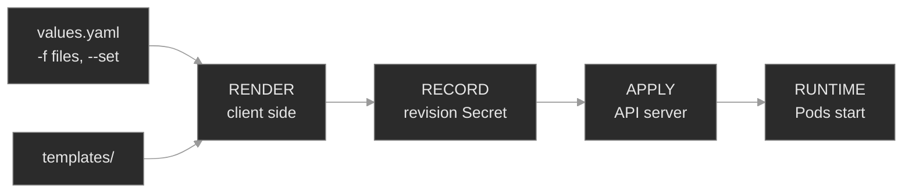

# M17 — Helm Fundamentals

> A chart plus values renders into manifests, Helm applies them, and Helm records the result as a release. How each of those stages fails, and which Helm view shows the failure.

## What you'll learn

- Read a chart on disk (`Chart.yaml`, `values.yaml`, `templates/`) and name the value keys its templates read
- Trace a value from `-f` or `--set` through the render to the live object with `helm template`, `helm get values` and `helm get manifest`
- Predict values precedence, and explain why Helm keeps an override key that no template reads
- Use the release record (`helm status`, `helm history`, `helm rollback`) to recover from a bad upgrade and to clear a release stuck in `pending-upgrade`
- Explain how Helm claims ownership of an object, why an install refuses an object it does not own, and why Helm 4 refuses to overwrite a field that another tool changed
- Locate any Helm failure to one stage: **render**, **apply**, **runtime**, or **record**

## Why it matters

Much of what an SRE operates did not arrive as hand-written YAML. The ingress controller, cert-manager and the metrics stack usually arrive as Helm releases, and so does a growing share of Polyphone's own services. When one of them breaks, the object in the cluster is the output of a render that you did not watch. The values behind it come from a chart default, a values file in git, and a `--set` on a CI runner.

Helm failures do not look like ordinary Kubernetes failures. A value that you set can have no effect, and Helm prints no warning. An upgrade can report `deployed` while the new Pods never start. An install can fail before it creates any object, so there is no Pod to `describe`. A release can refuse every change because an earlier deploy job died halfway. Each failure lives in a different stage of the pipeline, and Helm keeps its own record of each stage. This module teaches you to read that record as well as the cluster.

## Scope

**Covers:** chart structure; the render → apply → record pipeline and `helm template`; values merge order and override key paths; the `required` function; the release record (revisions, status, `helm history`, `helm get`, `helm rollback`, storage in Secrets, the pending lock); Helm ownership metadata and adoption; Helm 4 server-side apply and field conflicts; `--wait` and `--rollback-on-failure`; the Helm-versus-Kustomize decision.

**Doesn't cover:** chart authoring beyond one small chart (named templates, `range`/`with`, library charts, hooks, chart tests) → see the Helm chart template guide; dependencies and subcharts beyond one sentence; chart repositories, OCI registries and signing → M18 for sources, M20 for supply-chain policy; Helm run by a GitOps controller (Flux `HelmRelease`) → M18; Kustomize as a build tool → M16.

**Assumes:** you can read a Deployment and a Service and run the `get → describe → events → logs` loop (M00–M04); you know `ImagePullBackOff` (M02) and `Pending` from insufficient resources (M06); you know `kubectl apply` and why a hand edit drifts from source (M16).

## Vocabulary

| Term | Definition |
|------|------------|
| **Helm** | The Kubernetes package manager. A client-side CLI that renders charts, applies the result, and records it as a release. Since Helm 3 there is no in-cluster component. |
| **Chart** | "A collection of files that describe a related set of Kubernetes resources"<sup><a href="https://helm.sh/docs/topics/charts/">[1]</a></sup>: `Chart.yaml` (metadata), `values.yaml` (default inputs) and `templates/` (manifests with Go template actions). |
| **Values** | The inputs to a render. Templates read them as `.Values.<key path>`. |
| **Render** | The client-side step that merges values and evaluates the templates into plain YAML. `helm template` runs it without applying anything. |
| **Release** | One installed instance of a chart, identified by name and namespace. |
| **Revision** | One numbered entry in a release's history. Every install, upgrade and rollback adds one<sup><a href="https://helm.sh/docs/intro/using_helm/">[2]</a></sup>. |
| **Release record** | The stored state of one revision: its values, its rendered manifest and its status. Helm keeps it in a Secret in the release namespace by default. |
| **Status** | The state that Helm records for a revision: `deployed`, `superseded`, `failed`, or `pending-install` / `pending-upgrade` / `pending-rollback`. A status describes the Helm operation, not the health of the Pods. |
| **`required`** | A template function that stops the render with a message when its value is empty or missing<sup><a href="https://helm.sh/docs/chart_template_guide/function_list/">[3]</a></sup>. |
| **Ownership metadata** | The label `app.kubernetes.io/managed-by: Helm` and the annotations `meta.helm.sh/release-name` and `meta.helm.sh/release-namespace`. Helm writes them on every object it creates. |
| **Field manager** | The name that server-side apply records as the owner of each field of an object<sup><a href="https://kubernetes.io/docs/reference/using-api/server-side-apply/">[4]</a></sup>. Helm 4 applies as the manager `helm`. |

## Mental model

Helm is a render step and a bookkeeping step around an apply. It turns one parameterized chart into manifests for each environment. It also records what it applied, so it can upgrade and roll back the set of objects as one unit.



Each stage has its own failure and its own evidence:

- **Render** fails on the client. A missing `required` value stops it, nothing reaches the cluster, and Helm stores no release. A wrong key path does not fail. The render succeeds with the chart default, and the result is valid but wrong.
- **Record** happens before apply. Helm writes the new revision as `pending-upgrade` first and changes the status when the operation ends. A process that dies in between leaves the lock behind.
- **Apply** fails at the API server. An object that exists without Helm ownership metadata stops an install. In Helm 4, a field that another manager owns stops an upgrade.
- **Runtime** fails after Helm is done. By default Helm reports `deployed` once the apply succeeds, whether or not the Pods start.

Helm gives you three views that the cluster does not have. `helm get values` shows the inputs. `helm get manifest` shows the rendered output that Helm applied. `helm history` shows the revisions and their status. Compare those views with `kubectl get`, and the first mismatch names the stage that failed.

## Concept walkthrough

### The render: charts, values and key paths

A template reads specific key paths. At render time, `{{ .Values.replicaCount }}` becomes the merged value at the path `replicaCount`:

```yaml
spec:
  replicas: {{ .Values.replicaCount }}
  template:
    spec:
      containers:
        - name: app
          image: "{{ .Values.image.repository }}:{{ .Values.image.tag }}"
```

Values merge in a fixed order. The docs list the sources "in order of specificity"<sup><a href="https://helm.sh/docs/chart_template_guide/values_files/">[5]</a></sup>: the chart's `values.yaml`, then a parent chart's values for a subchart, then each `-f` file, then each `--set`. A later source wins a conflict. With several `-f` files, the rightmost file wins. The merge is deep: a file that sets `image.tag` keeps the chart's `image.repository`.

**Helm does not check an override against the keys that the templates read.** Suppose a values file sets `replicas: 3` and the template reads `replicaCount`. Helm stores `replicas: 3` in the release, renders `replicaCount` from the chart default, and prints no warning. Two commands show the gap:

- `helm get values <release>` prints only the user-supplied values, so it shows `replicas: 3` and looks correct.
- `helm get values <release> -a` prints the computed values. The unused `replicas: 3` sits next to `replicaCount: 1`, and `helm get manifest` shows `replicas: 1`.

A chart can ship a `values.schema.json`. Helm then validates the values during `install`, `upgrade`, `lint` and `template`<sup><a href="https://helm.sh/docs/topics/charts/">[1]</a></sup>. A schema that sets `additionalProperties: false` turns an unknown key into an error. Few charts ship a strict schema, so assume that no check exists until you see one.

`helm template` runs the merge and the render on your machine and prints the manifests<sup><a href="https://helm.sh/docs/helm/helm_template/">[6]</a></sup>. It is the fastest test of a change to values: it answers "what does this input produce?" and it reproduces every render error offline. `helm get manifest <release>` prints the manifest that Helm stored for the current revision. That stored manifest is what Helm applied, so it answers "what is the cluster supposed to run?" The chart on disk can have changed since the install.

The `required` function changes where a missing value fails. `{{ required "message" .Values.config.sipRealm }}` stops the render when the value is empty. The install prints `Error: INSTALLATION FAILED: execution error at (<template>:<line>:<col>): <message>`. Helm renders before it creates the release record, so the cluster has no release, no object and no event. The error text and `helm template` are the whole diagnosis.

<details>
<summary>📖 Going deeper: templates are Go text/template, so values have types<sup><a href="https://helm.sh/docs/chart_template_guide/functions_and_pipelines/">[7]</a></sup></summary>

Helm templates are Go `text/template` with the Sprig function library. Three behaviors cause quiet bugs:

- **A missing key renders as an empty string.** Helm runs the template engine with `missingkey=zero` and strips the `<no value>` text that Go would print. So `{{ .Values.nope }}` renders `""` with no error, and the manifest applies with an empty field. Only a missing *parent* fails: `{{ .Values.nope.deeper }}` stops the render with `nil pointer evaluating interface {}.deeper`. `helm lint --strict` turns missing keys into errors, which makes it a cheap check in CI.
- **A string `"false"` is true.** `--set enabled=false` passes a boolean, so `{{ if .Values.enabled }}` skips the block. `--set-string enabled=false` passes the string `"false"`. Go treats any non-empty string as true, so the block renders. Keep booleans in a values file or plain `--set`. Use `--set-string` only for values that must stay strings, such as a numeric-looking tag.
- **`--reuse-values` keeps the old chart's defaults.** On upgrade, `--reuse-values` merges your new overrides over the previous values *and* replaces the new chart's `values.yaml` with the old computed values. A new chart version that adds a default, and a template that reads it, then renders the key as empty or fails on a nil pointer. `--reset-then-reuse-values` keeps your previous overrides but starts from the new chart's defaults. A committed `-f` file avoids the question.

These rules are why the rendered text matters more than the chart source. Read `helm template` or `helm get manifest`, not the template.

</details>

### The release record: revisions, status and the lock

A release is Helm's record of an installed chart. By default, "release information is stored in Secrets in the namespace of the release"<sup><a href="https://helm.sh/docs/topics/advanced/">[8]</a></sup>. Each revision is one Secret named `sh.helm.release.v1.<release>.v<revision>`, with the labels `owner=helm`, `name`, `status` and `version`. The source of truth is the cluster, so every operator with access sees the same history. `helm upgrade` keeps 10 revisions by default (`--history-max`) and deletes older ones.

Two commands read the record. `helm status` shows the current revision. `helm history` shows every kept revision with its status and a description such as `Install complete`, `Upgrade complete` or `Rollback to 1`.

**`deployed` means the apply succeeded. It does not mean the Pods are healthy.** "Helm does not wait until all of the resources are running before it exits"<sup><a href="https://helm.sh/docs/intro/using_helm/">[2]</a></sup>. In Helm 4, the default for `--wait` is `hookOnly`: Helm waits for hooks only. An upgrade that sets an image tag that does not exist renders a valid Deployment, applies it, records `deployed` and exits 0. The new Pod then sits in `ImagePullBackOff`. The headline status lies here in the same way that `Running` lies about readiness in M01. Read past `helm status` to `kubectl get pods` and `kubectl rollout status`.

`--wait` closes that gap<sup><a href="https://helm.sh/docs/helm/helm_upgrade/">[9]</a></sup>. With `--wait` alone, Helm 4 uses the `watcher` strategy: it watches the resources until they report ready, up to `--timeout` (default 5m). If the timeout passes, Helm marks the revision `failed`. `--rollback-on-failure` (Helm 3 called it `--atomic`) also rolls a failed upgrade back to the last successful revision, and it uninstalls a failed install.

The record is also a lock. Helm writes the new revision with a pending status (`pending-install`, `pending-upgrade` or `pending-rollback`) before it applies anything. When the operation ends, Helm changes that status to `deployed` or `failed`. An upgrade checks the latest revision first. If that revision is pending, the upgrade stops with `another operation (install/upgrade/rollback) is in progress`. This check prevents two upgrades at the same time. But if a CI job is cancelled or a runner dies during `--wait`, no process remains to finish the operation, and the lock stays forever. The `status` label on the revision Secret shows it: `status=pending-upgrade`.

`helm rollback <release> <revision>` re-applies an old revision's manifest as a **new** revision<sup><a href="https://helm.sh/docs/helm/helm_rollback/">[10]</a></sup>. Rollback moves the history forward: after revision 2, a rollback to 1 becomes revision 3. A rollback does not check for a pending lock. So `helm rollback` is also the recovery for a stuck `pending-upgrade`: the new revision becomes the latest, its status is `deployed`, and the next upgrade proceeds. Do not delete revision Secrets by hand. That deletes history, and a wrong delete removes the record of the revision that runs now.

### Ownership: who may change an object

Helm writes ownership metadata on every object it creates: the label `app.kubernetes.io/managed-by: Helm` and the annotations `meta.helm.sh/release-name` and `meta.helm.sh/release-namespace`. Before an install creates an object, Helm checks whether the object already exists. If it does, Helm adopts it only when that metadata names this release. Otherwise Helm stops before it applies anything:

```text
Error: INSTALLATION FAILED: unable to continue with install: Service "voicemail" in namespace
"app-services" exists and cannot be imported into the current release: invalid ownership metadata;
label validation error: missing key "app.kubernetes.io/managed-by": must be set to "Helm"; ...
```

This failure is common when a team moves hand-applied manifests into a chart. `helm template` succeeds, because the render is correct. The conflict exists only in the cluster. There are three fixes. Add the label and both annotations to the existing object, then install: Helm adopts the object and keeps its UID and its ClusterIP. Or pass `--take-ownership` to tell Helm to skip the check<sup><a href="https://helm.sh/docs/helm/helm_install/">[11]</a></sup>. Or delete the object and let Helm recreate it, which accepts a short outage and a new ClusterIP. The error names one object at a time, so expect to repeat the fix for each object that existed before.

Helm 4 adds a second layer of ownership. "Helm 4 will default to server-side apply when installing a new Chart release"<sup><a href="https://helm.sh/docs/overview/">[12]</a></sup>. With server-side apply, the API server records a field manager for each field. Helm owns the fields it applied as the manager `helm`. Now suppose someone runs `kubectl scale deployment voicemail --replicas=4`. The manager `kubectl` now owns `.spec.replicas`, through the `scale` subresource. The next `helm upgrade`, and also the next `helm rollback`, fails and changes nothing:

```text
Error: UPGRADE FAILED: conflict occurred while applying object app-services/voicemail apps/v1,
Kind=Deployment: Apply failed with 1 conflict: conflict with "kubectl" with subresource "scale"
using apps/v1: .spec.replicas
```

The error names the other manager and the exact field. `--force-conflicts` tells Helm to take the field back. Use it after you decide that the chart, not the hand edit, is correct. If the hand edit is correct, move the change into the values and then upgrade. `kubectl rollout undo` on a Helm-managed Deployment causes the same conflict on the image field. It also leaves the release record on the bad revision, so recover through `helm rollback`.

Helm 3 used a client-side three-way merge instead. It compared the old manifest, the new manifest and the live object, and it overwrote drift in fields that the chart sets, with no message. Helm 4 keeps the previous apply method for an existing release. A release that Helm 3 created still upgrades with client-side apply, so in a mixed fleet the same drift is overwritten in silence on one release and is a hard error on another.

### Helm or Kustomize

Both tools solve one configuration for many environments. Kustomize has no template language: it layers patches over plain manifests, and `kubectl apply -k` builds the result<sup><a href="https://kubernetes.io/docs/tasks/manage-kubernetes-objects/kustomization/">[13]</a></sup>. Helm renders templates from values and adds packaging, versions and a release record.

| | Helm | Kustomize |
|---|---|---|
| Mechanism | Go templates and values | Patches and transformers over a base |
| Packaging | Versioned charts in repositories or OCI registries | Plain files in git |
| Release record | Revisions, `helm history`, `helm rollback` | None; the cluster holds the state |
| Quiet failure to know | An unread key is kept; `deployed` is not healthy | A `target:` selector that matches nothing is skipped |
| Good fit | Third-party software, and rollback as one unit | Your own manifests with small differences per environment |

Use Helm when you consume a packaged application or need the release record. Use Kustomize when you own the manifests and each environment differs by a few patches. The two compose. Kustomize can post-process Helm output, and Flux runs both (M18).

## Hands-on

The baseline has five steps. Five break/fix scenarios follow, one per failure stage. Each runs on the full Polyphone fleet with Helm 4 and the `voicemail` chart at `/root/voicemail`.

- **`baseline/`** — read the chart, render it, compare the render with the release, upgrade a value, walk the history and roll back. Then scale the Deployment by hand and resolve the field conflict that the next upgrade reports.
- **`breakfix-01-values-key-ignored`** — the release is `deployed` from a values file that asks for 3 replicas, and 1 Pod runs.
- **`breakfix-02-bad-upgrade-rollback`** — an upgrade reported `deployed`, and the rollout does not finish.
- **`breakfix-03-render-required-value`** — the install fails, and the namespace has no release and no object.
- **`breakfix-04-ownership-conflict`** — the install fails, and the chart renders without an error.
- **`breakfix-05-release-stuck-pending`** — every `helm upgrade` fails, and no deploy job is running.

Check yourself against `ANSWER-KEY.md` after each scenario.

## Common failure modes

| Symptom | Stage | Likely cause | Where to look |
|---------|-------|--------------|---------------|
| Value set, no effect | Render | Wrong key path, or a later source overrides it | `helm get values -a`, `helm get manifest`, `helm show values` |
| `INSTALLATION FAILED: execution error at (...)` | Render | A `required` value is missing, or a template error | The error names template and line; reproduce with `helm template` |
| `nil pointer evaluating interface {}` after a chart upgrade | Render | `--reuse-values` dropped the new chart's defaults | `helm get values -a`; upgrade with `--reset-then-reuse-values` |
| `exists and cannot be imported into the current release` | Apply | An object exists without Helm ownership metadata | `kubectl get <kind> <name> -o yaml` labels and annotations |
| `conflict with "kubectl" ... .spec.replicas` | Apply | A hand edit owns the field (Helm 4 server-side apply) | The error names manager and field; values, or `--force-conflicts` |
| `deployed`, Pods unhealthy | Runtime | Helm did not wait for readiness | `kubectl get pods`, `kubectl rollout status`, then `helm history` |
| `another operation (install/upgrade/rollback) is in progress` | Record | The latest revision is pending and its process is gone | `helm history`; Secret label `status=pending-upgrade`; `helm rollback` |

## Recap

- Helm renders, records a revision, then applies to the API server itself. Find the stage first: render errors happen before the cluster, apply errors come from the API server, runtime failures happen after `deployed`.
- A template reads specific key paths, and Helm keeps an unread override in silence. Compare `helm get values -a` and `helm get manifest`, not the values file.
- The release record is history and a lock. `helm rollback` writes a new revision, and it is also the way out of a stale pending status.
- `deployed` describes the Helm operation, not the workload. Use `--wait` or `--rollback-on-failure` when the deploy must grade readiness.
- Helm owns objects through metadata, and in Helm 4 through field managers. Change a Helm-managed object through its values, or Helm refuses to adopt it or refuses to overwrite it.

## Production thinking

- Every `--set` in an incident is triage, and the durable source is a values file in git. What makes sure the incident change reaches git before the next deploy job renders from the old file?
- `--rollback-on-failure --wait --timeout` makes a deploy slower and makes a stuck rollout loud. Which releases in your fleet should pay that cost, and which pipeline step notices a release that stays `pending-upgrade` after a runner dies?
- Your fleet runs releases that Helm 3 created (client-side apply) next to releases that Helm 4 created (server-side apply). The same `kubectl scale` is overwritten in silence on one and blocks the next deploy on the other. How do you find out which release uses which method before an incident tells you?
- You run two hundred releases of a chart you do not own, and it ships no strict schema. How do you catch an override key that no template reads?
- Helm documents a version skew policy: each Helm minor version supports a range of Kubernetes minor versions<sup><a href="https://helm.sh/docs/topics/version_skew/">[14]</a></sup>. How does your upgrade plan keep the Helm binary in CI inside that range for every cluster it deploys to?

## References

1. Helm — Charts (structure and schema files): https://helm.sh/docs/topics/charts/
2. Helm — Using Helm (install, upgrade, revisions): https://helm.sh/docs/intro/using_helm/
3. Helm — Template Function List (`required`): https://helm.sh/docs/chart_template_guide/function_list/
4. Kubernetes — Server-Side Apply (field management and conflicts): https://kubernetes.io/docs/reference/using-api/server-side-apply/
5. Helm — Values Files (order of specificity): https://helm.sh/docs/chart_template_guide/values_files/
6. Helm — `helm template`: https://helm.sh/docs/helm/helm_template/
7. Helm — Template Functions and Pipelines: https://helm.sh/docs/chart_template_guide/functions_and_pipelines/
8. Helm — Advanced Helm Techniques (storage backends): https://helm.sh/docs/topics/advanced/
9. Helm — `helm upgrade` (`--wait`, `--rollback-on-failure`, `--force-conflicts`): https://helm.sh/docs/helm/helm_upgrade/
10. Helm — `helm rollback`: https://helm.sh/docs/helm/helm_rollback/
11. Helm — `helm install` (`--take-ownership`): https://helm.sh/docs/helm/helm_install/
12. Helm — Helm 4 Overview (server-side apply, renamed flags): https://helm.sh/docs/overview/
13. Kubernetes — Declarative Management of Kubernetes Objects Using Kustomize: https://kubernetes.io/docs/tasks/manage-kubernetes-objects/kustomization/
14. Helm — Version Skew Policy: https://helm.sh/docs/topics/version_skew/
