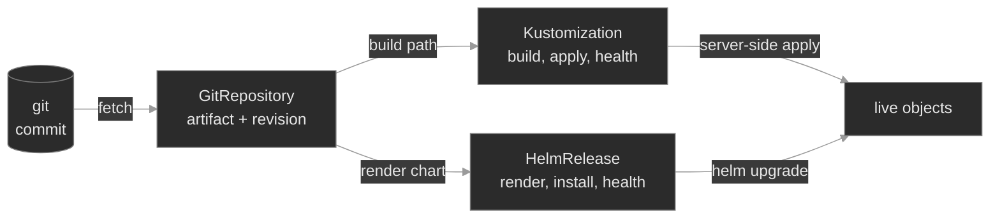

# M18 — Flux (GitOps Delivery)

> Git holds the desired state, and controllers in the cluster make the cluster match it on a loop. How Flux fetches a commit, builds it, applies it and checks its health, and how to find the stage where delivery stopped.

## What you'll learn

- Explain GitOps as a pull-based reconcile loop, and name the Flux controller that owns each stage: **fetch**, **build**, **apply** and **health**
- Read a `GitRepository` and its artifact revision, and compare that revision with the revision each consumer last applied
- Explain why a fetch failure leaves the consumers green on the last good revision, and why a build failure leaves the old objects running
- Predict what Flux does to a `kubectl scale` or `kubectl edit`: a `Kustomization` reverts it, and a `HelmRelease` keeps it unless drift detection is on
- Use `suspend` and `resume` on purpose, and find a consumer that someone suspended and forgot
- Order releases with `dependsOn`, and read the message when a dependency is missing or not ready
- Ship a fix through git when Flux reverts every hand fix, and confirm it with the revision fields

## Why it matters

Hand-run `kubectl apply` leaves one question without an answer during an incident: what is supposed to run right now? The cluster holds one answer, and drift lives in the cluster too. Last week's emergency `kubectl scale` is still there, and so is the `kubectl edit` that became permanent. GitOps answers the question with git. A controller in the cluster reads the declared state from git and keeps the cluster equal to it<sup><a href="https://opengitops.dev/">[1]</a></sup>.

Flux is that controller<sup><a href="https://fluxcd.io/flux/concepts/">[2]</a></sup>. It runs the Kustomize builds from M16 and the Helm releases from M17 for you, from a commit, on a loop. That changes what a failure looks like. A Flux failure is rarely a crashing Pod. Usually a stage of the delivery loop stopped, and the workload keeps running the previous revision. The merged fix never lands, the dashboards stay green, and the only evidence is in Flux's own objects. This module teaches you to read those objects in pipeline order before you open the workload.

## Scope

**Covers:** the GitOps principles and the pull model; the Flux controllers (source, kustomize, helm) and `flux install`; `GitRepository`, artifacts and revisions; the Flux `Kustomization` (`path`, `prune`, `wait`, `timeout`, `targetNamespace`, the inventory); drift correction with server-side apply; `suspend`/`resume`; `HelmRelease` with a chart from a `GitRepository`, its release name and storage namespace, drift detection, and remediation; `dependsOn`; reading `Ready` conditions and revisions with the `flux` CLI; the fix-in-git workflow; Flux version support.

**Doesn't cover:** `flux bootstrap` and a hosted git provider → this module uses `flux install` and an in-cluster git server; `HelmRepository` and `OCIRepository` sources → one sentence; notification-controller alerts and webhook receivers → one sentence; image automation → deferred; multi-tenancy and service-account impersonation → deferred; SOPS decryption → M11; multi-cluster promotion → M19; Argo CD → a short contrast only.

**Assumes:** you can read a Deployment and a Service and run the `get → describe → events → logs` loop (M00–M04); you know a Kustomize base and overlay and `kubectl apply -k` (M16); you know a Helm chart, a release and its revisions (M17); you know `ImagePullBackOff` (M02); you can make a commit and push it with `git`.

## Vocabulary

| Term | Definition |
|------|------------|
| **GitOps** | An operating model: the desired state is declarative, versioned and immutable, pulled automatically by software agents, and continuously reconciled<sup><a href="https://opengitops.dev/">[1]</a></sup>. |
| **Flux** | A set of Kubernetes controllers, the GitOps Toolkit, that implement GitOps through custom resources<sup><a href="https://fluxcd.io/flux/concepts/">[2]</a></sup>. `flux install` puts them in the `flux-system` namespace. |
| **Reconciliation** | One pass of a controller: read the desired state, compare it with the cluster, change the cluster to match. Flux runs a pass every `interval`, and also when the object or its source changes. |
| **Source** | An object that fetches content from outside the cluster and serves it as an artifact. source-controller manages the sources: `GitRepository`, `HelmRepository`, `OCIRepository` and `Bucket`<sup><a href="https://fluxcd.io/flux/components/source/">[3]</a></sup>. |
| **`GitRepository`** | A source that clones a git URL at a ref (branch, tag or commit) on an interval<sup><a href="https://fluxcd.io/flux/components/source/gitrepositories/">[4]</a></sup>. |
| **Artifact** | The packaged tree that a source produced from one fetch, served inside the cluster. Consumers read the artifact; they never clone git themselves. |
| **Revision** | The identity of an artifact, such as `main@sha1:3f9c…`: the branch and the commit. Each consumer records the revision it last applied, so you can compare the two. |
| **Consumer** | An object that reads an artifact and changes the cluster: a `Kustomization` or a `HelmRelease`. |
| **`Kustomization` (Flux)** | The kustomize-controller custom resource that builds a `path` from an artifact and applies the result<sup><a href="https://fluxcd.io/flux/components/kustomize/kustomizations/">[5]</a></sup>. Not the `kustomization.yaml` file from M16, which it may build. In this module, a bare `Kustomization` means the Flux object. |
| **`HelmRelease`** | The helm-controller custom resource that installs and upgrades a Helm release from a chart source<sup><a href="https://fluxcd.io/flux/components/helm/helmreleases/">[6]</a></sup>. |
| **`HelmChart`** | A source object that helm-controller creates for each `HelmRelease`. source-controller packages the chart from the named source into an artifact, and the `HelmRelease` installs from that artifact. |
| **Inventory** | The list of objects a `Kustomization` applied, kept in its `.status.inventory`. Pruning compares the next build with this list. |
| **Drift** | A difference between the live object and the desired state in git. |
| **`suspend`** | `spec.suspend: true` on a Flux object. The controller skips every pass for that object until the field is false or gone. |
| **`dependsOn`** | A list of objects of the same kind that must be `Ready` before this object reconciles. |
| **`Ready` condition** | The status condition on every Flux object: `True` when the last pass succeeded, `False` with a reason and a message when it did not. |

## Mental model

Delivery is a pipeline with four stages, and each stage records its result on a Flux object. The source-controller **fetches** the commit. The kustomize-controller **builds** the path, **applies** the result and **checks the health** of what it applied. The helm-controller does the same job for a chart. Two controls sit across the stages: the **order gate** (`dependsOn`) holds a consumer until its dependencies are ready, and the **suspend** switch stops every stage for one object.



Each failure stops one stage and leaves the stages after it on the last good result. A fetch failure turns the `GitRepository` red and leaves every consumer green on the old revision. A build failure turns the `Kustomization` red and leaves the old objects running. A health failure means that the controller applied the new objects and they did not become healthy. A closed order gate stops a consumer before it builds or renders anything. A suspended consumer does nothing at all, and it keeps the green condition of its last pass.

So the diagnosis is a fixed walk. Read `flux get sources git` and note the revision. Read `flux get kustomizations` and `flux get helmreleases`, and compare each applied revision with the source revision. Then open the workload. The first stage that is red, or behind, is the stage that stopped.

## Concept walkthrough

### The reconcile loop and the Flux controllers

GitOps has four principles. The desired state is **declarative**. It is **versioned and immutable**, which git provides. Software agents **pull** it automatically. The agents **continuously reconcile** the system to it<sup><a href="https://opengitops.dev/">[1]</a></sup>. The last two principles separate GitOps from a CI job that runs `kubectl apply`. A CI job pushes once, when it runs. If someone edits the cluster afterward, the CI job does not know until the next deploy. A GitOps agent pulls on a loop, so drift lasts at most one interval.

Flux splits the loop across controllers, and each controller owns one family of custom resources<sup><a href="https://fluxcd.io/flux/concepts/">[2]</a></sup>. source-controller fetches. kustomize-controller and helm-controller apply. notification-controller sends alerts and receives webhooks. The controllers communicate only through the Kubernetes API: each one writes status on its own objects. That is why `kubectl get` and `flux get` show the whole pipeline.

A controller runs a pass every `interval`. It also runs one at once when the object's spec changes or when its source produces a new revision<sup><a href="https://fluxcd.io/flux/components/kustomize/kustomizations/">[5]</a></sup>. `flux reconcile` asks for a pass now. `flux reconcile kustomization apps --with-source` refetches the source first, which is the command to use right after a push.

`flux install` applies the Flux CRDs and controllers to a cluster<sup><a href="https://fluxcd.io/flux/installation/">[7]</a></sup>. Production clusters usually run `flux bootstrap` instead. Bootstrap commits Flux's own manifests to a git repository and points Flux at that repository, so a Flux upgrade becomes a commit. It needs a git provider and a token.

Each Flux release supports a range of Kubernetes minor versions, and the project supports only the latest three. `flux check` tests the server version against that range, then checks the controllers and the CRDs. On a cluster outside the range, the first line fails and the command ends with `check failed`, even when every controller runs. Read the remaining lines on their own merits, and plan the cluster upgrade.

### Sources: the artifact and its revision

A `GitRepository` names a URL, a ref and an interval<sup><a href="https://fluxcd.io/flux/components/source/gitrepositories/">[4]</a></sup>:

```yaml
apiVersion: source.toolkit.fluxcd.io/v1
kind: GitRepository
metadata:
  name: polyphone-config
  namespace: flux-system
spec:
  interval: 1m
  url: http://gitea.flux-system.svc.cluster.local:3000/flux/polyphone-config.git
  ref:
    branch: main
```

On each pass, source-controller resolves the ref, clones that commit and stores the tree as an artifact with a revision such as `main@sha1:3f9c…`. A source never applies anything. Consumers read the artifact, so one fetch feeds every `Kustomization` and `HelmRelease` that points at the source.

When a fetch fails, source-controller sets `Ready` to `False` with the git error, and keeps the last artifact it stored. Consumers do not check the source's `Ready` condition. They check whether an artifact exists. Two cases follow, and they look different:

- **No artifact was ever stored.** A wrong branch from the first day produces this case. A `Kustomization` reports `Source artifact not found`, and a `HelmRelease` reports that its `HelmChart` has no artifact. Nothing is applied, and the workloads are absent.
- **An earlier artifact exists.** An expired credential or a renamed branch after a good fetch produces this case. Each consumer keeps applying the old artifact and stays `Ready True`. The new commit never arrives, and only the source is red.

The second case is the dangerous one, because every consumer is green. The check is the revision. Compare the source's artifact revision with the newest commit in git, and compare each consumer's applied revision with the source.

### The Kustomization: build, apply, health, prune

A `Kustomization` points at a source and a `path` inside its artifact<sup><a href="https://fluxcd.io/flux/components/kustomize/kustomizations/">[5]</a></sup>:

```yaml
apiVersion: kustomize.toolkit.fluxcd.io/v1
kind: Kustomization
metadata:
  name: apps
  namespace: flux-system
spec:
  interval: 1m
  sourceRef:
    kind: GitRepository
    name: polyphone-config
  path: ./apps
  targetNamespace: app-services
  prune: true
  wait: true
  timeout: 1m
```

Each pass runs four steps in order, and a failure stops the pass at that step. Apply and prune together form the apply stage of the pipeline.

1. **Build.** kustomize-controller runs the Kustomize engine from M16 on `path`. If the path is missing from the artifact, the build fails with `kustomization path not found`. The controller applies nothing and deletes nothing, so the objects from the last good build keep running. A repository restructure that moves a directory produces exactly this state: source-controller fetches the new commit, the `Kustomization` turns red, and the old workload serves.
2. **Apply.** kustomize-controller applies every built object with server-side apply. It forces ownership of the fields in the manifest, and it removes field entries that `kubectl` made. This is drift correction: a `kubectl scale` or `kubectl edit` on a field that git declares lasts until the next pass<sup><a href="https://fluxcd.io/flux/components/kustomize/kustomizations/">[5]</a></sup>. A field that git does not declare is left alone.
3. **Prune.** With `prune: true`, the controller deletes every object in the inventory that the new build no longer contains. Delete a manifest from git, and the object leaves the cluster on the next pass. Without `prune`, the object stays as an orphan that no file describes.
4. **Health.** With `wait: true`, the controller waits until every applied object reports healthy, for up to `timeout`. A Deployment is healthy when its rollout completes. A new image that cannot be pulled never completes, so the `Kustomization` turns `Ready False` with the reason `HealthCheckFailed`. kustomize-controller has already applied the objects by then. The old ReplicaSet keeps serving, and the new Pods sit in `ImagePullBackOff`. The `Kustomization` records the new commit as `lastAttemptedRevision`, and `lastAppliedRevision` stays on the old one, because the applied revision moves only when a whole pass succeeds. So `flux get` shows the old revision while the new objects are live.

Drift correction changes how an incident fix works. A hand fix on a Flux-managed field does not survive. If the bad image came from git, `kubectl set image` restores service for at most one interval, and then Flux applies the bad image again. The fix that sticks is a commit: revert or correct the change in git, push it, and run `flux reconcile kustomization apps --with-source`. Then confirm it with revisions. The `Kustomization`'s applied revision must equal the source's artifact revision, and that revision must be the fix commit.

<details>
<summary>📖 Going deeper: why the hand fix loses<sup><a href="https://kubernetes.io/docs/reference/using-api/server-side-apply/">[8]</a></sup></summary>

Server-side apply records a field manager for every field of an object, and every `kubectl` subcommand that changes an object records one. With kubectl v1.30, `kubectl scale` writes `.spec.replicas` as the manager `kubectl`. kustomize-controller applies the full manifest from git with the force option. The API server then gives every field in that manifest to the manager `kustomize-controller` and overwrites the values. The invariant is that forced apply takes every field the manifest declares. kustomize-controller v1.9 (Flux 2.9) also deletes the managed-field entries of `kubectl` and of the `before-first-apply` manager, and it removes the `kubectl.kubernetes.io/last-applied-configuration` annotation.

Two consequences matter at 03:00. A field that is not in the git manifest stays with its other manager, so a hand-added label survives and a hand-changed replica count does not. And a HorizontalPodAutoscaler (HPA, M09) fights Flux when the Deployment manifest in git sets `replicas`. Flux resets the count on every pass, and the HPA raises it again. Remove `replicas` from the manifest when an HPA owns it. An annotation `kustomize.toolkit.fluxcd.io/ssa: Merge` keeps fields from other managers only when they do not overlap the manifest.

</details>

`suspend` turns the whole loop off for one object. `flux suspend kustomization apps` sets `spec.suspend: true`, and kustomize-controller then skips every pass: no new revision is applied, no drift is corrected and nothing is pruned<sup><a href="https://fluxcd.io/flux/components/kustomize/kustomizations/">[5]</a></sup>. `flux resume` clears the field and runs a pass at once. Suspend is the correct tool before a deliberate hand change during an incident, because Flux would undo the change otherwise.

The hazard is the status. A suspended object keeps the condition of its last pass. If that pass succeeded, `flux get kustomizations` still shows `READY True` and the message `Applied revision: main@sha1:…`. Only the `SUSPENDED` column reads `True`. A suspend that nobody lifted after an incident stops all delivery for that object in silence. When a commit does not land and the source is current, check `SUSPENDED` first.

### HelmRelease and dependsOn

helm-controller runs the Helm operations from M17, driven by a `HelmRelease` object instead of a `helm` command<sup><a href="https://fluxcd.io/flux/components/helm/helmreleases/">[6]</a></sup>. The chart comes from a source. It can be a `HelmRepository`, an `OCIRepository`, or a chart directory inside a `GitRepository`:

```yaml
apiVersion: helm.toolkit.fluxcd.io/v2
kind: HelmRelease
metadata:
  name: voicemail
  namespace: flux-system
spec:
  interval: 1m
  targetNamespace: app-services
  chart:
    spec:
      chart: ./charts/voicemail
      sourceRef:
        kind: GitRepository
        name: polyphone-config
  dependsOn:
    - name: message-store
  values:
    replicaCount: 2
```

helm-controller stores the release the way the `helm` CLI does, in Secrets, so `helm list` and `helm history` still work. Two defaults decide where to look. The release name is `<targetNamespace>-<name>`, here `app-services-voicemail`. The release record lives in the HelmRelease's own namespace, here `flux-system`, not in the target namespace<sup><a href="https://fluxcd.io/flux/components/helm/helmreleases/">[6]</a></sup>. So `helm list -n flux-system` shows the release, and `helm list -n app-services` shows nothing.

A `HelmRelease` does not correct drift by default. `spec.driftDetection.mode` defaults to disabled, so a `kubectl scale` on a Helm-managed Deployment stays until the next upgrade. Set the mode to `warn` to get an event for each drift, or to `enabled` to correct it. Failure handling also starts off. A failed install or upgrade stays failed until `spec.install.remediation` or `spec.upgrade.remediation` configures retries. A new chart version or new values reset the counters and trigger a new attempt.

`dependsOn` orders objects of the same kind. A HelmRelease lists other HelmReleases, and a Kustomization lists other Kustomizations. At the start of every pass, the controller reads each listed object. It continues only when each object exists, has observed its latest generation and is `Ready True`<sup><a href="https://fluxcd.io/flux/components/helm/helmreleases/">[6]</a></sup>. Otherwise it sets `Ready False` with the reason `DependencyNotReady`, and it tries again every 30 seconds by default.

The message names the case. A dependency that exists and is not ready gives `dependency 'flux-system/message-store' is not ready`. A dependency that does not exist gives `unable to get 'flux-system/message-cache' dependency`, followed by the API `not found` error. Both carry the same reason, so read the message, not the reason. A stale rename leaves the dependent waiting forever, and the release never installs.

The check runs on every pass, not only at install. If a dependency turns red later, the dependent's next pass stops at the gate. Flux does not uninstall the dependent, so its workload keeps running. But it receives no upgrades and no drift correction until the dependency is `Ready` again.

<details>
<summary>📖 Going deeper: Flux and Argo CD<sup><a href="https://fluxcd.io/flux/concepts/">[2]</a></sup></summary>

Flux and Argo CD are both CNCF-graduated GitOps controllers, and both pull from git, reconcile on a loop and correct drift. Flux is a set of controllers with no built-in UI. You drive it with `kubectl` and `flux`, and you observe it through your own metrics and events. Argo CD centers on an `Application` object and ships a web UI with a diff view and manual sync. The source and consumer split, the interval, drift correction and dependency ordering transfer to either tool.

</details>

## Hands-on

The baseline has five steps. Five break/fix scenarios follow: one each for the fetch, build and health stages, one for the order gate and one for the suspend switch. The apply stage is the baseline's drift step. Each runs on the full Polyphone fleet with Flux, the `flux` and `helm` CLIs, an in-cluster git server and a clone of the config repo at `/root/polyphone-config`.

- **`baseline/`** — read the source, the `apps` Kustomization and its inventory, revert a hand scale, read the two HelmReleases and their release records. Then push a commit and watch a change and a prune arrive.
- **`breakfix-01-source-ref-not-found`** — the GitOps workloads are absent from `app-services`, and no Pod fails.
- **`breakfix-02-kustomization-suspended`** — `dialplan` runs 5 replicas against 2 in git, and `apps` reports `Ready True`.
- **`breakfix-03-helmrelease-dependency`** — `voicemail` never installs, and its source, its chart and its backing store are healthy.
- **`breakfix-04-path-not-found`** — a pushed commit never lands, the source has fetched it, and the old `dialplan` serves.
- **`breakfix-05-health-check-fix-in-git`** — `apps` reports `HealthCheckFailed`, and Flux undoes every hand fix.

Check yourself against `ANSWER-KEY.md` after each scenario.

## Common failure modes

| Symptom | Stage | Likely cause | Where to look |
|---------|-------|--------------|---------------|
| Workloads absent, consumers report `Source artifact not found` | Fetch | The source never stored an artifact: wrong ref, URL or credentials | `flux get sources git` message |
| Consumers `Ready True`, new commit missing from the cluster | Fetch | The fetch fails after an earlier success; consumers apply the old artifact | Source revision compared with git; source `Ready` message |
| `kustomization path not found` | Build | `spec.path` names a directory the artifact lacks | `flux get kustomizations`; `ls` the repo at the source revision |
| `HealthCheckFailed`, old Pods serving | Health | The applied change does not roll out | `kubectl describe` the Deployment's new Pods; fix in git |
| A hand fix keeps reverting | Apply | The field is in the git manifest; drift correction | Change git, or `flux suspend` before a deliberate hand change |
| `READY True`, drift stays, commits do not land | Suspend | The consumer is suspended | `SUSPENDED` column of `flux get kustomizations` |
| `DependencyNotReady`, release never installs | Order gate | A `dependsOn` target is missing, renamed or not ready | Condition message; `flux get helmreleases` for the named object |
| `helm list -n <target ns>` shows nothing | Apply (HelmRelease) | The release record lives in the HelmRelease namespace | `helm list -n flux-system` |
| Old object still present after its file was deleted | Apply (prune) | `prune: false`, or the object carries `prune: disabled` | `flux tree kustomization <name>` |

## Recap

- Flux is a pull loop with four stages: fetch, build, apply and health. Each stage records its result on a Flux object, and a failure leaves the later stages on the last good result.
- Compare revisions, not colors. A consumer stays `Ready True` on an old artifact when the fetch fails, and a suspended consumer keeps its last green condition.
- A `Kustomization` reverts any hand change to a field that git declares. When git holds the bad change, the only fix that sticks is a commit, confirmed when the applied revision equals the fix commit.
- `suspend` stops every pass for one object. Use it before a deliberate hand change, and lift it when the change is in git.
- `dependsOn` is checked at the start of every pass, for both kinds, and the message tells a missing dependency from a red one. A closed gate blocks upgrades and drift correction, and it never uninstalls.

## Production thinking

- A fetch failure after a good fetch leaves every consumer green, and a suspended consumer looks green too. What single signal would page you for both, and what does it cost you in false pages during a normal deploy?
- During an incident you suspend a `Kustomization` and patch the cluster by hand. What step in your runbook moves the patch into git and resumes the object, and what tells you a week later that a suspend is still in place?
- Your HelmReleases run with drift detection disabled, and your Kustomizations correct drift on every pass. Would you enable `driftDetection` fleet-wide, and what does an HPA do to that decision?

## References

1. OpenGitOps — Principles: https://opengitops.dev/
2. Flux — Core Concepts: https://fluxcd.io/flux/concepts/
3. Flux — Source Controller: https://fluxcd.io/flux/components/source/
4. Flux — GitRepositories: https://fluxcd.io/flux/components/source/gitrepositories/
5. Flux — Kustomizations (path, prune, wait, suspend, dependsOn, drift): https://fluxcd.io/flux/components/kustomize/kustomizations/
6. Flux — HelmReleases (release name, storage namespace, drift detection, remediation, dependsOn): https://fluxcd.io/flux/components/helm/helmreleases/
7. Flux — Installation: https://fluxcd.io/flux/installation/
8. Kubernetes — Server-Side Apply: https://kubernetes.io/docs/reference/using-api/server-side-apply/
